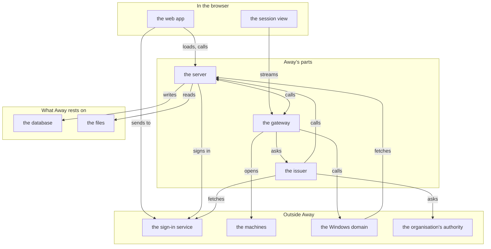
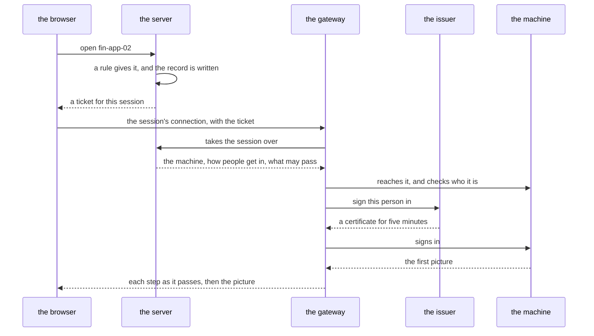

# Architecture

How Away is built: its components, what each reaches and what each keeps, the
decisions behind them, and which component carries each capability. It is the
fourth part of the specification. The [capabilities](../capabilities/README.md)
say what Away does and for whom, and the [screens](../screens/README.md) what
that looks like; this part says which piece of Away does it.

> **A model of something that is being built.** A component exists when
> [components](./components.md) says *there* of it, and no sooner. A decision
> is a record: Proposed until the owner accepts it by its number, Accepted from
> then on. Two of them rest on a proof that comes before anything is built
> around it.

## The parts that run

<!-- generated: picture -->

<!-- end: picture -->

A browser reaches Away at one address, through the way in that the cluster
already has. The pages and their requests go to **the server**, and a
session's connection goes to **the gateway**. The gateway alone reaches the
machines. When a session needs somebody signed in, the gateway asks **the
issuer**, which checks for itself who is asking and for whom before it signs
anything. Each of the three has its own rights and nothing more
([ADR-0003](./decisions/0003-three-parts-with-their-own-rights.md)).

The picture leaves out what the parts are built from, what builds and ships
them, and the way in itself. It also leaves out what each part has alike: its
own secrets from the cluster, the lines it puts out for the log system, and
the measures the monitoring reads. [Components](./components.md) and
[connections](./connections.md) list all of it.

## How a machine is opened

1. The server decides. It holds the person's sign-in, reads the rules, and
   writes the connection's record before anything else happens. Without a rule
   or without the record there is no ticket.
2. The ticket is good once, for a few seconds, for this session. The browser
   takes it to the gateway with the session's connection.
3. The gateway learns from the server which machine this is, how people get in
   there and what may pass. It reaches the machine and checks that it is the
   one Away knows.
4. The issuer signs the person in, or hands over the kept account's password,
   or signs with the kept account's key. A person who types a name and a
   password types them into Away's own page, and they go to the machine and
   nowhere else.
5. The steps the person sees while this happens
   ([chapter 5](../screens/opening.md)) are these steps, reported as each
   passes.

From then on the gateway keeps the session: the desktop's picture as the
machine has it, or what a shell wrote last. The connection to the browser can
drop, move to another tab or come back, and the session goes on
([ADR-0004](./decisions/0004-the-session-and-its-picture.md)).

## How to read it

A **component** is a piece of Away one can point at, or something Away rests on
or reaches. Each is in one **layer**, has a **kind**, and **comes** at some
time: it is there, it comes with the first release, or later.

A **connection** says that one component reaches another, and how. The kinds of
connection are listed with [the state of the model](#the-state-of-the-model).

A capability is **carried** by the components whose code makes it work. Only
Away's own components carry one: what Away rests on and what is outside it
carry none. [Where each capability is carried](./carried.md) lists every
capability of the first release with its components and the work package that
builds it.

A **decision** is a record under [decisions](./decisions/README.md): what was
decided, why, what follows from it, and what it rules out.

## What is checked

`scripts/model.py --check` runs on every change and fails when:

- a component is in no layer or of no kind that exists, or no connection names
  it;
- a connection is between components that don't exist, is there twice, says
  nothing of what it is on, or is planned sooner than a component it connects;
- a capability of the first release is carried by no component, by one that is
  not Away's own, or by one that comes later;
- a decision record lacks its number, its status or one of its sections, has no
  row, or its row names a component or a capability that doesn't exist;
- a table on these pages is not what the data says.

## The state of the model

<!-- generated: state -->
| Layer | Components | there | first release | later |
|---|---|---|---|---|
| In the browser | 2 |  | 2 |  |
| Away's parts | 4 | 3 |  | 1 |
| Away's own protocol code | 7 |  | 7 |  |
| What Away rests on | 4 |  | 4 |  |
| Outside Away | 6 |  | 6 |  |
| Making and shipping it | 6 | 5 | 1 |  |
| all | 29 | 8 | 20 | 1 |

| Connections | Rows | Means |
|---|---|---|
| loads | 1 | the browser gets the pages' files from the other |
| calls | 5 | it sends requests to the other |
| streams | 1 | it keeps a connection to the other open for as long as a session lasts, with messages both ways |
| sends to | 1 | it sends the browser to the other's page |
| signs in | 1 | it takes people's sign-ins from the other |
| opens | 4 | it opens the other, speaking the other's own protocol |
| asks | 2 | it asks the other to make something for one session |
| reads | 4 | it reads what the other holds, and changes nothing |
| writes | 1 | it changes what the other holds |
| fetches | 3 | it gets a file from the other |
| passes on | 2 | it hands what arrives on to the other |
| puts out | 3 | it writes lines that the other collects |
| measures | 3 | it reads the other's measures |
| uses | 9 | it is built from the other's code |
| publishes | 2 | it puts what it built where the other holds or shows it |
| tests | 1 | it runs its tests against the other |
| all | 43 |  |

| Decision records | Proposed | Accepted | Superseded | Rejected |
|---|---|---|---|---|
| 13 | 1 | 12 |  |  |

The first release holds 113 capabilities, and a component of Away's own carries each: 28 are carried by one component, the others by up to 6.
<!-- end: state -->

## What follows for the first release

What the first release does not do because of how it is built. Each is said
again where a person would meet it.

| Limit | Because | Lifted by |
|---|---|---|
| An update of Away ends every open shell, and desktops come back by themselves | one gateway holds the sessions, and a shell lives in its connection | the shell's screen in the gateway, and more than one gateway |
| A machine has to be reachable from the gateway | the gateway opens every machine itself | a relay placed in the machine's network |
| A video on a machine stutters on a slow line | the picture travels as still rectangles | the machine's own video stream, passed through |
| Machines, groups and rules are changed in their files, not in the browser | they are files, applied whole or not at all | adding a machine in the browser |
| A kept account's secret is made in the cluster by the operator | Away has no store of secrets of its own | adding a machine in the browser |
| What a shell wrote before the page was loaded again goes back only so far | a shell's past lives in the page | the shell's screen in the gateway |
| Being oneself on a Windows machine needs a domain that trusts an authority for sign-ins | a certificate is what signs the person in | being oneself on a machine that is joined to a cloud directory only |

## What the status page calls them

An administrator sees Away's parts by what they do
([chapter 15](../screens/admin-status.md)), not by these names.

| On the status page | Is |
|---|---|
| the sign-in service | `sign-in-service` |
| signing in on machines | `issuer` |
| the certificate authority | the issuer's own authority, or `authority` where the organisation's issues |
| the records | `database` as far as the records go, and the lines put out for `log-system` |
| the files | `files` |

## Pages

| Page | Covers |
|---|---|
| [components](./components.md) | every component, layer by layer |
| [connections](./connections.md) | what reaches what, and on what |
| [where each capability is carried](./carried.md) | every capability of the first release: its components and its work package |
| [decisions](./decisions/README.md) | the decision records, and what each governs |
| [the work packages](../plan/README.md) | the order in which it is built |
