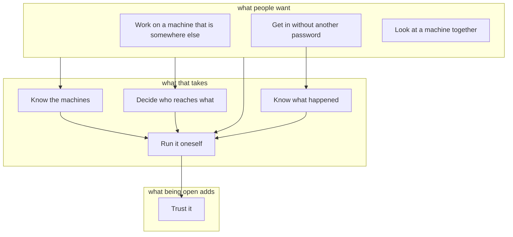

# What Away is for

Away is for an organisation whose people work on machines that are somewhere
else: a Windows desktop or one of its programs, a Mac or a Linux desktop, a
shell. They open it in a browser, signed in once, from whatever device they
have. And it is open: anyone can run it, look into it and change it.

Four things are left out on purpose in this first cut:

- **Making desktops.** Away reaches machines that exist. It makes, copies and
  hands out none.
- **A network to the machines.** Away carries a session to a machine and no
  other traffic. It is no private network, and it forwards no ports.
- **Software on the machines.** A machine is reached the way it already offers:
  over RDP, VNC or SSH. Nothing of Away's is installed on it.
- **An app to install.** The browser is the one way in, on a computer and on a
  phone.

Each of them is a row of the capability model marked "not planned", so that
leaving it out is written down and can be overruled.
[What is left out](../capabilities/left-out.md) lists these and the smaller ones.

Everything else in the specification follows from the goals, one step at a time:

1. **What people want.** To work on a machine that is somewhere else, to get in
   without another password, to look at a machine together. These are the goals
   Away exists for.
2. **What that takes.** To open a machine, Away has to know it. An organisation
   is many people: so somebody decides who reaches what. Whoever answers for
   the machines has to know what happened on them. And somebody has to run it.
   These goals exist only because the first ones do.
3. **What being open adds.** Away opens the door to every machine it knows, so
   anyone can check that it does what it says.
4. **How well.** Each goal has qualities: what "well" means for it, what
   measures that, and the target.
5. **What Away does for it.** The [capabilities](../capabilities/README.md):
   every area of them is for one goal, and so is every
   [expectation](../capabilities/expectations.md).

So a capability is there because a goal needs it, and a goal is met when what
is expected of it is there and its qualities reach their targets.

One arrow is worth a word. Getting in without another password needs the
records: Away signs a person in on a machine by itself, so every time it does
has to be on record.

On the site the goals are also a [map](https://nalet.github.io/away/spec/goals/map/):
a band for each kind of goal, a card for each goal, and in it a tile for each
group of capabilities that is for it, coloured by how much of it the first
release holds. Pointing at a goal draws the goals it needs and the goals that
need it.

> **Written by hand, counted by a program.** The goals are
> [goals.csv](./goals.csv) and their qualities [qualities.csv](./qualities.csv);
> the picture, the tables and the numbers on this page are computed from them
> and from the capability model. A check fails when an area, an expectation or
> a quality is for no goal, or a goal has nothing below it.

## How to read it

A goal is one of three kinds:

| Kind | Means |
|---|---|
| what people want | what a person does with Away: the reason it exists |
| what that takes | what has to be there for it: it serves no one by itself |
| what being open adds | what an open product owes the people who run it and check it |

An arrow in the picture leads from a goal to a goal it **needs**: working on a
machine needs Away to know the machine, and knowing the machines needs an Away
that runs.

A **quality** is one sentence of what a goal has to be met with, its kind after
ISO/IEC 25010, and what measures it. Its **target** is the owner's to set, and
until it is set nothing says what is good enough. **Proposed** is a suggestion
for the target, and no target until the owner takes it. Nothing is built, so
nothing is measured yet: what each quality is today joins the table with the
first release.

## The cascade

<!-- generated: cascade -->

<!-- end: cascade -->

## The goals

<!-- generated: goals -->
| Goal | Is | Needs | Expected of it | Capabilities | Qualities |
|---|---|---|---|---|---|
| [Work on a machine that is somewhere else](#work-on-a-machine-that-is-somewhere-else) | what people want | [Know the machines](#know-the-machines), [Decide who reaches what](#decide-who-reaches-what), [Run it oneself](#run-it-oneself) | 24: 2 there, 2 partly, 10 first release, 3 first release in part, 5 later, 2 not planned | 79 in 9 areas: 4 built, 43 first release, 27 later, 5 not planned | 9, 9 with a target |
| [Get in without another password](#get-in-without-another-password) | what people want | [Know the machines](#know-the-machines), [Decide who reaches what](#decide-who-reaches-what), [Run it oneself](#run-it-oneself), [Know what happened](#know-what-happened) | 16: 3 there, 2 partly, 6 first release, 2 first release in part, 2 later, 1 not planned | 15 in 1 area: 4 built, 6 first release, 3 later, 2 not planned | 5, 5 with a target |
| [Look at a machine together](#look-at-a-machine-together) | what people want | [Know the machines](#know-the-machines), [Decide who reaches what](#decide-who-reaches-what), [Run it oneself](#run-it-oneself) | 4: 3 later, 1 not planned | 6 in 1 area: 5 later, 1 not planned | 1, 1 with a target |
| [Know the machines](#know-the-machines) | what that takes | [Run it oneself](#run-it-oneself) | 13: 3 there, 2 partly, 1 first release, 6 later, 1 not planned | 32 in 2 areas: 13 built, 9 first release, 7 later, 3 not planned | 2, 2 with a target |
| [Decide who reaches what](#decide-who-reaches-what) | what that takes | [Run it oneself](#run-it-oneself) | 13: 3 there, 4 first release, 2 first release in part, 4 later | 24 in 2 areas: 4 built, 6 first release, 14 later | 2, 2 with a target |
| [Know what happened](#know-what-happened) | what that takes | [Run it oneself](#run-it-oneself) | 9: 1 there, 2 first release, 1 first release in part, 5 later | 13 in 1 area: 1 built, 4 first release, 8 later | 3, 3 with a target |
| [Run it oneself](#run-it-oneself) | what that takes | [Trust it](#trust-it) | 16: 4 there, 5 partly, 1 first release, 1 first release in part, 2 later, 3 not planned | 26 in 2 areas: 9 built, 1 partly built, 7 first release, 7 later, 2 not planned | 7, 7 with a target |
| [Trust it](#trust-it) | what being open adds | — | 4: 3 there, 1 partly | 7 in 1 area: 6 built, 1 first release | 6, 6 with a target |
<!-- end: goals -->

<!-- generated: by-goal -->
## Work on a machine that is somewhere else

A person opens a desktop, a single program or a shell of a machine that is somewhere else, in a browser, and works there as if sitting at it. It needs: [Know the machines](#know-the-machines), [Decide who reaches what](#decide-who-reaches-what), [Run it oneself](#run-it-oneself).

- **Expected of it:** [24 expectations](../capabilities/expectations.md#work-on-a-machine-that-is-somewhere-else): 2 there, 2 partly, 10 first release, 3 first release in part, 5 later, 2 not planned.
- **Capabilities:** [Opening a machine](../capabilities/session.md#opening-a-machine) (20), [The picture](../capabilities/session.md#the-picture) (11), [Keyboard and pointer](../capabilities/session.md#keyboard-and-pointer) (9), [Clipboard, files and printing](../capabilities/session.md#clipboard-files-and-printing) (6), [Sound and devices](../capabilities/session.md#sound-and-devices) (4), [The shell](../capabilities/session.md#the-shell) (7), [On a phone or a tablet](../capabilities/session.md#on-a-phone-or-a-tablet) (7), [The frame](../capabilities/app.md#the-frame) (10), [One's own settings](../capabilities/app.md#ones-own-settings) (5). Of the 79: 4 built, 43 first release, 27 later, 5 not planned.

| It has to | Kind | Measured by | Target | Proposed |
|---|---|---|---|---|
| Typing and pointing feel as they do at the machine | performance efficiency | the delay Away adds between a key or a pointer move and its effect on the screen | under 50 ms, 95 times of 100, with Away and the machine on one network | under 50 ms, 95 times of 100, with Away and the machine on one network |
| Text on the machine reads as sharp as on one's own screen | functional suitability | whether a screen at rest is shown exactly, pixel for pixel | exact within a second of coming to rest, on a high-density screen too | exact within a second of coming to rest, on a high-density screen too |
| A moving picture stays smooth | performance efficiency | pictures a second while a window is dragged, at 1920 by 1080 | 30 or more on a local network; 15 or more on a line of 10 Mbit/s | 30 or more on a local network; 15 or more on a line of 10 Mbit/s |
| It stays usable on a slow line | performance efficiency | the slowest line on which office work is still possible | 2 Mbit/s for a desktop; 50 kbit/s for a shell | 2 Mbit/s for a desktop; 50 kbit/s for a shell |
| A machine is on the screen soon after it is chosen | performance efficiency | seconds from choosing a machine to its first picture | under 5 s for a desktop that is running; under 2 s for a shell | under 5 s for a desktop that is running; under 2 s for a shell |
| A dropped connection costs no work | reliability | what a change of network or a closed lid costs | the session is back by itself within 10 s of the network returning, as it was left | the session is back by itself within 10 s of the network returning, as it was left |
| It works in the browser a person has | compatibility | the browsers and devices every release is tested on | the current and the previous version of Chrome, Edge, Firefox and Safari, on a computer, a tablet and a phone | the current and the previous version of Chrome, Edge, Firefox and Safari, on a computer, a tablet and a phone |
| Every key and shortcut reaches the machine | interaction capability | the key combinations with no way to send them, by browser and keyboard layout | none: what a browser keeps for itself can be sent from a menu | none: what a browser keeps for itself can be sent from a menu |
| People who see or hear less can use it | interaction capability | the accessibility level the pages around a session meet | WCAG 2.2 level AA around the session; a shell a screen reader can read | WCAG 2.2 level AA around the session; a shell a screen reader can read |

## Get in without another password

A person signs in once, where the organisation already signs in, and is then signed in on the machine too, from any device. It needs: [Know the machines](#know-the-machines), [Decide who reaches what](#decide-who-reaches-what), [Run it oneself](#run-it-oneself), [Know what happened](#know-what-happened).

- **Expected of it:** [16 expectations](../capabilities/expectations.md#get-in-without-another-password): 3 there, 2 partly, 6 first release, 2 first release in part, 2 later, 1 not planned.
- **Capabilities:** [Signing in](../capabilities/app.md#signing-in) (15). Of the 15: 4 built, 6 first release, 3 later, 2 not planned.

| It has to | Kind | Measured by | Target | Proposed |
|---|---|---|---|---|
| One sign-in is enough | interaction capability | times a name or a password is asked between opening Away and working on a machine | none on a Windows machine in a domain and on a shell; none elsewhere once a secret is kept | none on a Windows machine in a domain and on a shell; none elsewhere once a secret is kept |
| It works from a device the organisation does not manage | compatibility | what a device needs besides a browser | nothing: no app, no certificate, no membership of the domain, no private network | nothing: no app, no certificate, no membership of the domain, no private network |
| What opens a machine is worth little when stolen | security | how long a credential made for one sign-in is valid, and where it can be used | five minutes or less, made for one person and one session, and never sent to the browser | five minutes or less, made for one person and one session, and never sent to the browser |
| It cannot sign in as the directory's administrators | security | the accounts Away may sign in as by itself | none of the directory's privileged groups, unless an administrator names one | none of the directory's privileged groups, unless an administrator names one |
| A kept secret is never shown again | security | who can read a kept password or key back | nobody: not in a page, not through an interface, not in a log | nobody: not in a page, not through an interface, not in a log |

## Look at a machine together

Two people look at the same session from wherever each is: one shows, helps or takes over. It needs: [Know the machines](#know-the-machines), [Decide who reaches what](#decide-who-reaches-what), [Run it oneself](#run-it-oneself).

- **Expected of it:** [4 expectations](../capabilities/expectations.md#look-at-a-machine-together): 3 later, 1 not planned.
- **Capabilities:** [Working together](../capabilities/app.md#working-together) (6). Of the 6: 5 later, 1 not planned.

| It has to | Kind | Measured by | Target | Proposed |
|---|---|---|---|---|
| Nobody is watched without knowing | security | what a person sees while someone else is in their session | who is there, for as long as they are; joining asks first | who is there, for as long as they are; joining asks first |

## Know the machines

To open a machine, Away has to know it: what it is, where it is, how it is reached and signed in to, whether it is on. It needs: [Run it oneself](#run-it-oneself). Needed by: [Work on a machine that is somewhere else](#work-on-a-machine-that-is-somewhere-else), [Get in without another password](#get-in-without-another-password), [Look at a machine together](#look-at-a-machine-together).

- **Expected of it:** [13 expectations](../capabilities/expectations.md#know-the-machines): 3 there, 2 partly, 1 first release, 6 later, 1 not planned.
- **Capabilities:** [Finding a machine](../capabilities/app.md#finding-a-machine) (13), [The register of machines](../capabilities/admin.md#the-register-of-machines) (19). Of the 32: 13 built, 9 first release, 7 later, 3 not planned.

| It has to | Kind | Measured by | Target | Proposed |
|---|---|---|---|---|
| The list shows the machines that are really there | functional suitability | the time until a machine added, renamed or removed at its source shows in Away | 15 minutes for machines taken from a directory; at once for those kept as files | 15 minutes for machines taken from a directory; at once for those kept as files |
| A machine is found in a moment, among hundreds | interaction capability | steps from opening Away to a session on a machine used before | two: choose it among the last used, and it opens | two: choose it among the last used, and it opens |

## Decide who reaches what

An organisation is many people and many machines: each person sees and reaches only what they may, and does there only what they may. It needs: [Run it oneself](#run-it-oneself). Needed by: [Work on a machine that is somewhere else](#work-on-a-machine-that-is-somewhere-else), [Get in without another password](#get-in-without-another-password), [Look at a machine together](#look-at-a-machine-together).

- **Expected of it:** [13 expectations](../capabilities/expectations.md#decide-who-reaches-what): 3 there, 4 first release, 2 first release in part, 4 later.
- **Capabilities:** [Who reaches what](../capabilities/admin.md#who-reaches-what) (19), [Sessions as they run](../capabilities/admin.md#sessions-as-they-run) (5). Of the 24: 4 built, 6 first release, 14 later.

| It has to | Kind | Measured by | Target | Proposed |
|---|---|---|---|---|
| A person reaches only what a rule gives them | security | ways to a machine that no rule allows | none: without a rule a machine is neither shown nor reached, and a test proves it on every change | none: without a rule a machine is neither shown nor reached, and a test proves it on every change |
| A right that is taken away is gone at once | security | the time from removing a right to the end of the sessions that rested on it | under a minute | under a minute |

## Know what happened

Whoever answers for the machines can say afterwards who was on which one, when, as whom, and what was done there. It needs: [Run it oneself](#run-it-oneself). Needed by: [Get in without another password](#get-in-without-another-password).

- **Expected of it:** [9 expectations](../capabilities/expectations.md#know-what-happened): 1 there, 2 first release, 1 first release in part, 5 later.
- **Capabilities:** [What happened](../capabilities/admin.md#what-happened) (13). Of the 13: 1 built, 4 first release, 8 later.

| It has to | Kind | Measured by | Target | Proposed |
|---|---|---|---|---|
| No connection is made without a record | security | connections with no entry in the records | none: when the record cannot be written, the connection is not made | none: when the record cannot be written, the connection is not made |
| A record cannot be changed afterwards | security | who can change or remove an entry, and whether it would show | nobody inside Away; every entry also leaves Away as it is written | nobody inside Away; every entry also leaves Away as it is written |
| A recording takes little room | performance efficiency | the size of an hour of office work, recorded | under 100 MB for a desktop; under 1 MB for a shell | under 100 MB for a desktop; under 1 MB for a shell |

## Run it oneself

Somebody runs it: installs it, makes it reachable, keeps it up to date, and learns when it fails. It needs: [Trust it](#trust-it). Needed by: [Work on a machine that is somewhere else](#work-on-a-machine-that-is-somewhere-else), [Get in without another password](#get-in-without-another-password), [Look at a machine together](#look-at-a-machine-together), [Know the machines](#know-the-machines), [Decide who reaches what](#decide-who-reaches-what), [Know what happened](#know-what-happened).

- **Expected of it:** [16 expectations](../capabilities/expectations.md#run-it-oneself): 4 there, 5 partly, 1 first release, 1 first release in part, 2 later, 3 not planned.
- **Capabilities:** [Installing and configuring](../capabilities/platform.md#installing-and-configuring) (17), [Running it](../capabilities/platform.md#running-it) (9). Of the 26: 9 built, 1 partly built, 7 first release, 7 later, 2 not planned.

| It has to | Kind | Measured by | Target | Proposed |
|---|---|---|---|---|
| It runs where there is no Windows domain | flexibility | what an installation needs besides a cluster and a sign-in service | nothing: no Windows domain, no certificate authority and no directory of its own | nothing: no Windows domain, no certificate authority and no directory of its own |
| Someone who has not seen it installs it in an hour | flexibility | time from nothing to a first session, with a cluster and an identity provider at hand | one hour | one hour |
| It runs on little | performance efficiency | the processor and the memory that 20 desktops of office work take | 2 processor cores and 2 GiB | 2 processor cores and 2 GiB |
| A connection that fails says why | interaction capability | the share of failed connections whose message names the step that failed and what to do | all of them | all of them |
| An update ends nobody's work unannounced | reliability | what an update does to the sessions that are open | people are told before; desktops are back by themselves within 30 s | people are told before; desktops are back by themselves within 30 s |
| Whoever runs it learns of a failure before the people do | reliability | how a failure reaches them | a health address and measures for the monitoring that is there, with alert rules ready to use | a health address and measures for the monitoring that is there, with alert rules ready to use |
| One failing part does not end everyone's work | reliability | what the loss of one instance costs | its desktops are back on another instance within 30 s | its desktops are back on another instance within 30 s |

## Trust it

It opens the door to every machine it knows, so anyone can see what it does, check it, change it, and count on it staying open. Needed by: [Run it oneself](#run-it-oneself).

- **Expected of it:** [4 expectations](../capabilities/expectations.md#trust-it): 3 there, 1 partly.
- **Capabilities:** [Checking it](../capabilities/platform.md#checking-it) (7). Of the 7: 6 built, 1 first release.

| It has to | Kind | Measured by | Target | Proposed |
|---|---|---|---|---|
| A security hole can be reported in private | security | a policy that says where and how, and how soon an answer comes | a policy in the repository, private reports turned on, a first answer within three working days | a policy in the repository, private reports turned on, a first answer within three working days |
| Every image can be traced to the source it was built from | security | signatures, a record of each build, a list of what an image holds | all three, for every release | all three, for every release |
| It rests on little that others wrote | maintainability | the libraries a release is built from, and which of them speak a remote protocol | none that speaks RDP, VNC or SSH; every other one listed, licensed and checked on each build | none that speaks RDP, VNC or SSH; every other one listed, licensed and checked on each build |
| A hostile machine cannot harm Away or the person's browser | security | how the code that reads what a machine sends is tested | fuzzed on every change and without pause; reviewed by someone outside before the first release | fuzzed on every change and without pause; reviewed by someone outside before the first release |
| What is done in a session stays with whoever runs Away | security | what the pages and the server send to anyone else | nothing: no fonts, scripts, statistics or update checks from outside | nothing: no fonts, scripts, statistics or update checks from outside |
| A stranger can change it and have the change taken in | maintainability | a guide to contributing, and tests that run on every change | both, with tests against a real server of each protocol | both, with tests against a real server of each protocol |
<!-- end: by-goal -->

## The files

| File | Written by | Holds |
|---|---|---|
| [goals.csv](./goals.csv) | hand | one row a goal: its kind, the goals it needs, why it is one |
| [qualities.csv](./qualities.csv) | hand | one row a quality: its goal, its kind, what measures it, the target, a proposal for it |
| the picture and the tables of this page | `scripts/model.py` | never edited by hand |

An area's goal is in [areas.csv](../capabilities/areas.csv), an expectation's
in [expectations.csv](../capabilities/expectations.csv).
