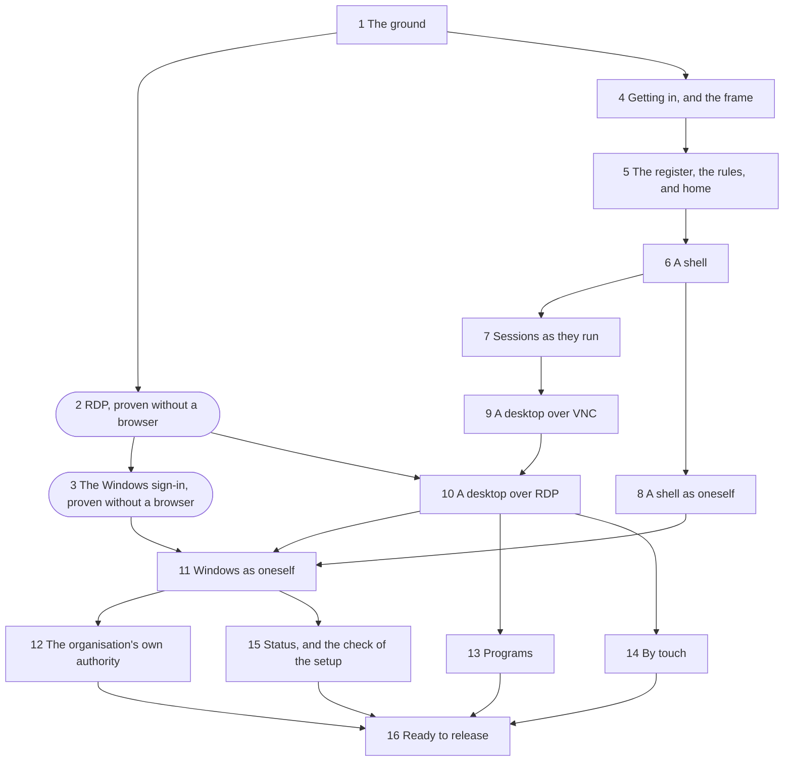

# The work packages

The order in which the first release is built, in pieces small enough to
review one at a time. It is the fifth part of the specification: the
[capabilities](../capabilities/README.md) say what the first release holds,
the [architecture](../architecture/README.md) which piece of Away carries each
capability, and this part when each is built and what shows that it is done.

> **A package begins when the owner names it**, by its number, and not before
> the decisions it rests on are accepted. The table of packages says how far
> each is.

## How a package runs

1. **It begins** when the packages it comes after have met their gates, the
   decisions it rests on are accepted, and the owner has named it.
2. **It builds** the capabilities it delivers, as the screens draw them and in
   the words the chapters give. Where building shows that a drawing or a
   capability was wrong, the specification is changed first.
3. **It ends at its gate.** A gate is a test that anyone can run again, and no
   opinion. A gate that measures against a quality needs that quality's target
   set.
4. **A proof** builds only as much as its gate asks and delivers no capability.
   It is there to find out early whether a decision holds.

A package's **state** says how far it is:

| State | Means |
|---|---|
| proposed | nobody has decided on it |
| agreed | the owner has named it, and it begins when what it comes after is done |
| begun | being built |
| done | its gate is met |

## The order

<!-- generated: order -->

<!-- end: order -->

An arrow leads from a package to one that comes after it. A rounded box is a
proof.

Two lines start side by side after the first package. Packages 2 and 3 prove
the hardest protocol work with no browser: a Windows desktop reached with
Away's own code, and a person signed in there with a certificate. Packages 4
to 9 build Away around the simpler protocols meanwhile: getting in, the
machines and the rules, a shell, and a desktop over VNC. The two lines meet in
package 10.

If package 2 misses its gate, everything from package 10 on waits for the
owner's word on [ADR-0001](../architecture/decisions/0001-own-protocol-code.md),
and nothing built by then is lost.

## The packages

<!-- generated: packages -->
| No. | Package | Is | State | After | Rests on | Delivers |
|---|---|---|---|---|---|---|
| 1 | [The ground](#1-the-ground) | build | done | — | [ADR‑0002](../architecture/decisions/0002-rust-one-program-one-repository.md), [ADR‑0003](../architecture/decisions/0003-three-parts-with-their-own-rights.md), [ADR‑0012](../architecture/decisions/0012-one-chart-no-special-rights.md), [ADR‑0013](../architecture/decisions/0013-built-tested-signed-by-the-pipelines.md) | 11 capabilities |
| 2 | [RDP, proven without a browser](#2-rdp-proven-without-a-browser) | proof | done | 1 | [ADR‑0001](../architecture/decisions/0001-own-protocol-code.md) | — |
| 3 | [The Windows sign-in, proven without a browser](#3-the-windows-sign-in-proven-without-a-browser) | proof | agreed | 2 | [ADR‑0007](../architecture/decisions/0007-short-lived-certificates.md), [ADR‑0008](../architecture/decisions/0008-the-authority-for-windows-sign-ins.md) | — |
| 4 | [Getting in, and the frame](#4-getting-in-and-the-frame) | build | done | 1 | [ADR‑0006](../architecture/decisions/0006-the-sign-in-is-held-by-the-server.md), [ADR‑0011](../architecture/decisions/0011-the-web-app.md) | 17 capabilities |
| 5 | [The register, the rules, and home](#5-the-register-the-rules-and-home) | build | begun | 4 | [ADR‑0009](../architecture/decisions/0009-one-database-and-files.md) | 21 capabilities |
| 6 | [A shell](#6-a-shell) | build | agreed | 5 | [ADR‑0001](../architecture/decisions/0001-own-protocol-code.md), [ADR‑0004](../architecture/decisions/0004-the-session-and-its-picture.md), [ADR‑0005](../architecture/decisions/0005-the-shells-screen-in-the-browser.md), [ADR‑0010](../architecture/decisions/0010-secrets-live-in-the-cluster.md) | 29 capabilities |
| 7 | [Sessions as they run](#7-sessions-as-they-run) | build | agreed | 6 | [ADR‑0003](../architecture/decisions/0003-three-parts-with-their-own-rights.md), [ADR‑0004](../architecture/decisions/0004-the-session-and-its-picture.md), [ADR‑0006](../architecture/decisions/0006-the-sign-in-is-held-by-the-server.md) | 12 capabilities |
| 8 | [A shell as oneself](#8-a-shell-as-oneself) | build | agreed | 6 | [ADR‑0007](../architecture/decisions/0007-short-lived-certificates.md) | 4 capabilities |
| 9 | [A desktop over VNC](#9-a-desktop-over-vnc) | build | agreed | 7 | [ADR‑0001](../architecture/decisions/0001-own-protocol-code.md), [ADR‑0004](../architecture/decisions/0004-the-session-and-its-picture.md) | 24 capabilities |
| 10 | [A desktop over RDP](#10-a-desktop-over-rdp) | build | agreed | 2, 9 | [ADR‑0001](../architecture/decisions/0001-own-protocol-code.md), [ADR‑0004](../architecture/decisions/0004-the-session-and-its-picture.md) | 28 capabilities |
| 11 | [Windows as oneself](#11-windows-as-oneself) | build | agreed | 3, 8, 10 | [ADR‑0007](../architecture/decisions/0007-short-lived-certificates.md), [ADR‑0008](../architecture/decisions/0008-the-authority-for-windows-sign-ins.md) | 6 capabilities |
| 12 | [The organisation's own authority](#12-the-organisations-own-authority) | build | agreed | 11 | [ADR‑0008](../architecture/decisions/0008-the-authority-for-windows-sign-ins.md) | 1 capability |
| 13 | [Programs](#13-programs) | build | agreed | 10 | [ADR‑0001](../architecture/decisions/0001-own-protocol-code.md), [ADR‑0004](../architecture/decisions/0004-the-session-and-its-picture.md) | 5 capabilities |
| 14 | [By touch](#14-by-touch) | build | agreed | 10 | [ADR‑0011](../architecture/decisions/0011-the-web-app.md) | 3 capabilities |
| 15 | [Status, and the check of the setup](#15-status-and-the-check-of-the-setup) | build | agreed | 11 | [ADR‑0012](../architecture/decisions/0012-one-chart-no-special-rights.md) | 2 capabilities |
| 16 | [Ready to release](#16-ready-to-release) | build | agreed | 12, 13, 14, 15 | [ADR‑0013](../architecture/decisions/0013-built-tested-signed-by-the-pipelines.md) | 1 capability |

16 packages: 2 proofs and 14 builds. Together the builds deliver 118 of the 118 capabilities of the first release.
<!-- end: packages -->

## What the build needs first

Things no package makes, and that have to be there before the package that
needs them.

| Needed | By |
|---|---|
| The decisions a package rests on, accepted | every package: the table above says which, and [the decisions](../architecture/decisions/README.md) which are |
| A Kubernetes cluster and an OpenShift cluster to install on | package 1 |
| A sign-in service to sign in through | package 4 |
| A Windows machine of each version on the list | package 2 |
| A domain that exists for testing, with a Windows machine and a file share in it | packages 3 and 11, and the Windows suite of every release |
| A certificate authority in that domain | package 12 |
| A phone and a tablet | package 14 |
| Somebody outside to review the code that reads what a machine sends | package 16 |

## What each package delivers

<!-- generated: by-package -->
### 1 The ground

A build, with nothing before it. It rests on [ADR‑0002](../architecture/decisions/0002-rust-one-program-one-repository.md), [ADR‑0003](../architecture/decisions/0003-three-parts-with-their-own-rights.md), [ADR‑0012](../architecture/decisions/0012-one-chart-no-special-rights.md), [ADR‑0013](../architecture/decisions/0013-built-tested-signed-by-the-pipelines.md). The repository's layout, the one program with its three parts, the chart, the pipelines.

**Its gate.** On a fresh Kubernetes cluster and in a fresh namespace of an OpenShift cluster, one command installs Away with no rights beyond its namespace. Its three parts answer whether they are well, give their measures and write their lines. The image's signature, the record of its build and the list of what it holds can be checked by anyone. A connection the model doesn't list is refused by the cluster.

| Area | What it delivers |
|---|---|
| [Installing and configuring](../capabilities/platform.md#installing-and-configuring) | Install it on Kubernetes or OpenShift with one chart; Run with no special rights on the cluster; Set the address it answers on, behind the reverse proxy that is there: behind OpenShift's router, with routes; Use the cluster's certificates, or one's own: with the cluster's own certificate; Run the part that signs people in on machines apart from the rest, with rights of its own |
| [Running it](../capabilities/platform.md#running-it) | Give the monitoring that is there its measures: sessions, sign-ins, failures, delay: each part's own measures; Write what happens as lines a log collector reads |
| [Checking it](../capabilities/platform.md#checking-it) | Check that an image is the one the project built; See what an image holds: every part, its version, its licence; Build it from its source with one command; Report a security hole in private, and learn what happens next |

### 2 RDP, proven without a browser

A proof, after package 1. It rests on [ADR‑0001](../architecture/decisions/0001-own-protocol-code.md). The gate of ADR-0001. The pictures matched on all three on 2026-11-14, and the owner said the same day that the RDP code stays Away's own.

**Its gate.** A test program built from Away's own RDP code signs in with a typed name and password on Windows 11, on Windows Server 2025 and on an RDP server on Linux, and saves the desktop's picture. The picture is the machine's screen, pixel for pixel. The owner then says whether the RDP code stays Away's own.

### 3 The Windows sign-in, proven without a browser

A proof, after package 2. It rests on [ADR‑0007](../architecture/decisions/0007-short-lived-certificates.md), [ADR‑0008](../architecture/decisions/0008-the-authority-for-windows-sign-ins.md). The proof the first release rests on.

**Its gate.** On a domain that exists for testing and has no certificate authority of its own, the test program signs an ordinary account in on a Windows machine with a certificate of five minutes and nothing typed, from outside the domain. The domain controllers have their certificates from the same test authority. It reads a file share as that account. An account of the directory's administrators is refused.

### 4 Getting in, and the frame

A build, after package 1. It rests on [ADR‑0006](../architecture/decisions/0006-the-sign-in-is-held-by-the-server.md), [ADR‑0011](../architecture/decisions/0011-the-web-app.md).

**Its gate.** A person signs in through the organisation's sign-in service and sees the frame on a computer and on a phone, with no token in the page. The sign-in renews itself, and signing out ends it. Every page is used with the keyboard alone and passes the accessibility checks. The pages load nothing from outside. Behind an ingress controller on Kubernetes, Away answers on its address with a certificate of one's own.

| Area | What it delivers |
|---|---|
| [On a phone or a tablet](../capabilities/session.md#on-a-phone-or-a-tablet) | Find a machine and open it on a phone, with every page fitted to it |
| [Signing in](../capabilities/app.md#signing-in) | Sign in through the organisation's identity provider; Stay signed in while the sign-in renews itself; Sign in again when the sign-in has run out, with the open sessions kept; Sign out, and end the sessions Away opened |
| [The frame](../capabilities/app.md#the-frame) | Move between home, the programs, the machines, the open sessions and the settings; See which account is signed in; Use every page around a session with the keyboard alone, and with a screen reader |
| [Who reaches what](../capabilities/admin.md#who-reaches-what) | Take people and their groups from the identity provider, and keep none of its own; Say who administers Away, who reads its records, and who only connects |
| [Installing and configuring](../capabilities/platform.md#installing-and-configuring) | Use the identity provider that is there, over OpenID Connect; Keep what has to stay secret encrypted, with the key kept elsewhere; Say whom people turn to, and show it wherever something fails; Set the address it answers on, behind the reverse proxy that is there: behind an ingress controller on Kubernetes; Use the cluster's certificates, or one's own: with one's own certificate |
| [Checking it](../capabilities/platform.md#checking-it) | See in Away itself which version runs, where its source is and the licences of what it is built from; Run it with no call to anyone outside: no fonts, scripts, statistics or update checks |

### 5 The register, the rules, and home

A build, after package 4. It rests on [ADR‑0009](../architecture/decisions/0009-one-database-and-files.md).

**Its gate.** With a set of files, every person sees exactly the machines a rule gives them: a test proves it for each person and each machine. A broken file is refused as a whole, its reason shows, and what was in force stays. Every change of the files is a record.

| Area | What it delivers |
|---|---|
| [The frame](../capabilities/app.md#the-frame) | Find a machine by its name from any page |
| [Finding a machine](../capabilities/app.md#finding-a-machine) | See the machines one may reach, on a page of their own; Find a machine by its name, its address or its group; See the machines in the groups an administrator made; See every program one may open on a page of their own, each as an entry, and find it by its name; Mark machines and programs as favourites, and see them on home; See what a machine is: its kind, its address, how one gets in; Choose how to open a machine that offers more than one way: its desktop, its programs, its shell; Open a machine from a link or a bookmark |
| [The register of machines](../capabilities/admin.md#the-register-of-machines) | Keep machines, groups and rules as files, applied as they change; See the machines, groups and rules that are in force, and the file each comes from; See that a changed file was refused, and why, while what was in force stays; Put machines in groups; Say for a machine how people are signed in: as themselves, with a kept secret, or by typing; Set how a machine is reached: its port, its screen, what may pass; Give a program an icon of its own, which people know it by; Read the desktops and programs a farm of Windows machines publishes from the farm itself, as it changes |
| [Who reaches what](../capabilities/admin.md#who-reaches-what) | Allow a group of people to reach a machine or a group of machines; Show a person only the machines a rule gives them; See what a person reaches, and by which rule |
| [What happened](../capabilities/admin.md#what-happened) | Keep a record of every change to machines, rules and settings |

### 6 A shell

A build, after package 5. It rests on [ADR‑0001](../architecture/decisions/0001-own-protocol-code.md), [ADR‑0004](../architecture/decisions/0004-the-session-and-its-picture.md), [ADR‑0005](../architecture/decisions/0005-the-shells-screen-in-the-browser.md), [ADR‑0010](../architecture/decisions/0010-secrets-live-in-the-cluster.md). The first session: it brings the session's connection, the session's bar and the records.

**Its gate.** A shell on a real SSH server opens with a typed password, with a kept password and with a kept key, and runs the editors, pagers and monitors of the test list as a terminal of reference does. A machine that shows another identity than the one Away knows is refused. The record is written before the connection is made, and no connection is made when it can't be written. A kept key signs inside the issuer and never leaves it.

| Area | What it delivers |
|---|---|
| [Opening a machine](../capabilities/session.md#opening-a-machine) | Open a shell on a machine; See how far a connection has come, and which step failed and why (SSH); See why a session ended, and open it again from there (SSH) |
| [The picture](../capabilities/session.md#the-picture) | Fit the machine's screen to the window, and follow when its size changes (SSH); Fill the whole screen with a session (SSH); Show a sharp picture on a high-density screen (SSH) |
| [Keyboard and pointer](../capabilities/session.md#keyboard-and-pointer) | Type with one's own keyboard layout, whatever the machine's is (SSH); Send the key combinations a browser or a device keeps for itself, from a menu (SSH); Give every key to the machine while a session fills the screen (SSH); Use every mouse button and the wheel, in both directions (SSH); Scroll with a trackpad as smoothly, as fast and in the direction one is used to (SSH); Type in a language whose characters are composed of several keys |
| [Clipboard, files and printing](../capabilities/session.md#clipboard-files-and-printing) | Copy text on one side and paste it on the other (SSH) |
| [The shell](../capabilities/session.md#the-shell) | Run the programs that take the whole shell: editors, monitors, with colours and the mouse; Scroll back through what the shell showed, and search it; Select the shell's text with the mouse or the keys, and copy it; Set the shell's text size, its font and its colours |
| [Signing in](../capabilities/app.md#signing-in) | Type a name and a password when the machine asks for them (SSH); Be signed in with a name and password or a key that Away keeps for the machine (SSH); Check that a machine is the one it claims to be, and refuse one that changed (SSH) |
| [The frame](../capabilities/app.md#the-frame) | Reach a session's own controls without leaving it: keys, clipboard, files, size, ending it; Give the machine the whole window while a session is open |
| [One's own settings](../capabilities/app.md#ones-own-settings) | Set how one's sessions open: their size, the picture, the keyboard layout |
| [The register of machines](../capabilities/admin.md#the-register-of-machines) | Keep a name and password or a key for a machine, never shown again; Say how a machine proves who it is, and accept a changed identity on purpose; Test a machine: is it reached, does signing in work, and if not, which step fails |
| [Who reaches what](../capabilities/admin.md#who-reaches-what) | Allow or forbid the clipboard, in each direction |
| [What happened](../capabilities/admin.md#what-happened) | Keep a record of every connection: who, which machine, as whom, when, from where, how it ended; Keep a record of every sign-in Away made on a machine for someone |

### 7 Sessions as they run

A build, after package 6. It rests on [ADR‑0003](../architecture/decisions/0003-three-parts-with-their-own-rights.md), [ADR‑0004](../architecture/decisions/0004-the-session-and-its-picture.md), [ADR‑0006](../architecture/decisions/0006-the-sign-in-is-held-by-the-server.md).

**Its gate.** Several shells are open at once, each also in a browser tab of its own. A connection that drops brings a shell back as it was, with what it wrote meanwhile. A session nobody uses warns and then ends. Taking a right away ends the sessions that rested on it within the time its target sets. An administrator sees the sessions that run, ends one, and reads and searches the records, each of which also left Away as a line.

| Area | What it delivers |
|---|---|
| [Opening a machine](../capabilities/session.md#opening-a-machine) | Keep several machines open at once and move between them (SSH); Open a session in a browser tab or window of its own (SSH); Come back to a session by itself after the connection dropped (SSH) |
| [The frame](../capabilities/app.md#the-frame) | See the sessions that are open, and go to one |
| [Finding a machine](../capabilities/app.md#finding-a-machine) | See the machines used last |
| [Who reaches what](../capabilities/admin.md#who-reaches-what) | End a session nobody has used for a set time, with a warning before |
| [Sessions as they run](../capabilities/admin.md#sessions-as-they-run) | See who is connected to what right now; End a session, or all of a person's; End a person's sessions as soon as their right or their account is gone |
| [What happened](../capabilities/admin.md#what-happened) | Read the records and search them; Send every record on to the organisation's own log system as it is written |
| [Running it](../capabilities/platform.md#running-it) | Give the monitoring that is there its measures: sessions, sign-ins, failures, delay: the measures of sessions |

### 8 A shell as oneself

A build, after package 6. It rests on [ADR‑0007](../architecture/decisions/0007-short-lived-certificates.md).

**Its gate.** With one line on the machine, a person is in their own account on a shell with nothing typed. The certificate lasts five minutes and names that account alone. An account the issuer never signs in as is refused. Every sign-in is a line of the issuer's own and a record.

| Area | What it delivers |
|---|---|
| [Signing in](../capabilities/app.md#signing-in) | Be signed in on the machine as oneself, with nothing asked (SSH) |
| [Installing and configuring](../capabilities/platform.md#installing-and-configuring) | Have the shells trust Away's sign-in, with one line on each machine; Say which part of a person's sign-in names their account on the machines: the name of a person's account on a shell |
| [Running it](../capabilities/platform.md#running-it) | Give the monitoring that is there its measures: sessions, sign-ins, failures, delay: the measures of the sign-ins made on machines |

### 9 A desktop over VNC

A build, after package 7. It rests on [ADR‑0001](../architecture/decisions/0001-own-protocol-code.md), [ADR‑0004](../architecture/decisions/0004-the-session-and-its-picture.md). The first picture: the gate of ADR-0004.

**Its gate.** A desktop of a Linux machine and of a Mac opens over VNC and meets the targets for the picture: exact once it rests, smooth while a window is dragged, usable on the slow line. Typing arrives in one's own layout, a trackpad scrolls as one is used to, and text is copied both ways. An update of Away tells the people in a session, and their desktops are back by themselves.

| Area | What it delivers |
|---|---|
| [Opening a machine](../capabilities/session.md#opening-a-machine) | Open a machine's desktop (VNC); See how far a connection has come, and which step failed and why (VNC); Keep several machines open at once and move between them (VNC); Open a session in a browser tab or window of its own (VNC); Come back to a session by itself after the connection dropped (VNC); Leave a session running while the browser is closed, and pick it up again (VNC); See why a session ended, and open it again from there (VNC); See that a desktop is in use by someone else, where opening it would take it from them or show their screen (VNC) |
| [The picture](../capabilities/session.md#the-picture) | Fit the machine's screen to the window, and follow when its size changes (VNC); Fill the whole screen with a session (VNC); Show a screen at rest exactly, pixel for pixel (VNC); Give up detail while the picture moves or the line is slow, and restore it after (VNC); Draw the pointer on one's own device, so that it moves without delay (VNC) |
| [Keyboard and pointer](../capabilities/session.md#keyboard-and-pointer) | Type with one's own keyboard layout, whatever the machine's is (VNC); Send the key combinations a browser or a device keeps for itself, from a menu (VNC); Give every key to the machine while a session fills the screen (VNC); Use a Mac keyboard on a Windows machine and the reverse, with the keys where the hands expect them (VNC); Use every mouse button and the wheel, in both directions (VNC); Scroll with a trackpad as smoothly, as fast and in the direction one is used to (VNC); Type the clipboard's text into the machine key by key |
| [Clipboard, files and printing](../capabilities/session.md#clipboard-files-and-printing) | Copy text on one side and paste it on the other (VNC) |
| [Signing in](../capabilities/app.md#signing-in) | Type a name and a password when the machine asks for them (VNC); Be signed in with a name and password or a key that Away keeps for the machine (VNC) |
| [Running it](../capabilities/platform.md#running-it) | Update to a new version in one step, with people told and their desktops back by themselves |

### 10 A desktop over RDP

A build, after package 2 and package 9. It rests on [ADR‑0001](../architecture/decisions/0001-own-protocol-code.md), [ADR‑0004](../architecture/decisions/0004-the-session-and-its-picture.md).

**Its gate.** A Windows desktop opens with a typed and with a kept password, takes the window's size and the screen's density, looks as it does at the machine, and meets the targets for the picture. Leaving it running and signing out of the machine both do what they say, and a desktop that was left running is picked up as it was.

| Area | What it delivers |
|---|---|
| [Opening a machine](../capabilities/session.md#opening-a-machine) | Open a machine's desktop (RDP); Reach a farm of Windows machines through its broker and land on the right one; Take the licence that a machine for many people hands every client; See how far a connection has come, and which step failed and why (RDP); Keep several machines open at once and move between them (RDP); Open a session in a browser tab or window of its own (RDP); Come back to a session by itself after the connection dropped (RDP); Leave a session running while the browser is closed, and pick it up again (RDP); Choose between leaving a desktop running and signing out of the machine; See why a session ended, and open it again from there (RDP); See that a desktop is in use by someone else, where opening it would take it from them or show their screen (RDP) |
| [The picture](../capabilities/session.md#the-picture) | Fit the machine's screen to the window, and follow when its size changes (RDP); Fill the whole screen with a session (RDP); Show a sharp picture on a high-density screen (RDP); Show a screen at rest exactly, pixel for pixel (RDP); Give up detail while the picture moves or the line is slow, and restore it after (RDP); Show the desktop as it looks at the machine: its background, smooth fonts, its effects; Draw the pointer on one's own device, so that it moves without delay (RDP) |
| [Keyboard and pointer](../capabilities/session.md#keyboard-and-pointer) | Type with one's own keyboard layout, whatever the machine's is (RDP); Send the key combinations a browser or a device keeps for itself, from a menu (RDP); Give every key to the machine while a session fills the screen (RDP); Use a Mac keyboard on a Windows machine and the reverse, with the keys where the hands expect them (RDP); Use every mouse button and the wheel, in both directions (RDP); Scroll with a trackpad as smoothly, as fast and in the direction one is used to (RDP) |
| [Clipboard, files and printing](../capabilities/session.md#clipboard-files-and-printing) | Copy text on one side and paste it on the other (RDP) |
| [Signing in](../capabilities/app.md#signing-in) | Type a name and a password when the machine asks for them (RDP); Be signed in with a name and password or a key that Away keeps for the machine (RDP); Check that a machine is the one it claims to be, and refuse one that changed (RDP) |

### 11 Windows as oneself

A build, after package 3 and package 8 and package 10. It rests on [ADR‑0007](../architecture/decisions/0007-short-lived-certificates.md), [ADR‑0008](../architecture/decisions/0008-the-authority-for-windows-sign-ins.md). With Away's own authority, which also certifies the domain controllers of a domain that has none.

**Its gate.** On a real domain, from a device that is not in it, a person with an ordinary account opens a Windows desktop with nothing typed, reaches a file share as themselves, and opens the desktop again after it locked. The certificate lasts five minutes. An account of the directory's administrators is refused. With no domain named in the configuration, Away runs as before and shows no authority.

| Area | What it delivers |
|---|---|
| [Signing in](../capabilities/app.md#signing-in) | Be signed in on the machine as oneself, with nothing asked (RDP); Reach file shares and printers from the machine as oneself; Open a locked desktop again with nothing asked |
| [Installing and configuring](../capabilities/platform.md#installing-and-configuring) | Choose who issues the sign-ins on a Windows domain's machines: Away's own authority or the organisation's: with Away's own authority; Give a domain's controllers the certificates they need, where the domain has no authority of its own; Say which part of a person's sign-in names their account on the machines: the name and the identifier a Windows domain knows a person's account by |

### 12 The organisation's own authority

A build, after package 11. It rests on [ADR‑0008](../architecture/decisions/0008-the-authority-for-windows-sign-ins.md). It begins with a proof of how the authority is asked; if no way holds, the owner chooses what follows.

**Its gate.** With the configuration changed to the organisation's own authority and nothing else, a person is signed in on a Windows machine as in package 11, and the directory itself refuses a certificate for an account outside the group it allows. Nothing of Away's is installed on a Windows machine.

| Area | What it delivers |
|---|---|
| [Installing and configuring](../capabilities/platform.md#installing-and-configuring) | Choose who issues the sign-ins on a Windows domain's machines: Away's own authority or the organisation's: with the organisation's own authority |

### 13 Programs

A build, after package 10. It rests on [ADR‑0001](../architecture/decisions/0001-own-protocol-code.md), [ADR‑0004](../architecture/decisions/0004-the-session-and-its-picture.md).

**Its gate.** Two programs of one Windows machine open in one sign-in, each in windows of its own on Away's ground. The list names every window, brings one to the front, and brings back one that was made small. A window made as large as it gets lies beside the list. On a phone one window shows at a time.

| Area | What it delivers |
|---|---|
| [Opening a machine](../capabilities/session.md#opening-a-machine) | Open one program of a Windows machine, without its desktop; Switch between the programs open on a machine, each in a window of its own; See a machine's open windows in a list beside them, and bring one to the front, also one made small |
| [Finding a machine](../capabilities/app.md#finding-a-machine) | See the programs a Windows machine offers, and open one |
| [The register of machines](../capabilities/admin.md#the-register-of-machines) | Say which programs of a Windows machine people may open |

### 14 By touch

A build, after package 10. It rests on [ADR‑0011](../architecture/decisions/0011-the-web-app.md).

**Its gate.** On a phone and on a tablet, in the two browsers most used there, a desktop and a shell are worked by touch: a tap clicks, holding gives the other button, two fingers scroll and zoom, and the keys a phone lacks are there.

| Area | What it delivers |
|---|---|
| [On a phone or a tablet](../capabilities/session.md#on-a-phone-or-a-tablet) | Work by touch: tap to click, hold for the other button, two fingers to scroll; Zoom into the picture with two fingers and move around it; Use the keys a phone's keyboard lacks: Ctrl, Alt, Esc, Tab, the arrows, the function keys |

### 15 Status, and the check of the setup

A build, after package 11. It rests on [ADR‑0012](../architecture/decisions/0012-one-chart-no-special-rights.md).

**Its gate.** The status page shows each part as it answers. For each kind of mistake in a setup, the check names it in words that say what to do: a wrong client at the sign-in service, a database that can't be reached, a broken file, a machine that isn't there, an authority the domain doesn't trust.

| Area | What it delivers |
|---|---|
| [Installing and configuring](../capabilities/platform.md#installing-and-configuring) | Check the whole setup and say what is wrong: the provider, the authority, each kind of machine |
| [Running it](../capabilities/platform.md#running-it) | See whether Away and what it rests on are well |

### 16 Ready to release

A build, after package 12 and package 13 and package 14 and package 15. It rests on [ADR‑0013](../architecture/decisions/0013-built-tested-signed-by-the-pipelines.md).

**Its gate.** Every quality is measured against its target, and each gap is closed or accepted by the owner. Someone who has not seen Away installs it in the time its target sets. The code that reads what a machine sends has been fuzzed without pause and reviewed by someone outside. Anyone runs the tests against a real server of each protocol with one command.

| Area | What it delivers |
|---|---|
| [Checking it](../capabilities/platform.md#checking-it) | Run its tests on one's own machine, against a real server of each protocol |
<!-- end: by-package -->
