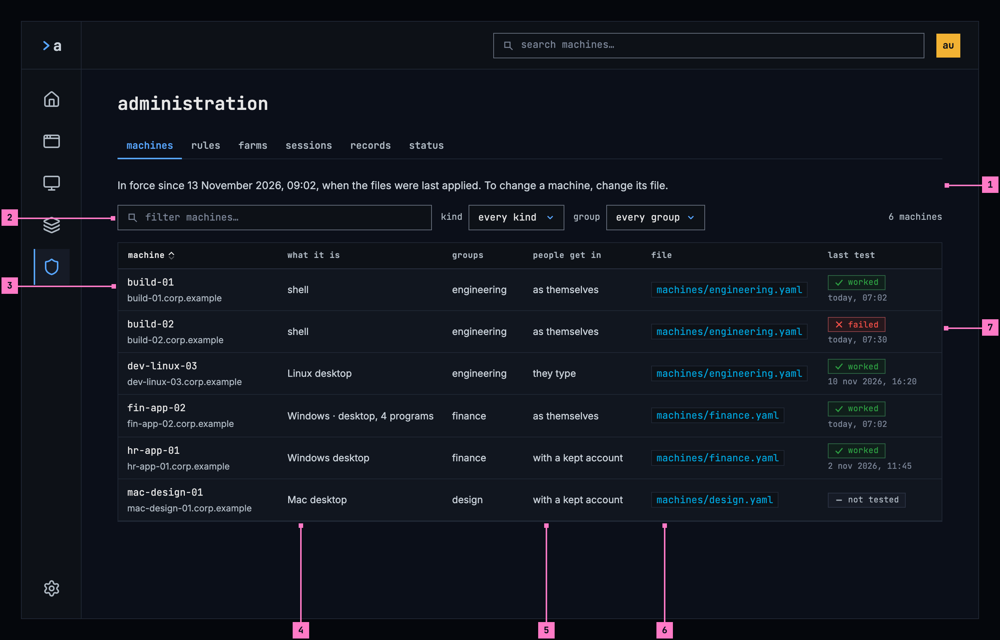
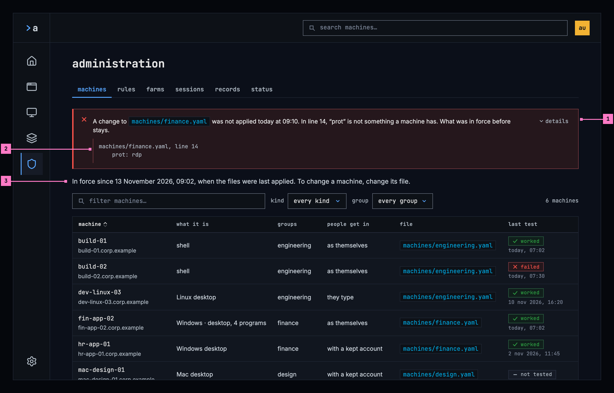
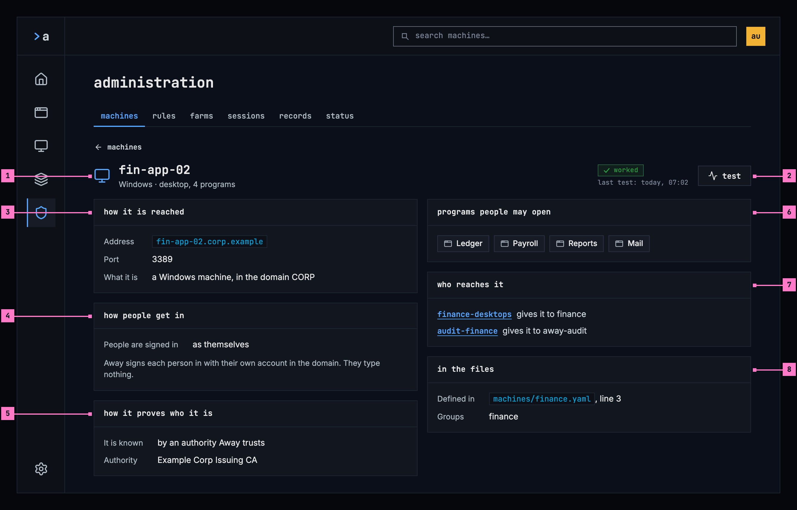
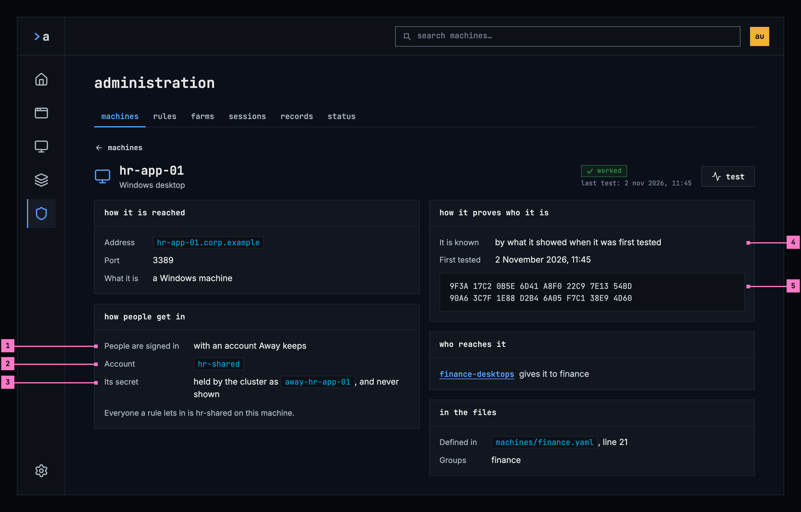
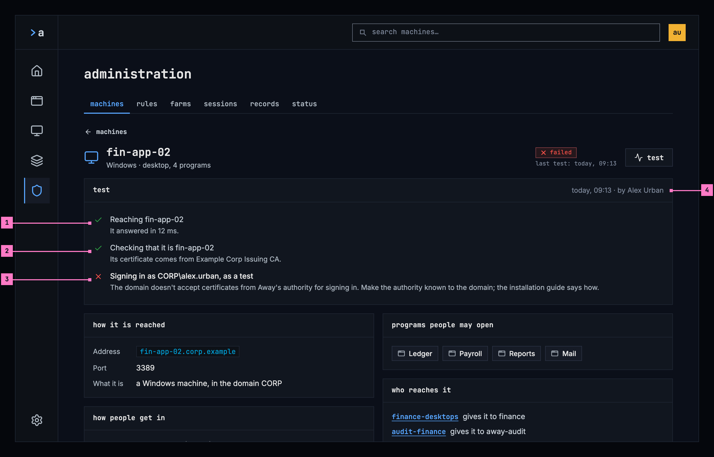
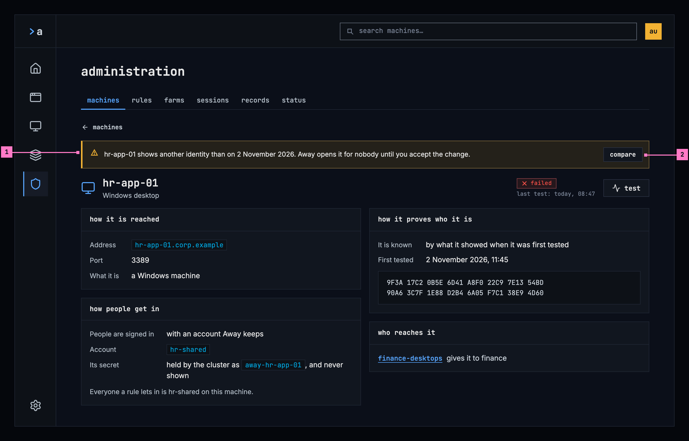
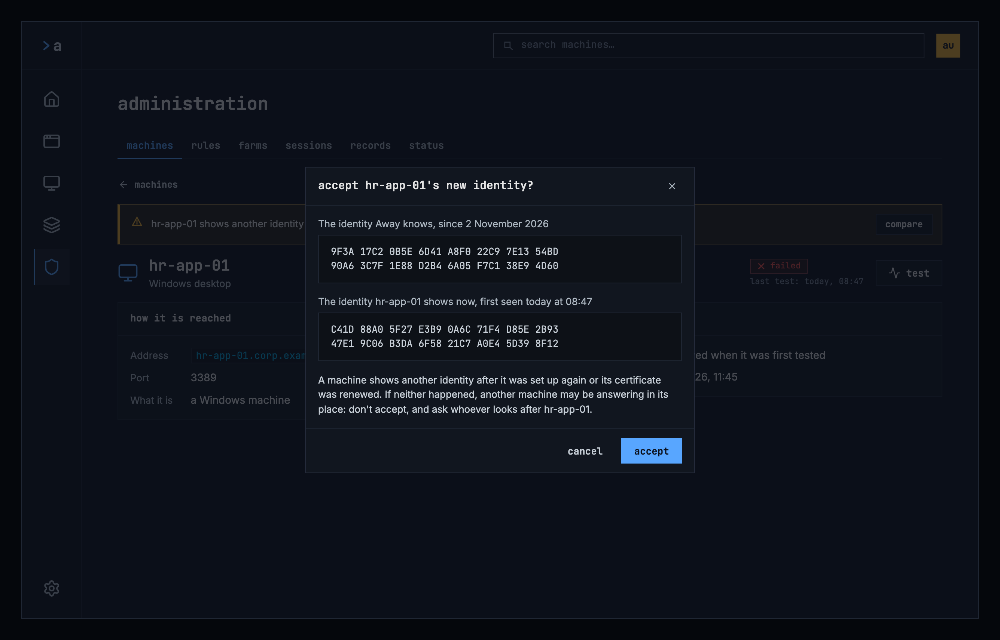

# 12 Administration: machines

The administration is for whoever looks after the machines and the rules. Its
first tab shows the machines: which there are, how each is reached, how people
get in, and whether a test of it worked. An administrator gets to it through
the shield in the rail ([chapter 2](./frame.md)). Nobody else has that icon.

> **In the first release, machines, groups and rules are files.** The operator
> applies them, and the administration shows what is in force and changes none
> of it. In the browser an administrator tests a machine, accepts a machine's
> changed identity, ends a session and reads the records. Adding and changing
> machines in the browser comes later.

This chapter draws what the first release holds of
[The register of machines](../capabilities/admin.md#the-register-of-machines).
The other tabs are [rules](./admin-rules.md),
[sessions and records](./admin-records.md) and [status](./admin-status.md).

## 12.1 The machines in force

**Figure 12.1** The machines in force.

1. **Since when this is in force**: the moment the files were last applied.
2. **The filter**: a search by name or address, the kind, the group, and how
   many machines the list holds.
3. **A machine**: its name over its address. Its row leads to its page (12.3).
4. **What it is**, in the words home uses ([chapter 4](./machines.md)).
5. **How people get in** (12.3).
6. **The file** the machine comes from.
7. **The last test** and when it ran (12.4).

| Column | What it holds |
|---|---|
| machine | the name people see, over the address Away reaches it at |
| what it is | shell · Windows desktop · Windows · desktop, 4 programs · Linux desktop · Mac desktop |
| groups | the groups of machines it is in |
| people get in | as themselves · with a kept account · they type |
| file | the file that holds it |
| last test | worked · failed · not tested, with the day and the time |

- The page shows what is in force, which is what the files said when they were
  last applied. A changed file that was refused changes nothing here (12.2).
- The list is sorted by name. A column's head sorts by that column.
- Nothing on this tab changes a machine. Its sentence says where a machine is
  changed: in its file.
- What a farm publishes is in force like a machine of the files
  ([ADR-0014](../architecture/decisions/0014-a-farm-says-what-it-publishes.md)).
  Its row names the farm's entry in the files.
- The tab **farms** lists the farms the files name: each with its feed, its
  groups, how many desktops and programs it publishes, when its feed was last
  read, and its file. A feed that could not be read shows as a banner over the
  list, with the reason, and what the farm published before stays. A desktop
  that a farm publishes under the name of a machine of the files is left out,
  and a banner names it.

## 12.2 A changed file that was refused

**Figure 12.2** A change that was not applied.

1. **The banner** names the file and the time, says in words what is wrong with
   it, and says that what was in force before stays.
2. **Details** hold the file's own line.
3. **The sentence under it** still gives the moment of the last change that was
   applied.

- A change is applied whole or not at all. When one line of it is wrong,
  everything stays as it was in force.
- The banner is on the tab the file belongs to, this one or
  [rules](./admin-rules.md), and stays until a change is applied. The
  [status tab](./admin-status.md) counts it.
- A change of the files is kept in the records, applied or refused
  ([chapter 14](./admin-records.md)).

## 12.3 A machine's page

**Figure 12.3** A machine on which people are signed in as themselves.

1. **The machine**: its name, what it is, and the result of its last test.
2. **Test** runs a test now (12.4).
3. **How it is reached**: its address, its port and what it is.
4. **How people get in**: one of the three ways below.
5. **How it proves who it is**: one of the two ways below.
6. **The programs people may open**, on a Windows machine that offers programs
   ([chapter 7](./programs.md)).
7. **Who reaches it**: the rules that give it, each leading to
   [the rules](./admin-rules.md).
8. **In the files**: the file and the line that hold it, and its groups.

People get in to a machine in one of three ways:

| The page says | What it means |
|---|---|
| as themselves | Away signs each person in with their own account, and they type nothing. A Windows machine in a domain and a shell that trusts Away take it. |
| with an account Away keeps | Away signs everyone in with one account, whose secret it keeps. They type nothing, and everyone a rule lets in is that account on the machine. |
| they type a name and a password | The machine asks, the person types, and Away passes it on and keeps nothing ([chapter 5](./opening.md)). |

**Figure 12.4** A machine with a kept account, known by its first test.

1. **The way**: with an account Away keeps.
2. **The account** everyone is on this machine.
3. **Its secret**: where it is held. The secret itself is never shown.
4. **How it is known**: by what it showed when it was first tested.
5. **The identity** Away took then.

- A kept secret is never shown again: not on a page, not in a record, not in a
  log. In the first release it is a secret of the cluster, and the machine's
  file names it. Typing one in the browser comes with adding machines there.
- A machine proves who it is in one of two ways. Either its certificate comes
  from an authority Away trusts, which the page names, or it shows the identity
  it showed at its first test that worked, which Away keeps from then on.
- A Windows machine and a shell prove who they are. For any other desktop the
  check comes later, and its page says: “Its identity is not checked.”

## 12.4 Testing a machine

**Figure 12.5** A test that failed at signing in.

1. **Reaching the machine**, and how long its answer took.
2. **Checking that it is the machine**, and by what.
3. **Signing in, as a test.** A step that fails says why in words, and what to
   do about it.
4. **When the test ran**, and who ran it.

- A test takes the steps of a connection ([chapter 5](./opening.md)) as far as
  the sign-in and stops there. It opens no desktop and no shell, and changes
  nothing on the machine. The machine's own log shows a sign-in.
- Where people are signed in as themselves, the test signs in the administrator
  who runs it. Where Away keeps an account, it signs in that account. Where
  people type, there is nothing to sign in with, and the test ends after the
  second step.
- The result stays in the machine's head and in the list until the next test.
- The first test of a machine that is known by its first test also takes its
  identity.

## 12.5 A machine that shows another identity

**Figure 12.6** A machine that shows another identity than the one Away knows.

1. **The warning**: since when the identity differs, and what follows from it.
2. **Compare** opens the dialog of figure 12.7.

**Figure 12.7** Accepting a machine's new identity.

The dialog shows the identity Away knows and the one the machine shows now, one
under the other, each with its date. It says when a change is expected, and
what to do when it is not. **Accept** makes the new identity the one Away
knows. **Cancel** changes nothing.

- Away opens a machine that shows another identity for nobody. A person who
  tries reads that it is not the machine Away knows
  ([chapter 5](./opening.md)); an administrator reads this warning.
- Only an administrator accepts, on purpose, and the acceptance is kept in the
  records with who accepted.
- A machine that is known by an authority has nothing to accept: its
  certificate comes from the authority, or the connection is refused.

## 12.6 States

| State | What the tab shows |
|---|---|
| The files hold no machine | no machines yet: “The files hold no machine. The installation guide says how a machine is written down.” |
| No machine matches the filter | no machine matches: “Nothing in force has that name, kind and group.” and clear all |
| Loading | the table's head, and grey rows in the place of the machines |
| Couldn't load | couldn't load the machines, with the reason and try again ([chapter 16](./errors.md)) |

## 12.7 Words

| Where | Text |
|---|---|
| The page's heading and its tabs | administration · machines · rules · farms · sessions · records · status |
| The farms | A farm says itself what it publishes: Away asks its feed every few minutes. · farm · feed · groups · publishes · last read · file · 1 desktop, 23 programs · The files name no farms. |
| A feed that could not be read | The feed of Work Resources could not be read. The farm's feed answered with the status 503. What it published before stays. |
| A name a farm may not take | Left out of what Work Resources publishes, because a machine of the files has the name: fin-app-02. |
| The sentence over the list | In force since 13 November 2026, 09:02, when the files were last applied. To change a machine, change its file. |
| The filter | filter machines… · kind · every kind · group · every group · 6 machines |
| The table's heads | machine · what it is · groups · people get in · file · last test |
| How people get in, in the table | as themselves · with a kept account · they type |
| The last test | worked · failed · not tested |
| A change that was not applied | A change to machines/finance.yaml was not applied today at 09:10. In line 14, “prot” is not something a machine has. What was in force before stays. · details |
| A machine's page, the way back and the button | machines · test |
| The cards | how it is reached · how people get in · how it proves who it is · programs people may open · who reaches it · in the files |
| How it is reached | Address · Port · What it is |
| How people get in | People are signed in · as themselves · Away signs each person in with their own account in the domain. They type nothing. |
| How people get in, a kept account | with an account Away keeps · Account · Its secret · held by the cluster as away-hr-app-01, and never shown · Everyone a rule lets in is hr-shared on this machine. |
| How people get in, typing | they type a name and a password · The machine asks each person for them. Away passes them on and keeps nothing. |
| How it proves who it is | It is known · by an authority Away trusts · Authority · by what it showed when it was first tested · First tested · Its identity is not checked. |
| Who reaches it | finance-desktops gives it to finance |
| In the files | Defined in · line 3 · Groups |
| The test | test · Reaching fin-app-02 · It answered in 12 ms. · Checking that it is fin-app-02 · Its certificate comes from Example Corp Issuing CA. · Signing in as CORP\alex.urban, as a test · today, 09:13 · by Alex Urban |
| The test, the domain refuses Away's authority | The domain doesn't accept certificates from Away's authority for signing in. Make the authority known to the domain; the installation guide says how. |
| The test, the organisation's authority gives no certificate | The organisation's authority gave no certificate for CORP\alex.urban. Its answer is in the details; the installation guide says what it has to allow. |
| A changed identity | hr-app-01 shows another identity than on 2 November 2026. Away opens it for nobody until you accept the change. · compare |
| The dialog | accept hr-app-01's new identity? · The identity Away knows, since 2 November 2026 · The identity hr-app-01 shows now, first seen today at 08:47 · A machine shows another identity after it was set up again or its certificate was renewed. If neither happened, another machine may be answering in its place: don't accept, and ask whoever looks after hr-app-01. · cancel · accept |

## 12.8 What the figures draw

<!-- generated: draws -->
| Figure | Draws |
|---|---|
| 12.1 The machines in force | [See the machines, groups and rules that are in force, and the file each comes from](../capabilities/admin.md#the-register-of-machines), [Keep machines, groups and rules as files, applied as they change](../capabilities/admin.md#the-register-of-machines), [Put machines in groups](../capabilities/admin.md#the-register-of-machines), [Say for a machine how people are signed in: as themselves, with a kept secret, or by typing](../capabilities/admin.md#the-register-of-machines), [Test a machine: is it reached, does signing in work, and if not, which step fails](../capabilities/admin.md#the-register-of-machines) |
| 12.2 A change that was not applied | [See that a changed file was refused, and why, while what was in force stays](../capabilities/admin.md#the-register-of-machines), [Keep machines, groups and rules as files, applied as they change](../capabilities/admin.md#the-register-of-machines) |
| 12.3 A machine on which people are signed in as themselves | [See the machines, groups and rules that are in force, and the file each comes from](../capabilities/admin.md#the-register-of-machines), [Set how a machine is reached: its port, its screen, what may pass](../capabilities/admin.md#the-register-of-machines), [Say for a machine how people are signed in: as themselves, with a kept secret, or by typing](../capabilities/admin.md#the-register-of-machines), [Say how a machine proves who it is, and accept a changed identity on purpose](../capabilities/admin.md#the-register-of-machines), [Say which programs of a Windows machine people may open](../capabilities/admin.md#the-register-of-machines), [Put machines in groups](../capabilities/admin.md#the-register-of-machines), [Test a machine: is it reached, does signing in work, and if not, which step fails](../capabilities/admin.md#the-register-of-machines) |
| 12.4 A machine with a kept account, known by its first test | [Keep a name and password or a key for a machine, never shown again](../capabilities/admin.md#the-register-of-machines), [Say for a machine how people are signed in: as themselves, with a kept secret, or by typing](../capabilities/admin.md#the-register-of-machines), [Say how a machine proves who it is, and accept a changed identity on purpose](../capabilities/admin.md#the-register-of-machines) |
| 12.5 A test that failed at signing in | [Test a machine: is it reached, does signing in work, and if not, which step fails](../capabilities/admin.md#the-register-of-machines) |
| 12.6 A machine that shows another identity than the one Away knows | [Say how a machine proves who it is, and accept a changed identity on purpose](../capabilities/admin.md#the-register-of-machines) |
| 12.7 Accepting a machine's new identity | [Say how a machine proves who it is, and accept a changed identity on purpose](../capabilities/admin.md#the-register-of-machines) |
<!-- end: draws -->
