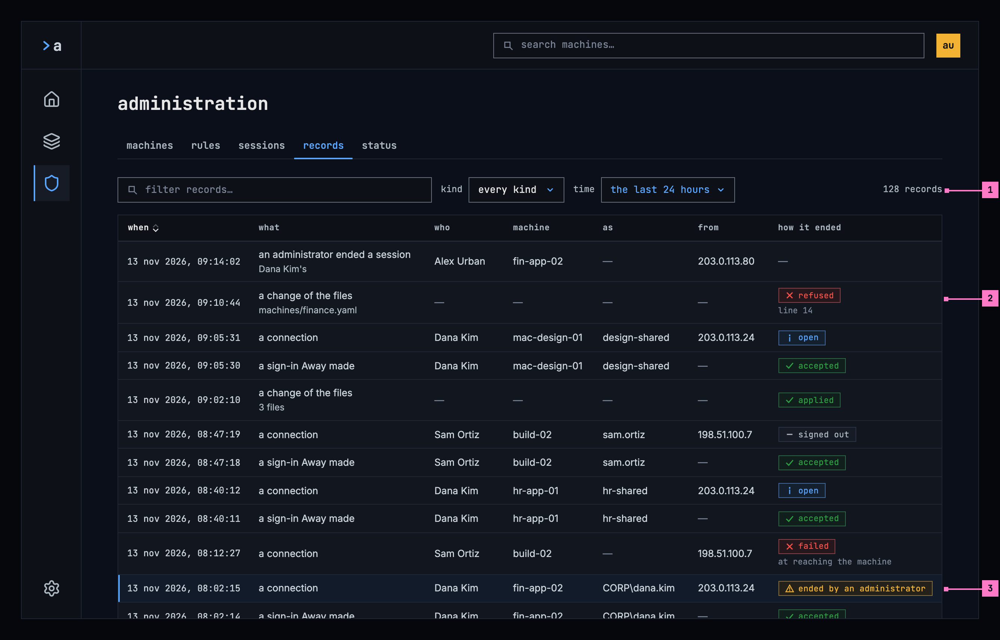

# 14 Administration: sessions and records

Two tabs of the administration say what is happening and what happened. The
tab sessions shows who is connected to what right now, and ends a session. The
tab records holds every connection, every sign-in Away made and every change,
to read and to search. An administrator gets to both through the shield in the
rail ([chapter 12](./admin-machines.md) has the administration's head). A
reader of the records has the shield too, and sees the records tab alone.

> **In the first release, machines, groups and rules are files.** The operator
> applies them, and the administration shows what is in force and changes none
> of it. In the browser an administrator tests a machine, accepts a machine's
> changed identity, ends a session and reads the records.

This chapter draws what the first release holds of
[Sessions as they run](../capabilities/admin.md#sessions-as-they-run) and
[What happened](../capabilities/admin.md#what-happened).

## 14.1 The sessions that are open

**Figure 14.1** The sessions that are open.

1. **The filter**, and how many sessions are open.
2. **A session**: the person's name over their account. Someone with three
   sessions has three rows.
3. **End** ends this session (14.2).

| Column | What it holds |
|---|---|
| person | the name over the account, as the identity provider gives them |
| machine | the machine's name |
| what | desktop · programs · shell |
| as | the account the person is on the machine: their own, the one Away keeps, or the one they typed |
| since | when the session opened, and how long ago that is |
| from | the address the person's browser comes from |
| last used | when a key or a click last reached the machine |

- The list holds what is open now and keeps itself up to date. A session that
  ended is in the records (14.3).
- **Last used** is what a rule's time counts from before it ends a session
  nobody uses ([chapter 13](./admin-rules.md)).
- A session whose person lost the right to the machine, or the account, ends by
  itself within a minute, and its record says so.

## 14.2 Ending a session

**Figure 14.2** Ending a session.

The dialog names the person and the machine. It says what the person is told
and what becomes of their work, offers to end all of the person's sessions
with one tick, and ends the session with **end session**. **Cancel** changes
nothing.

- The person's window says that an administrator ended the session
  ([chapter 6](./desktop.md)).
- What becomes of the work depends on what was open, and the dialog says which:
  a desktop and programs keep running on their machine, and a shell ends with
  what runs in it.
- Ending a session is kept in the records, with who ended it.

## 14.3 The records

**Figure 14.3** The records, newest first.

1. **The filter**: a search for a person, a machine, an account or an address;
   the kind of record; the time; and how many records the list holds.
2. **How it ended**, with a detail where there is one: here the line of the
   file that was refused.
3. **The chosen record.** A row leads to its page (14.4).

Away writes a record of four things:

| What | When it is written | How it ended says |
|---|---|---|
| a connection | when it opens, and again when it ends | open · left · signed out · ended unused · ended by an administrator · the right was gone · failed, with the step |
| a sign-in Away made | each time Away signs someone in on a machine | accepted · refused |
| a change of the files | each time the files change | applied · refused, with the line |
| an administrator ended a session, or accepted a machine's new identity | when it is done | nothing |

- No connection is made without a record. When the record cannot be written,
  the connection is not made, and the person reads why
  ([chapter 16](./errors.md)).
- Nobody changes or removes a record in Away. Every record also leaves Away as
  it is written: Away puts it out as a line where the organisation's log
  collector reads it. Whether the log system took it, Away can't know, so a
  page says “put out”, and never “received”.
- **Who** is the person the record is about, or the administrator who did
  something. **As** is the account on the machine. A dash stands where a record
  has nothing to say: a change of the files has no machine.
- The time is one of: the last hour, the last 24 hours, the last 7 days,
  everything. The list opens on the last 24 hours.
- A reader of the records sees this tab and the pages of its records, and
  nothing else of the administration.

## 14.4 One record

**Figure 14.4** The record of a connection.

1. **What the record is**, when it began, and how it ended.
2. **The connection**: who, to which machine, to what of it, as whom there, and
   from where: the address and the browser's own name for itself.
3. **How it ended**: when it opened and ended, how long it lasted, and what
   ended it, with the way to that record.
4. **The sign-in Away made** for it: as whom, with what, its number, when, and
   what the machine answered.
5. **The record itself**: its number, when it was written and when it was put
   out for the log system.

- A record has an address of its own, so a link to it can be passed on to
  someone who may read the records.
- A connection, the sign-in made for it and what ended it lead to one another.
- A sign-in says with what it was made: a certificate with its number and how
  long it was valid, or the account Away keeps. A secret is never part of a
  record. Where a person typed a name and a password, Away made no sign-in, and
  the card says so: “The person typed a name and a password.”

## 14.5 States

| State | What the tab shows |
|---|---|
| No session is open | no sessions open: “Nobody is connected to a machine right now.” |
| No session matches the filter | no session matches, and clear all |
| No record matches the filter | no record matches: “Nothing in that time has those words and that kind.” and clear all |
| Loading | the table's head, and grey rows in the place of the list |
| Couldn't load | couldn't load the sessions, or the records, with the reason and try again ([chapter 16](./errors.md)) |

## 14.6 Words

| Where | Text |
|---|---|
| The sessions' filter | filter sessions… · 7 sessions |
| The sessions' heads | person · machine · what · as · since · from · last used |
| What | desktop · programs · shell |
| Last used | a moment ago · 12 min ago |
| The button at a row's end | end |
| Ending a session | end Dana Kim's session on fin-app-02? · Dana Kim sees that an administrator ended it. The desktop keeps running on fin-app-02. · End all 3 of Dana Kim's sessions · cancel · end session |
| Ending a session, programs | The programs keep running on fin-app-02. |
| Ending a session, a shell | The shell on build-01 ends, and what runs in it with it. |
| The records' filter | filter records… · kind · every kind · connections · sign-ins · changes · time · the last hour · the last 24 hours · the last 7 days · everything · 128 records |
| The records' heads | when · what · who · machine · as · from · how it ended |
| What | a connection · a sign-in Away made · a change of the files · an administrator ended a session · an administrator accepted a new identity |
| How it ended | open · left · signed out · ended unused · ended by an administrator · the right was gone · failed · accepted · refused · applied |
| How it ended, the detail | at reaching the machine · at checking who it is · at signing in · line 14 |
| A record's page, the way back | records |
| The cards | the connection · how it ended · the sign-in away made · the record |
| The connection | Who · Machine · What · its desktop · its programs · its shell · As · From · Firefox 144 on Windows, as the browser named itself |
| How it ended | Opened · Ended · It lasted · How it ended · Alex Urban ended it |
| The sign-in Away made | As · With · a certificate, valid for five minutes · the account Away keeps · Its number · Made · The machine · accepted it · refused it · The person typed a name and a password. |
| The record | Number · Written · 08:02:15, when the connection opened · 09:14:02, when it ended · Put out · for the log system at 08:02:15 · and at 09:14:03 |
| No session is open | no sessions open · Nobody is connected to a machine right now. |
| No record matches | no record matches · Nothing in that time has those words and that kind. · clear all |

## 14.7 What the figures draw

<!-- generated: draws -->
| Figure | Draws |
|---|---|
| 14.1 The sessions that are open | [See who is connected to what right now](../capabilities/admin.md#sessions-as-they-run), [End a session, or all of a person's](../capabilities/admin.md#sessions-as-they-run) |
| 14.2 Ending a session | [End a session, or all of a person's](../capabilities/admin.md#sessions-as-they-run) |
| 14.3 The records, newest first | [Read the records and search them](../capabilities/admin.md#what-happened), [Keep a record of every connection: who, which machine, as whom, when, from where, how it ended](../capabilities/admin.md#what-happened), [Keep a record of every sign-in Away made on a machine for someone](../capabilities/admin.md#what-happened), [Keep a record of every change to machines, rules and settings](../capabilities/admin.md#what-happened) |
| 14.4 The record of a connection | [Read the records and search them](../capabilities/admin.md#what-happened), [Keep a record of every connection: who, which machine, as whom, when, from where, how it ended](../capabilities/admin.md#what-happened), [Keep a record of every sign-in Away made on a machine for someone](../capabilities/admin.md#what-happened), [Send every record on to the organisation's own log system as it is written](../capabilities/admin.md#what-happened) |
<!-- end: draws -->
