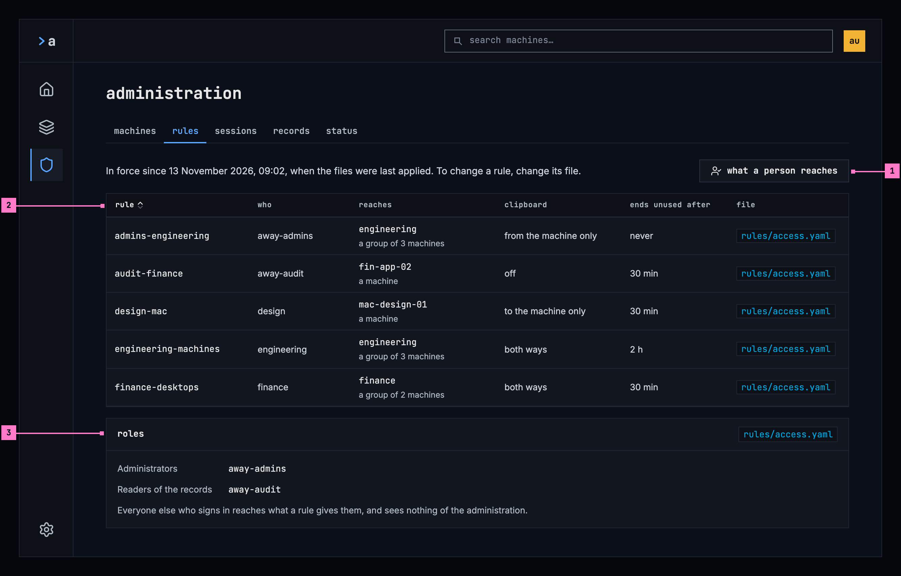
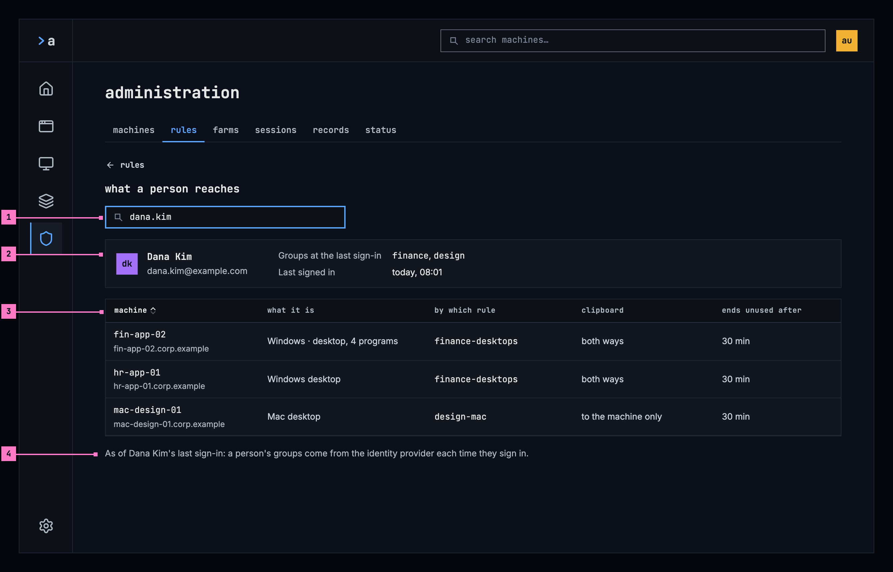
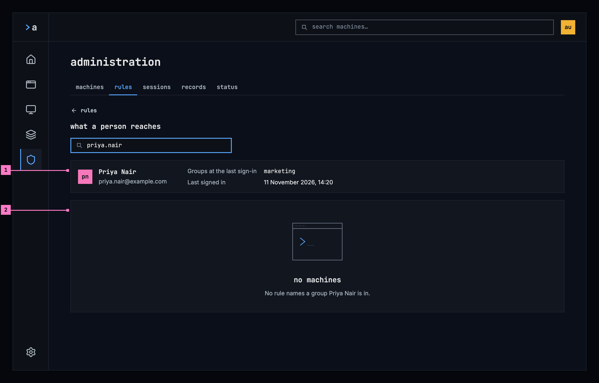

# 13 Administration: rules

The rules say which people reach which machines, and what may pass between
their device and the machine. The second tab of the administration shows the
rules in force and the roles, and answers one question: what does this person
reach, and why. An administrator gets to it through the shield in the rail and
the tab rules ([chapter 12](./admin-machines.md) has the administration's
head).

> **In the first release, machines, groups and rules are files.** The operator
> applies them, and the administration shows what is in force and changes none
> of it. In the browser an administrator tests a machine, accepts a machine's
> changed identity, ends a session and reads the records. Changing rules in the
> browser comes later.

This chapter draws what the first release holds of
[Who reaches what](../capabilities/admin.md#who-reaches-what).

## 13.1 The rules in force

**Figure 13.1** The rules in force, and the roles.

1. **What a person reaches** leads to the page of 13.2.
2. **The rules**, one in a row, sorted by name.
3. **The roles**: which of the identity provider's groups administer Away, and
   which read its records.

| Column | What it holds |
|---|---|
| rule | the rule's name, as its file gives it |
| who | a group of people, as the identity provider names it |
| reaches | a group of machines with how many it holds, or one machine |
| clipboard | both ways · to the machine only · from the machine only · off |
| ends unused after | a time, or never |
| file | the file that holds the rule |

What the clipboard column says:

| It says | What passes |
|---|---|
| both ways | text or a picture copied on either side can be pasted on the other |
| to the machine only | text or a picture from one's own device reaches the machine, and nothing comes back |
| from the machine only | text or a picture from the machine reaches one's own device, and nothing goes the other way |
| off | nothing |

- Without a rule a machine is neither shown nor reached. Home shows a person
  the machines a rule gives them and no others ([chapter 4](./machines.md)).
- People and their groups come from the identity provider each time someone
  signs in. Away keeps no people and no groups of its own, so a rule names a
  group by the name the identity provider gives it.
- **Ends unused after** is the time after which a session nobody uses ends. The
  warning of [chapter 6](./desktop.md) counts down to it. Never means that a
  session doesn't end for being unused.
- The sentence over the table and a refused change of a rule's file work as on
  the machines tab ([chapter 12](./admin-machines.md)).
- The page of 13.2 shows a person whom two rules give the same machine both
  rules. The strictest of their limits then applies: the clipboard passes in a
  direction only where every one of the rules lets it, and the shortest of
  their times counts.

Who sees the administration follows from the roles:

| Who | Sees |
|---|---|
| an administrator | every tab |
| a reader of the records | the records tab alone ([chapter 14](./admin-records.md)) |
| everyone else | nothing of it: the rail has no shield |

## 13.2 What a person reaches

**Figure 13.2** What a person reaches, and by which rule.

1. **The field** takes a name or an account and finds the people who have
   signed in.
2. **Who it is**: the name and the address, the groups the last sign-in gave,
   and when that was.
3. **What they reach**: each machine with what it is, the rule that gives it,
   and what that rule lets pass and after what time it ends unused.
4. **As of when** the answer holds.

- The page has an address of its own under the rules tab, and a way back to the
  rules. A rule's name leads back to the rule.
- The answer is as of the person's last sign-in, because that is when Away last
  heard of their groups. A group they joined or left since shows after their
  next sign-in.
- Someone who never signed in is not known to Away. The field then finds
  nobody: “Nobody by that name has signed in yet.”

**Figure 13.3** A person no rule gives a machine.

1. **Who it is**, as in figure 13.2.
2. **No machines**, and why: no rule names one of the person's groups.

## 13.3 States

| State | What the tab shows |
|---|---|
| The files hold no rule | no rules yet: “The files hold no rule, so nobody reaches a machine. The installation guide says how a rule is written down.” |
| A person no rule gives a machine | no machines: “No rule names a group Priya Nair is in.” |
| Nobody by that name has signed in | nobody found: “Nobody by that name has signed in yet.” |
| Loading | the table's head, and grey rows in the place of the rules |
| Couldn't load | couldn't load the rules, with the reason and try again ([chapter 16](./errors.md)) |

## 13.4 Words

| Where | Text |
|---|---|
| The sentence over the list | In force since 13 November 2026, 09:02, when the files were last applied. To change a rule, change its file. |
| The button beside it | what a person reaches |
| The table's heads | rule · who · reaches · clipboard · ends unused after · file |
| Reaches | a group of 3 machines · a machine |
| Clipboard | both ways · to the machine only · from the machine only · off |
| Ends unused after | 30 min · 2 h · never |
| The roles | roles · Administrators · Readers of the records · Everyone else who signs in reaches what a rule gives them, and sees nothing of the administration. |
| What a person reaches, the way back and the heading | rules · what a person reaches |
| The field | a name or an account… |
| Who it is | Groups at the last sign-in · Last signed in |
| The answer's heads | machine · what it is · by which rule · clipboard · ends unused after |
| Under the answer | As of Dana Kim's last sign-in: a person's groups come from the identity provider each time they sign in. |
| No machines | no machines · No rule names a group Priya Nair is in. |
| Nobody found | nobody found · Nobody by that name has signed in yet. |

## 13.5 What the figures draw

<!-- generated: draws -->
| Figure | Draws |
|---|---|
| 13.1 The rules in force, and the roles | [Allow a group of people to reach a machine or a group of machines](../capabilities/admin.md#who-reaches-what), [Take people and their groups from the identity provider, and keep none of its own](../capabilities/admin.md#who-reaches-what), [Say who administers Away, who reads its records, and who only connects](../capabilities/admin.md#who-reaches-what), [Allow or forbid the clipboard, in each direction](../capabilities/admin.md#who-reaches-what), [End a session nobody has used for a set time, with a warning before](../capabilities/admin.md#who-reaches-what), [See the machines, groups and rules that are in force, and the file each comes from](../capabilities/admin.md#the-register-of-machines) |
| 13.2 What a person reaches, and by which rule | [See what a person reaches, and by which rule](../capabilities/admin.md#who-reaches-what), [Take people and their groups from the identity provider, and keep none of its own](../capabilities/admin.md#who-reaches-what) |
| 13.3 A person no rule gives a machine | [See what a person reaches, and by which rule](../capabilities/admin.md#who-reaches-what), [Show a person only the machines a rule gives them](../capabilities/admin.md#who-reaches-what) |
<!-- end: draws -->
