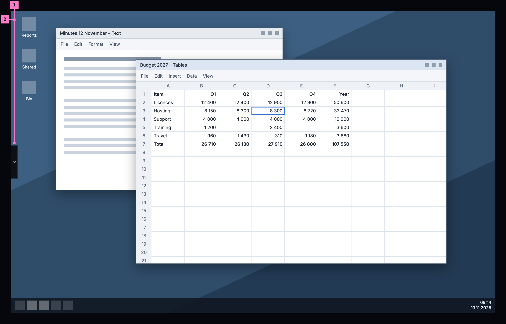
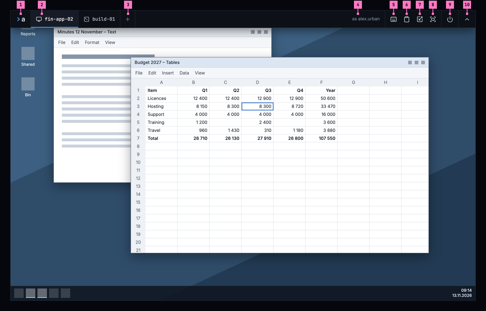
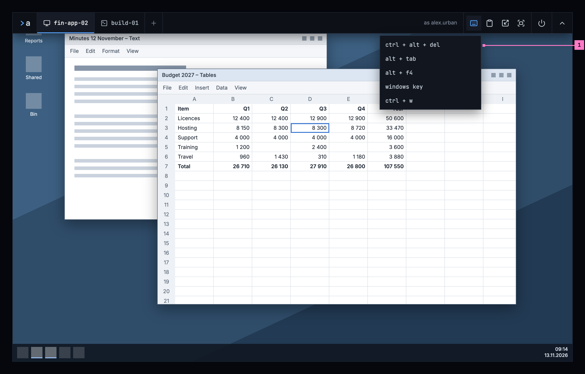
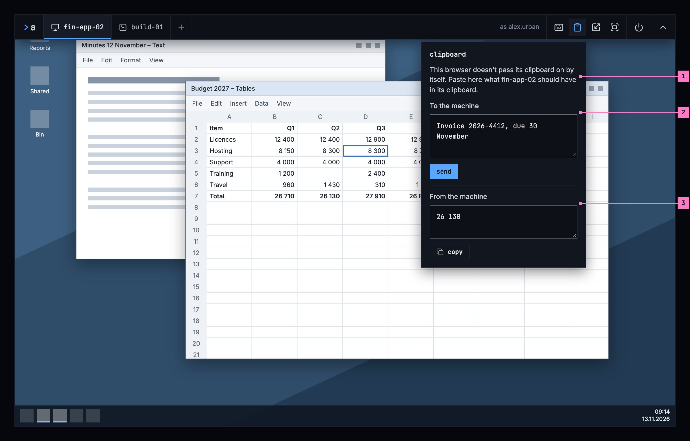
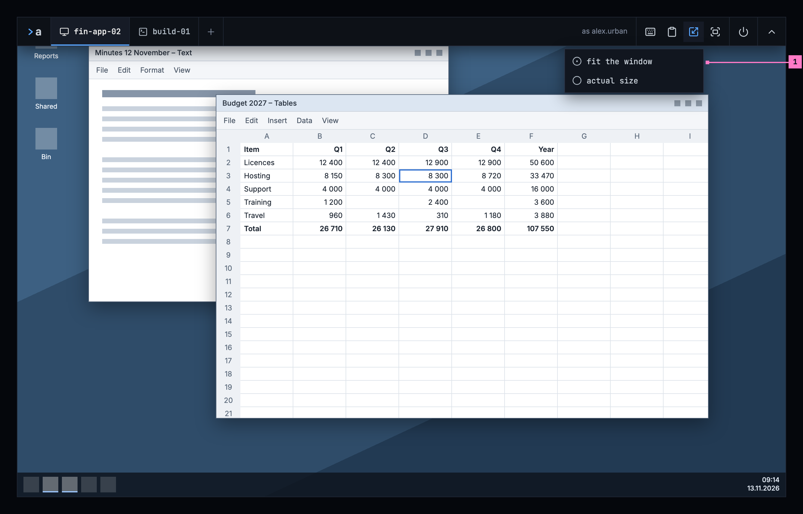
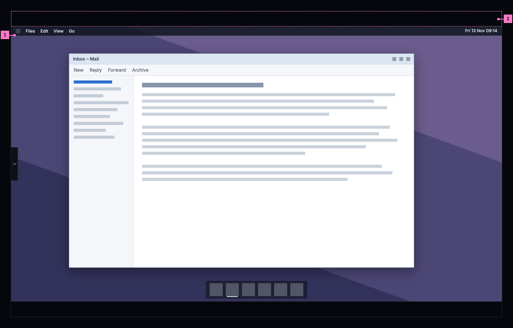
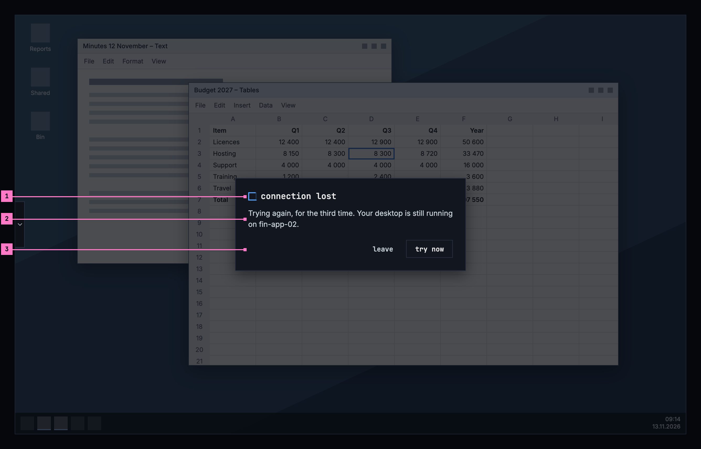
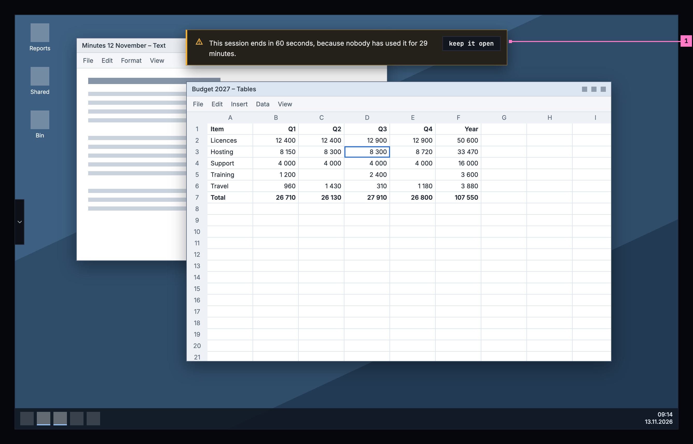
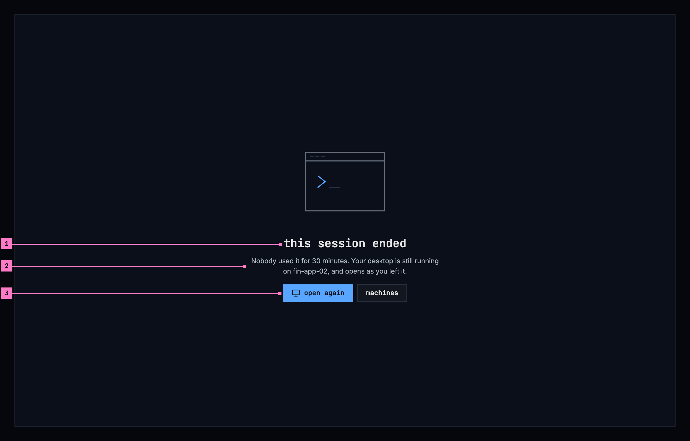

# 6 A desktop

A desktop is a machine's own screen in the browser: a Windows machine's, a
Mac's or a Linux machine's. This chapter covers a session from its first picture
to its end: the session's bar and what is in it, the picture's size, a dropped
connection, and how a session ends. How a machine is opened is
[chapter 5](./opening.md), a program without its desktop is
[chapter 7](./programs.md), and a phone is [chapter 10](./phone.md).

It draws what the first release holds of
[Opening a machine](../capabilities/session.md#opening-a-machine),
[The picture](../capabilities/session.md#the-picture),
[Keyboard and pointer](../capabilities/session.md#keyboard-and-pointer) and
[Clipboard, files and printing](../capabilities/session.md#clipboard-files-and-printing).

## 6.1 The machine has the window

**Figure 6.1** A desktop, on a computer. While a session is open, Away shows
nothing of its own but the handle.

1. **The handle** opens the session's bar. It also opens with Ctrl + Alt +
   Shift, pressed and let go with no other key, which no program on a machine
   uses for itself.
2. **The machine's screen.** Every key, every click and the wheel go to the
   machine.

- A session has the whole browser window, without the top bar and the rail of
  [chapter 2](./frame.md). The browser tab is named after the machine.
- A session has an address of its own. Reloading the page comes back to the same
  session, and the browser's back button leads to the page one came from, while
  the session goes on.
- The pointer is drawn on one's own device and moves without waiting for the
  machine. It takes the shape the machine gives it.

## 6.2 The session's bar

**Figure 6.2** The session's bar, open. It lies over the top of the picture and
takes nothing from the machine's screen.

1. **The mark** leads to Away's pages, to [home](./machines.md). The session
   goes on meanwhile.
2. **The open sessions**, each with its kind and its machine's name. The current
   one stands on a lighter ground with a blue bar under it. A click goes to
   another one.
3. **Open another machine** shows home, to choose one.
4. **Who one is on the machine**: the account's name there, after “as”.
5. **Keys**: the key combinations a browser keeps for itself (6.3).
6. **Clipboard** (6.4).
7. **Picture**: the picture's size (6.5).
8. **Fill the screen**, and leave it again.
9. **End** (6.6).
10. **Close the bar.** Esc closes it too, and so does a click on the machine's
    screen.

- Every button is an icon with its name as a tooltip and for a screen reader.
  The Tab key walks through them in this order.
- A button whose menu is open stands in blue on a lighter ground.
- The bar shows the sessions open in this browser window. All of a person's
  sessions are in [chapter 9](./sessions.md).

## 6.3 Keys a browser keeps for itself

**Figure 6.3** The keys menu.

1. **The key combinations** a browser or a device keeps for itself, sent to the
   machine with one click: Ctrl + Alt + Del, Alt + Tab, Alt + F4, the Windows key
   and Ctrl + W, and the two that take a picture of the machine's screen there:
   Print Screen, and Windows + Shift + S for a part of it.

- Every other key goes to the machine as it is pressed, in one's own keyboard
  layout, whatever the machine's layout is.
- While a session fills the screen, a browser that allows it gives every key to
  the machine, and the menu is not needed. Where the browser doesn't allow it,
  the menu stays the way.
- With a Mac keyboard on a Windows machine, the keys are where the hands expect
  them; [chapter 11](./settings.md) says which key is sent as which.

## 6.4 The clipboard

**Figure 6.4** The clipboard panel, in a browser that doesn't pass its clipboard
on by itself.

1. **Why the panel is needed**, in one sentence.
2. **To the machine**: what is pasted here and sent is in the machine's
   clipboard. A picture that is pasted here goes at once, and the panel says
   that the machine has it.
3. **From the machine**: the last text copied there, to copy on one's own
   device. Where a picture was copied there, the panel shows it small in place
   of the text, and copy takes the picture.

- In a browser that passes its clipboard on, what is copied on one side is
  pasted on the other with nothing more to do. The browser asks once whether
  Away may read the clipboard. The panel then says only that the clipboard
  passes both ways.
- Text passes, and a picture where the machine carries pictures, which a
  Windows machine does: a screenshot taken there is in one's own clipboard, and
  one taken here can be pasted there. Of a clipboard that holds both, the text
  passes. A picture that is seen through in places lies on white at the
  machine.
- Files that are copied on a Windows machine reach no clipboard of a browser's:
  no browser lets a page put a file there. The panel lists them instead, each
  with its size and a button that downloads it, and one button for all of them
  as one ZIP file, in which a folder that was copied keeps its files. While the
  panel is closed, a line at the foot of the session says that files were
  copied, and leads to the panel. Nothing of a file leaves the machine before
  its button is pressed, and each file that passed is a record. A file of more
  than 1 GB doesn't pass yet.
- One's own files are given to a Windows machine from the panel, with **add
  files**, by pasting them into the panel, or by dropping them on the session.
  The machine is told their names and their sizes, and has them in its
  clipboard, to paste where files go there. What is in a file stays on one's own
  device until the machine pastes it, and then goes a piece at a time, so the
  session has to stay open until the machine has it. The panel lists what was
  given, and **take them back** withdraws it. Each file the machine had to its
  end is a record. Folders of one's own don't pass yet.
- Text with its formatting comes later.
- **Copy a picture of the screen** takes one of what the session shows, as Away
  has it, into one's own clipboard. The machine has no part in it, so it is
  there for every kind of machine, where copying from the machine is let.
- A machine's own sign-in screen, or a console, takes no clipboard. For a Mac or
  a Linux desktop the panel's first field has a second button, **type it**,
  which types the text into the machine key by key.
- Where a rule forbids a direction, the panel says so in place of that field:
  “Copying from fin-app-02 is switched off.” or “Pasting to fin-app-02 is
  switched off.”

## 6.5 The picture's size

**Figure 6.5** The picture menu.

1. **Fit the window**, which is how a session opens, or **actual size**, the
   machine's screen dot for dot, with scroll bars when it is larger than the
   window.

**Figure 6.6** A desktop whose screen keeps its own shape.

1. **The machine's screen**, scaled to fit the window whole.
2. **What the window has left over** stays empty.

- The menu changes this session alone. How a desktop opens is one's own setting
  ([chapter 11](./settings.md)).
- A Windows machine's screen takes the window's size, and follows when the
  window changes, so text keeps the size it has at the machine. On a
  high-density screen the picture is as sharp as the screen allows.
- Any other desktop has the size its machine gives it. Fit the window scales it
  down or up to the window, and keeps its shape.
- A screen at rest is shown exactly. While the picture moves, or on a slow line,
  detail is given up and comes back as soon as it rests.

## 6.6 Ending a session

- **End** ends the connection. The desktop goes on at the machine with
  everything open, and is there again the next time the machine is opened, on
  this device or on another: a session is taken along from one device to the
  next. The device it was open on says where it went (6.8).
- Away signs nobody out of a machine. Whoever wants the desktop gone signs
  out there, with the machine's own menu, and the session ends as in 6.8.
- Closing the browser tab leaves the desktop running too.
- After ending, Away shows the page one came from.

## 6.7 When the connection drops

**Figure 6.7** The connection dropped.

1. **What happened.**
2. **What Away is doing about it**, and what became of the work: the desktop is
   still running.
3. **Leave** gives up and shows the page one came from. **Try now** doesn't wait
   for the next try.

- Away tries again by itself, at once and then at longer intervals, and the
  session is back as it was left. The card shows after two seconds without the
  machine, so a short gap shows nothing.
- When Away itself is being updated, the card says so in the same place:
  “Away is being updated. Your desktop comes back by itself.”

## 6.8 When a session ends

**Figure 6.8** The warning before a session ends because nobody uses it.

1. **The warning** counts down, and **keep it open** starts the time again. So
   does any key or click on the machine's screen.

**Figure 6.9** A session that ended.

1. **What happened.**
2. **Why**, and what became of the work.
3. **Open again**, and the way back to the machines.

A session that ends without the person asking for it always says why:

| Why it ended | It says | It offers |
|---|---|---|
| Nobody used it for the time a rule sets | this session ended: “Nobody used it for 30 minutes. Your desktop is still running on fin-app-02, and opens as you left it.” | open again, machines |
| An administrator ended it | this session was ended: “An administrator ended it. Your desktop is still running on fin-app-02.” | open again, machines |
| The right to the machine is gone | you can't open fin-app-02 anymore: “The rule that let you reach it is gone, so this session ended.” | machines |
| The machine closed it | fin-app-02 closed this session: “It was shut down or restarted, or you were signed out there.” | open again, machines |
| The same desktop was opened elsewhere | this desktop is open somewhere else: “You opened fin-app-02 in another window or on another device. A desktop is in one place at a time.” | bring it here, machines |

- The times come from the rule that applies, and the machine's name from the
  session.
- Where the operator named someone to turn to, the page adds it as its last
  line: “Questions go to” and the contact.

## 6.9 Words

| Where | Text |
|---|---|
| The handle's name | open the session's bar |
| The bar's buttons, as tooltips | keys · clipboard · picture · fill the screen · end · close the bar |
| The bar, before the account's name | as |
| The keys menu | ctrl + alt + del · alt + tab · alt + f4 · windows key · ctrl + w · print screen · windows + shift + s |
| The clipboard panel | clipboard · To the machine · send · type it · From the machine · copy |
| The clipboard panel, the clipboard passes by itself | Text or a picture you copy on one side can be pasted on the other. · on a machine that carries text alone: Text you copy on one side can be pasted on the other. |
| The clipboard panel, the browser doesn't pass it on | This browser doesn't pass its clipboard on by itself. Paste here what fin-app-02 should have in its clipboard: text, or a picture, which goes at once. |
| The clipboard panel, files | download · download all as one zip · stop · Getting budget.xlsx: 40 %. · budget.xlsx is in your downloads now. · fin-app-02 gave no more of budget.xlsx. · Files of more than 1 GB don't pass yet. |
| The clipboard panel, one's own files | add files · 3 files are in the clipboard of fin-app-02 now. Paste them there. · A file is in the clipboard of fin-app-02 now. Paste it there. · take them back |
| The line at the foot when files were copied | 3 files were copied on fin-app-02. · A file was copied on fin-app-02. · show |
| The clipboard panel, a picture of the screen | copy a picture of the screen · A picture of the screen is in your clipboard now. |
| The clipboard panel, a picture | a picture of 1920 by 1080 pixels · The picture is in the clipboard of fin-app-02 now. · That picture is too large to pass. |
| The picture menu | fit the window · actual size |
| The connection dropped | connection lost · Trying again, for the third time. Your desktop is still running on fin-app-02. · leave · try now |
| Before a session ends unused | This session ends in 60 seconds, because nobody has used it for 29 minutes. · keep it open |
| A session that ended | the texts of the table in 6.8 · open again · bring it here · machines |

## 6.10 What the figures draw

<!-- generated: draws -->
| Figure | Draws |
|---|---|
| 6.1 A desktop, on a computer | [Open a machine's desktop](../capabilities/session.md#opening-a-machine), [Give the machine the whole window while a session is open](../capabilities/app.md#the-frame), [Show the desktop as it looks at the machine: its background, smooth fonts, its effects](../capabilities/session.md#the-picture) |
| 6.2 The session's bar, open | [Reach a session's own controls without leaving it: keys, clipboard, files, size, ending it](../capabilities/app.md#the-frame), [Keep several machines open at once and move between them](../capabilities/session.md#opening-a-machine), [Fill the whole screen with a session](../capabilities/session.md#the-picture) |
| 6.3 The keys menu | [Send the key combinations a browser or a device keeps for itself, from a menu](../capabilities/session.md#keyboard-and-pointer) |
| 6.4 The clipboard panel | [Copy text on one side and paste it on the other](../capabilities/session.md#clipboard-files-and-printing) |
| 6.5 The picture menu | [Fit the machine's screen to the window, and follow when its size changes](../capabilities/session.md#the-picture) |
| 6.6 A desktop whose screen keeps its own shape | [Fit the machine's screen to the window, and follow when its size changes](../capabilities/session.md#the-picture), [Open a machine's desktop](../capabilities/session.md#opening-a-machine) |
| 6.7 The connection dropped | [Come back to a session by itself after the connection dropped](../capabilities/session.md#opening-a-machine) |
| 6.8 The warning before a session ends unused | [End a session nobody has used for a set time, with a warning before](../capabilities/admin.md#who-reaches-what) |
| 6.9 A session that ended | [See why a session ended, and open it again from there](../capabilities/session.md#opening-a-machine) |
<!-- end: draws -->
