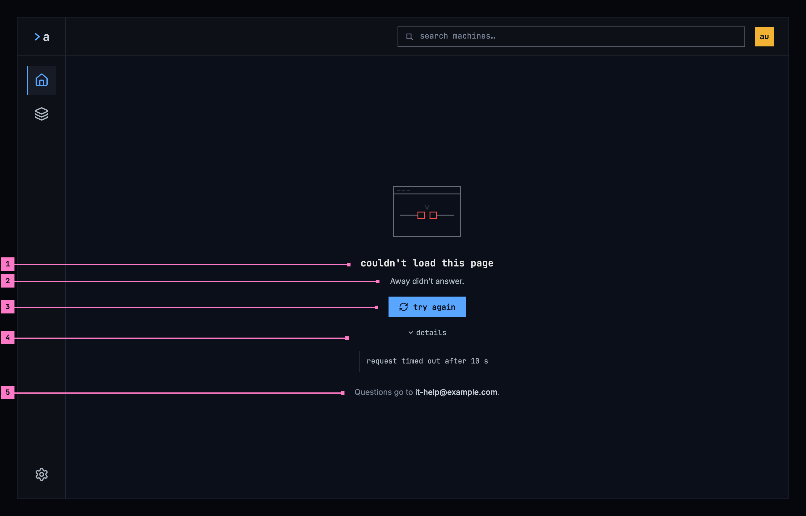
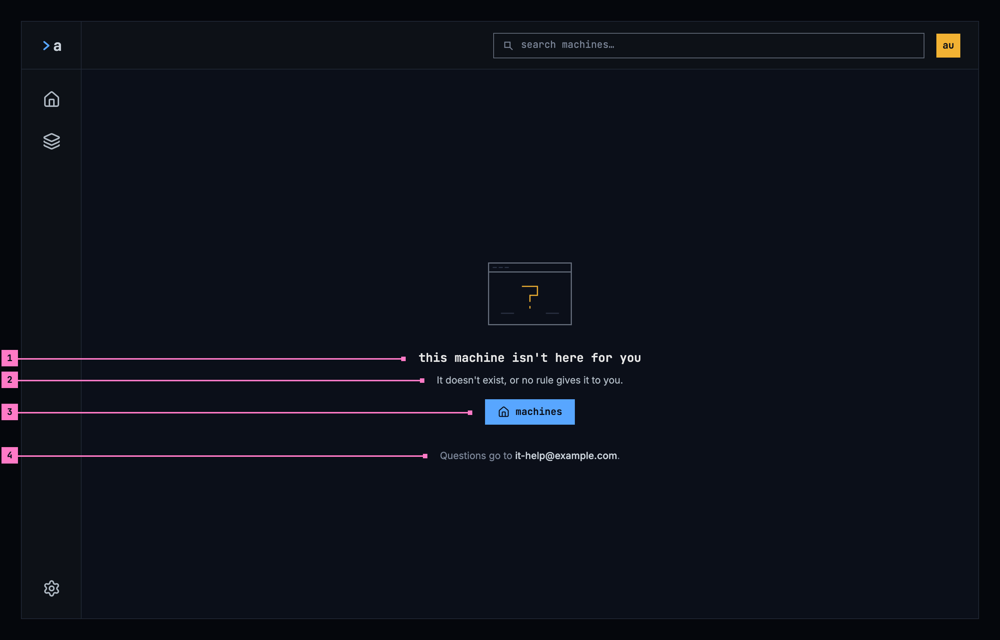
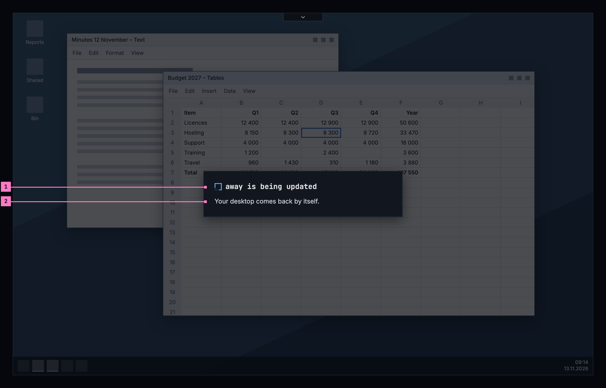
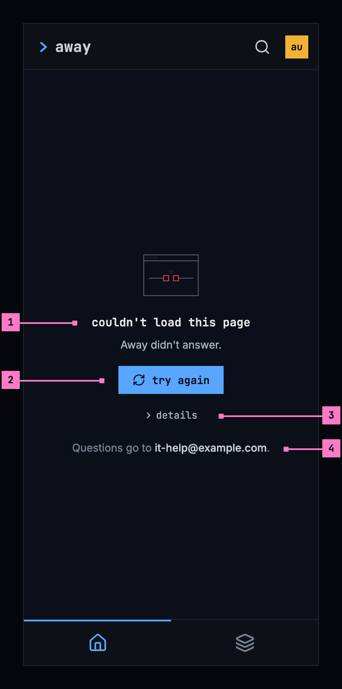

# 16 When something goes wrong

This chapter says what a page shows when it can't do its job, by cause. Each
chapter holds the failures of its own screen: a connection that fails is in
[chapter 5](./opening.md), a session that drops or ends in
[chapter 6](./desktop.md), signing in in [chapter 3](./start.md). Here is what
they share, and the pages that belong to no other chapter.

It draws what a person sees of
[Opening a machine](../capabilities/session.md#opening-a-machine) when a step
fails, the contact of
[Installing and configuring](../capabilities/platform.md#installing-and-configuring),
an update of [Running it](../capabilities/platform.md#running-it), the record
that [What happened](../capabilities/admin.md#what-happened) needs before a
machine opens, and the keyboard's part of
[The frame](../capabilities/app.md#the-frame).

## 16.1 What every failure says

**Figure 16.1** A page that couldn't load.

1. **What happened**, as the heading.
2. **Why**, in one sentence, in the reader's words.
3. **What to do**: one button.
4. **Details**: the reason as the system gave it. They are closed until
   someone opens them, and their text can be copied.
5. **Whom to turn to**, as the last line.

- Every failure says these three things: what happened, why, and what to do.
  A page never shows a code or a system's message in place of them.
- The last line is there wherever the operator named someone to turn to. It
  says “Questions go to” and what the configuration names. Where nobody is
  named, there is no such line.
- A page that fails as a whole says so in its own place, with the design
  system's empty state. The frame stays, and with it the way to every other
  view.
- A part of a page that fails gets a banner over that part, and the rest of the
  page stays as it is. Figure 15.2 of [chapter 15](./admin-status.md) has one.
- Nothing is said by colour alone. An empty state has its picture and its
  words, a failed step its cross and its words, a state its mark and its word.
- When a page turns into a failure, the focus moves to its heading, and a
  screen reader says the heading and the sentence under it. The button is the
  next stop of the Tab key.
- Try again asks once more, at once. Away doesn't go on asking by itself,
  except where a chapter says so: a dropped connection (chapter 6), and an
  update (16.5).

## 16.2 By cause

| Cause | The page says | It offers |
|---|---|---|
| Away gave no answer in time, or the network is gone | couldn't load this page: “Away didn't answer.” | try again |
| Away answered that it failed | couldn't load this page: “Away ran into a problem.” | try again |
| The sign-in ran out | nothing of its own: Away asks to sign in again ([chapter 3](./start.md)) and then shows the page that was asked for | |
| A machine that doesn't exist, or that no rule gives this person | this machine isn't here for you: “It doesn't exist, or no rule gives it to you.” | machines |
| A page that doesn't exist | this page doesn't exist: “The link may be old, or mistyped.” | home |
| A page of the administration, for someone without a role there | this page isn't for your account: “It is for administrators.” | home |
| Away is being updated, on a page | away is being updated: “It is back in a moment, and this page loads again by itself.” | |
| Away is being updated, in a session | the card of 16.5 | |
| The record of a connection can't be written | the step “Keeping a record of this connection” fails (16.6) | try again, machines |
| The browser lacks something a session needs | this browser can't show a session (16.4) | machines |

The causes are told apart by what Away answered and never by the wording of a
message. The details hold that answer.

## 16.3 A machine that isn't there

**Figure 16.2** A link to a machine that doesn't exist, or that no rule gives
this person.

1. **What happened.**
2. **Why**: both reasons in one sentence.
3. **Machines** leads home, to the machines this person has.
4. **Whom to turn to**: the person who can add them to a rule.

- A machine that doesn't exist and a machine that no rule gives look the same,
  so that a link tells nobody which machines there are.
- No view is current in the rail: the page belongs to none of them.

## 16.4 A browser that can't show a session

**Figure 16.3** A browser that can't show a session.

1. **What happened.**
2. **Why**, and which browsers can: the ones every release is tested with.
3. **Machines** leads back to Away's pages, which work in this browser.
4. **Details**: what the browser lacks, by its technical name.

- Away looks at the browser when a machine is chosen, before it opens
  anything. So no connection is made that the browser couldn't show, and no
  record of one is written.
- The page has the whole window, as a session would have had.

## 16.5 While Away is updated

**Figure 16.4** Away is being updated while a desktop is open.

1. **What is happening**, with a loader, because something is going on.
2. **What becomes of the work.**

- The card shows in every open session as the update begins, in the place
  where a dropped connection shows its card ([chapter 6](./desktop.md)). It
  has no button: there is nothing to do but wait.
- A desktop goes on at its machine meanwhile. The new version picks it up
  again as it was left, and the card goes.
- A shell can't be kept through an update in the first release. Its card says
  so: “This shell ends with the update. Open build-01 again in a moment.”
- On one of Away's own pages, the page's place says that Away is being
  updated, and the page loads again by itself.

## 16.6 When the record can't be written

**Figure 16.5** A machine that is not opened, because Away can't keep its
record of the connection.

1. **The step that failed**, with a cross, and why in a sentence.
2. **The steps after it** have not begun: Away never reached the machine.
3. **Details**: the reason as the records gave it.
4. **Machines** leads home; **try again** starts the connection anew.
5. **Whom to turn to.**

- Away writes a connection into its records before it reaches the machine.
  When it can't, it makes no connection.
- The step takes no time a person would notice, so the steps of
  [chapter 5](./opening.md) don't list it. It shows here because it failed.
- An administrator sees the same failure on the status tab
  ([chapter 15](./admin-status.md)), as the part “the records”.

## 16.7 On a phone

**Figure 16.6** A page that couldn't load, on a phone.

1. **What happened**, with why under it.
2. **Try again.**
3. **Details**, closed.
4. **Whom to turn to.**

- A failure has the same parts and the same words on a phone. The picture is
  smaller, and the sentences run to the width of the screen.

## 16.8 Words

| Where | Text |
|---|---|
| A page that couldn't load | couldn't load this page · Away didn't answer. · Away ran into a problem. · try again |
| Under any failure | details |
| The last line of a failure | Questions go to it-help@example.com. |
| A machine that isn't there | this machine isn't here for you · It doesn't exist, or no rule gives it to you. · machines |
| A page that doesn't exist | this page doesn't exist · The link may be old, or mistyped. · home |
| A page of the administration, without a role | this page isn't for your account · It is for administrators. · home |
| A browser that can't show a session | this browser can't show a session · It lacks something a session needs. A current version of Chrome, Edge, Firefox or Safari has it. · machines |
| Away is being updated, in a desktop | away is being updated · Your desktop comes back by itself. |
| Away is being updated, in a shell | away is being updated · This shell ends with the update. Open build-01 again in a moment. |
| Away is being updated, on a page | away is being updated · It is back in a moment, and this page loads again by itself. |
| The record can't be written | Keeping a record of this connection · Away can't keep its records right now, so it opens no machine. · machines · try again |

## 16.9 What the figures draw

<!-- generated: draws -->
| Figure | Draws |
|---|---|
| 16.1 A page that couldn't load | [Say whom people turn to, and show it wherever something fails](../capabilities/platform.md#installing-and-configuring) |
| 16.2 A machine that isn't there for this person | [Show a person only the machines a rule gives them](../capabilities/admin.md#who-reaches-what), [Open a machine from a link or a bookmark](../capabilities/app.md#finding-a-machine), [Say whom people turn to, and show it wherever something fails](../capabilities/platform.md#installing-and-configuring) |
| 16.3 A browser that can't show a session | — |
| 16.4 Away is being updated while a desktop is open | [Update to a new version in one step, with people told and their desktops back by themselves](../capabilities/platform.md#running-it), [Come back to a session by itself after the connection dropped](../capabilities/session.md#opening-a-machine) |
| 16.5 A machine not opened because its record can't be written | [Keep a record of every connection: who, which machine, as whom, when, from where, how it ended](../capabilities/admin.md#what-happened), [See how far a connection has come, and which step failed and why](../capabilities/session.md#opening-a-machine), [Say whom people turn to, and show it wherever something fails](../capabilities/platform.md#installing-and-configuring) |
| 16.6 A page that couldn't load, on a phone | [Find a machine and open it on a phone, with every page fitted to it](../capabilities/session.md#on-a-phone-or-a-tablet), [Say whom people turn to, and show it wherever something fails](../capabilities/platform.md#installing-and-configuring) |
<!-- end: draws -->
