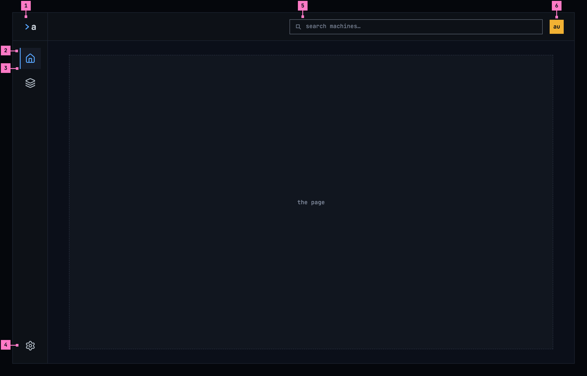
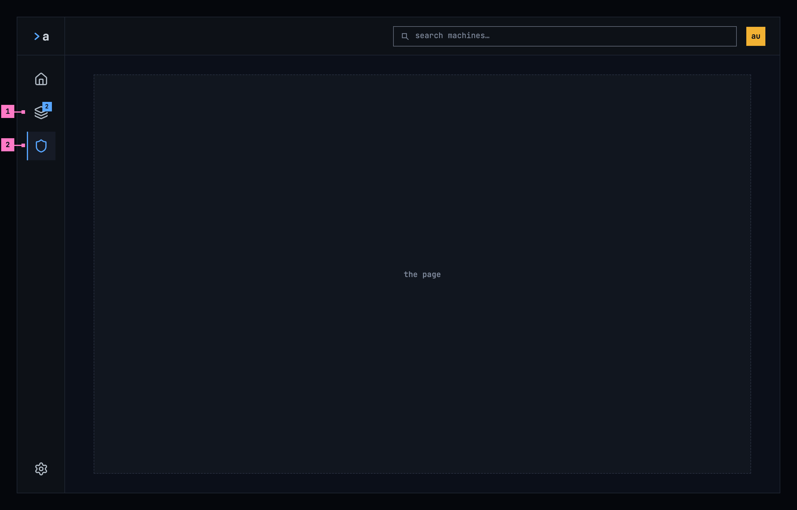
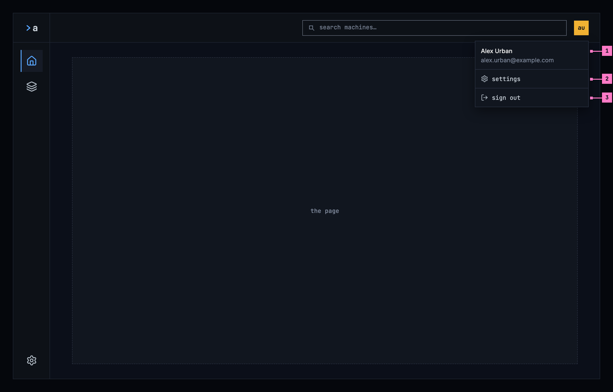
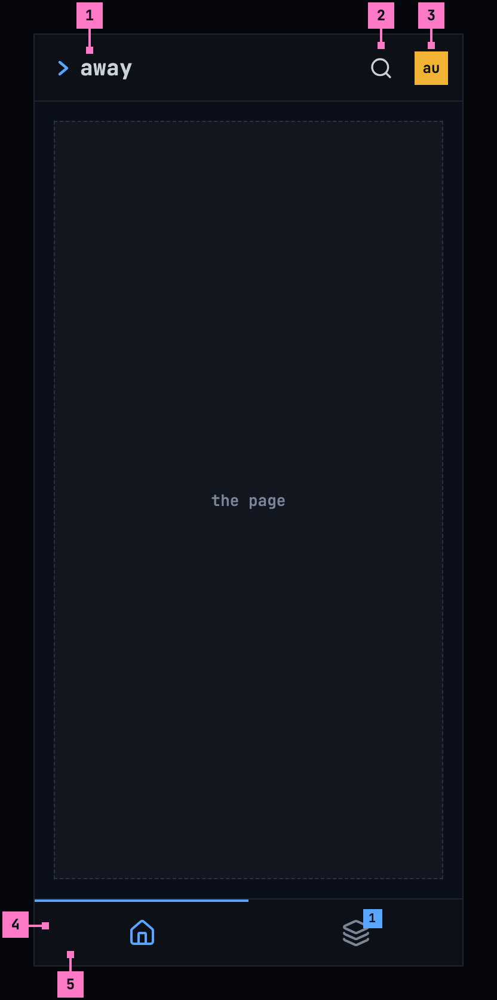
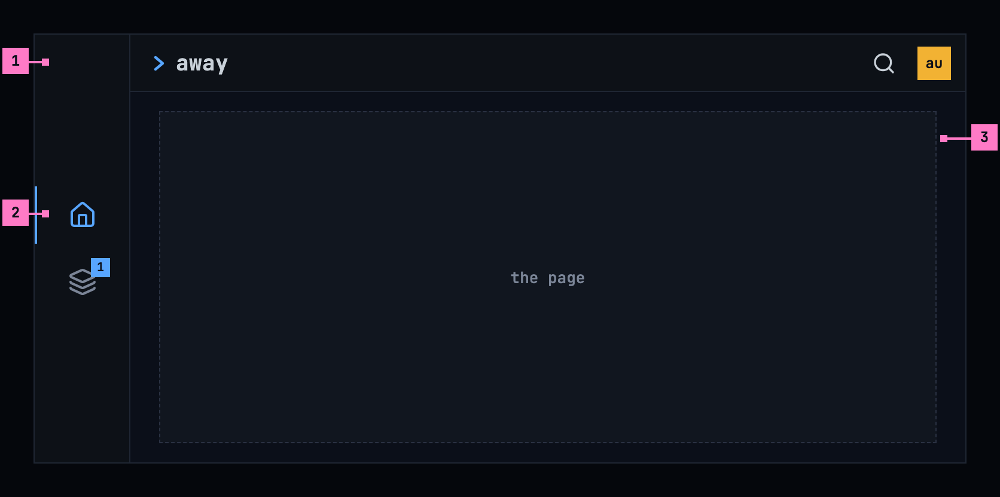

# 2 The frame

The frame is what is around every page of Away: the top bar, and the views one
moves between. It is not around a session: a machine that is open has the whole
window ([chapter 6](./desktop.md)).

It draws [The frame](../capabilities/app.md#the-frame) of the capabilities, and
follows the design system's draft for
[a product's few views](https://nalet.github.io/design-system/patterns/consumer-navigation/):
icons alone, in a rail on a wide screen and in a tab bar on a phone.

## 2.1 On a computer

**Figure 2.1** The frame on a computer.

1. **The mark**, the chevron and the letter a, over the rail and as wide as it.
   It leads home.
2. **The rail**: the views, one under the other, each its icon alone.
3. **The current view** is blue on a lighter square, with a blue bar on its left
   edge, so that it never shows by colour alone.
4. **Settings**, at the rail's foot ([chapter 11](./settings.md)).
5. **The search** finds a machine by its name, its address or its group, from
   any page ([chapter 4](./machines.md)). The `/` key puts the cursor in it.
6. **The avatar**, the initials of whoever is signed in, opens the menu of 2.3.

The views are few, and the same for everyone:

| View | Its icon | What it is |
|---|---|---|
| Home | a house | the machines one may reach ([chapter 4](./machines.md)) |
| Sessions | a stack of layers | the sessions that are open ([chapter 9](./sessions.md)) |
| Administration | a shield | only for an administrator or a reader of the records (chapters 12 to 15) |
| Settings | a gear | at the rail's foot; on a phone in the avatar's menu |

- A view's name is its link's name for a screen reader, and a tooltip under the
  pointer.
- Every view has an address of its own, so a link, a reload and the back button
  lead to it.
- The whole frame works with the keyboard alone. The Tab key goes from a link
  that skips to the page, to the mark, the search, the avatar, the rail and
  then the page.
- The first release has no notifications, so the bar has no bell.

**Figure 2.2** The rail of an administrator, with two sessions open.

1. **Sessions** carries the number of sessions that are open, and nothing when
   there are none.
2. **Administration** is in the rail of someone who has a role there, and of
   nobody else.

## 2.2 The avatar's menu

**Figure 2.3** The avatar's menu.

1. **Who is signed in**: the name and the address the identity provider gave.
2. **Settings**, here on every screen.
3. **Sign out** signs out of Away and ends the sessions Away opened
   ([chapter 3](./start.md)).

## 2.3 On a phone

**Figure 2.4** The frame on a phone held upright.

1. **The name**, which leads home.
2. **The search** opens over the page, with the keyboard.
3. **The avatar** opens the same menu, with settings in it.
4. **The tabs**: the same views as icons alone, in the same order.
5. **The current view** is blue with a blue bar on its top edge.

**Figure 2.5** The frame on a phone held sideways.

1. **The tabs become a rail** down the left edge, so the page keeps its height.
2. **The current view** has its bar on its left edge.
3. **The page.**

- Turning the phone moves the tabs and nothing else.
- Every page fits a phone: nothing needs scrolling sideways, and everything that
  is pressed is at least 48 px high.

## 2.4 Words

| Where | Text |
|---|---|
| The views' names | home · sessions · administration · settings |
| The search field | search machines… |
| The avatar's menu | settings · sign out |
| The link before the mark, for the keyboard | skip to the page |

## 2.5 What the figures draw

<!-- generated: draws -->
| Figure | Draws |
|---|---|
| 2.1 The frame on a computer | [Move between the machines, the open sessions and the settings](../capabilities/app.md#the-frame), [Find a machine by its name from any page](../capabilities/app.md#the-frame), [See which account is signed in](../capabilities/app.md#the-frame), [Use every page around a session with the keyboard alone, and with a screen reader](../capabilities/app.md#the-frame) |
| 2.2 The rail of an administrator, with two sessions open | [Move between the machines, the open sessions and the settings](../capabilities/app.md#the-frame), [See the sessions that are open, and go to one](../capabilities/app.md#the-frame), [Say who administers Away, who reads its records, and who only connects](../capabilities/admin.md#who-reaches-what) |
| 2.3 The avatar's menu | [See which account is signed in](../capabilities/app.md#the-frame), [Sign out, and end the sessions Away opened](../capabilities/app.md#signing-in) |
| 2.4 The frame on a phone held upright | [Move between the machines, the open sessions and the settings](../capabilities/app.md#the-frame), [Find a machine by its name from any page](../capabilities/app.md#the-frame), [Find a machine and open it on a phone, with every page fitted to it](../capabilities/session.md#on-a-phone-or-a-tablet) |
| 2.5 The frame on a phone held sideways | [Move between the machines, the open sessions and the settings](../capabilities/app.md#the-frame), [Find a machine and open it on a phone, with every page fitted to it](../capabilities/session.md#on-a-phone-or-a-tablet) |
<!-- end: draws -->
