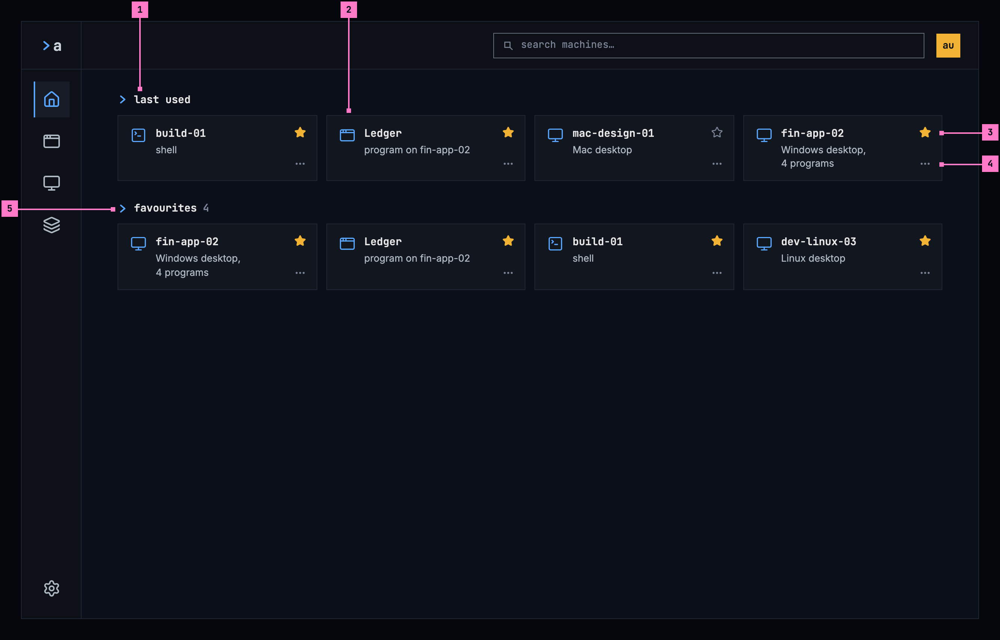
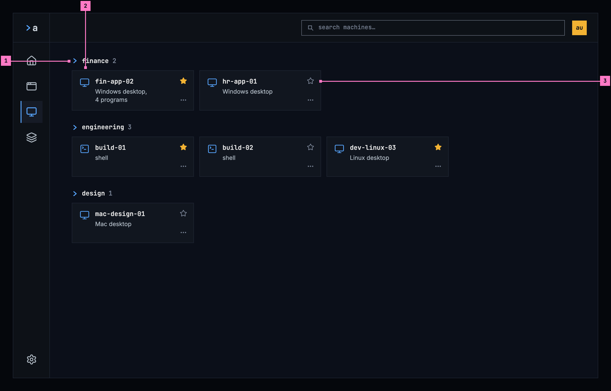
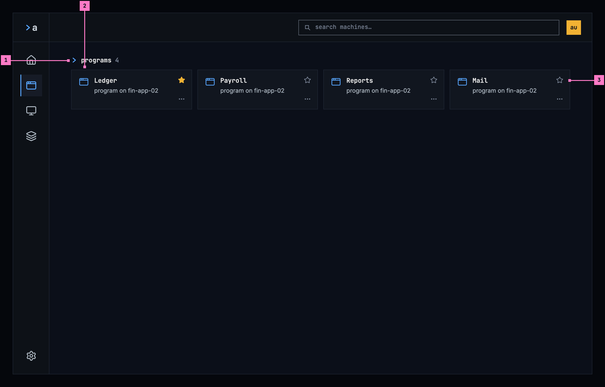
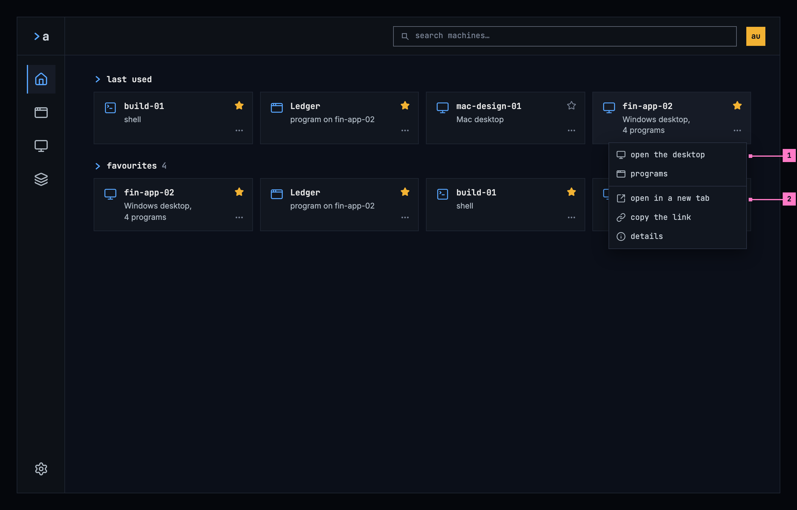
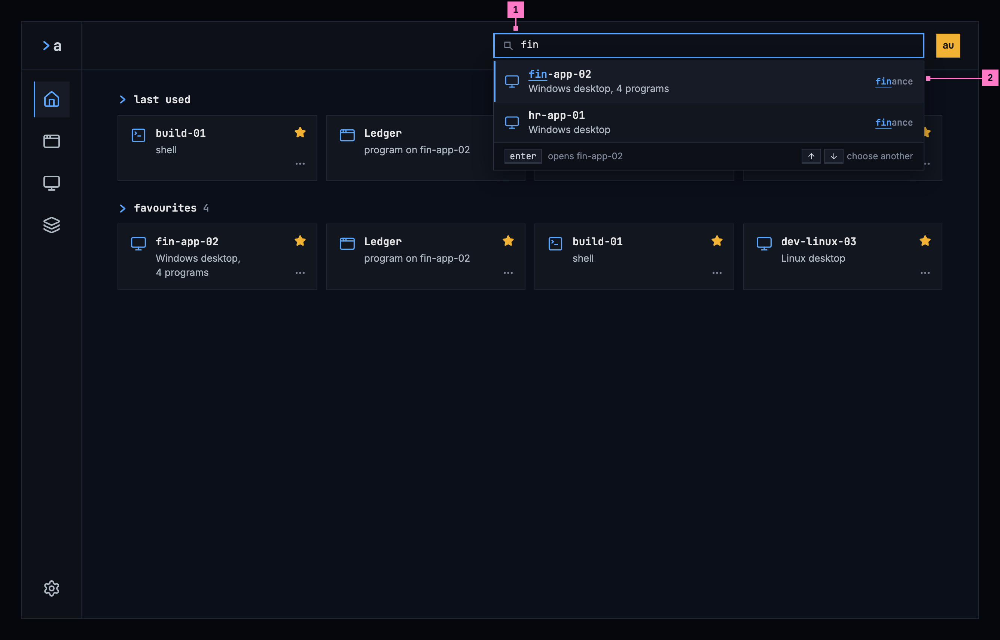
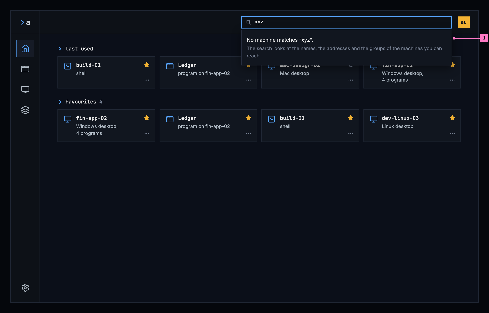
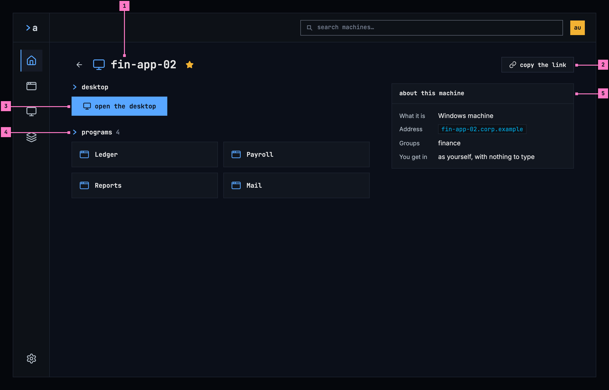
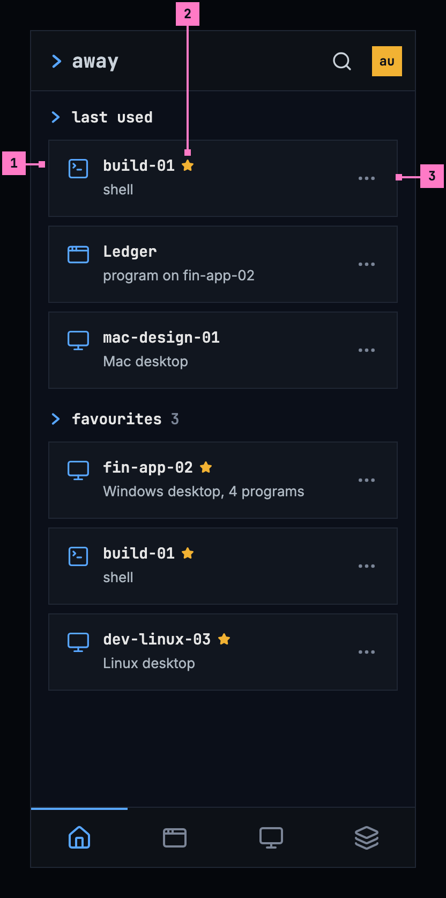
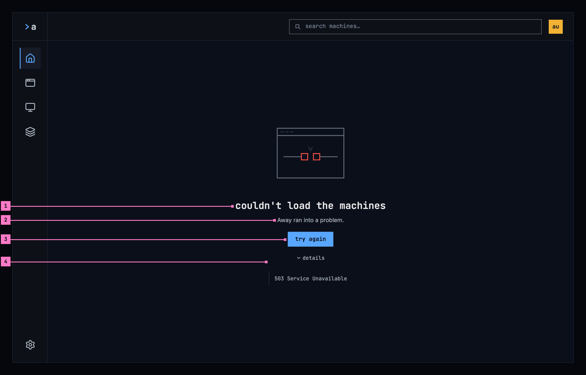

# 4 Machines

Home is what a person keeps at hand: what they opened last, and what they
starred. It is the first page after signing in, and where the mark leads. The
machines one may reach have a page of their own, and so have the programs. A
click on a machine or on a program opens it at once
([chapter 5](./opening.md)); what else a machine offers is in its menu and on
its own page. The search in the top bar finds a machine from any page.

It draws what the first release holds of
[Finding a machine](../capabilities/app.md#finding-a-machine), and the search of
[The frame](../capabilities/app.md#the-frame).

## 4.1 Home

**Figure 4.1** Home, on a computer.

1. **Last used**: what one opened last, the newest first.
2. **A tile.** Its icon says what a click opens: a screen for a desktop, a
   prompt for a shell, a window for a program. Under the name it says what the
   machine is. This one is a program, named with its machine.
3. **The star** marks a machine as a favourite, and takes the mark away again.
4. **The menu** holds the other ways in and what else can be done with the
   machine (4.4).
5. **Favourites**: the machines and the programs one starred.

- A click on a tile opens the machine in the way that is listed first for it.
  From opening Away to a session on a machine used before takes two steps.
- Last used comes first, then the favourites. A section with nothing in it
  is not shown. Someone who has opened nothing yet and starred nothing is told
  where the programs and the machines are.
- Last used is one row: the last machines and programs one opened, as many as
  fit, six at most.
- A tile says what the machine is in one of four ways: Windows desktop, Mac
  desktop, Linux desktop, shell. A machine with more ways in names them, as in
  “Windows desktop, 4 programs”.
- Favourites are kept with the account, so they are the same on every device.
  A program is starred like a machine.
- A person sees the machines a rule gives them, and no others: not here, not
  on the pages of the machines and of the programs, and not in the search.
- The Tab key goes from tile to tile, and to each tile's star and menu. Enter
  opens what has the focus.

## 4.2 The machines

**Figure 4.2** The machines, on a computer.

1. **A group**, as an administrator made it, with the number of its machines
   that one may reach.
2. **A tile.** A click opens the machine in the way that is listed first for
   it.
3. **The star** puts the machine on home.

- The groups come in the order of the administrator's files, and inside a
  group the machines keep the files' order. A machine that is in several
  groups shows in each. A machine in no group is under “other machines”.
- A machine that offers programs and neither a desktop nor a shell is here
  too: a click shows its page, with its programs.
- The page has a view of its own in the rail, and the mark of the current view
  is on it also while a machine's own page shows.

## 4.3 The programs

**Figure 4.3** The programs, on a computer.

1. **The programs** one may open, with their number.
2. **A program's tile**: its name, and the machine it runs on. A click opens
   the program in windows of its own, without the machine's desktop
   ([chapter 7](./programs.md)).
3. **The star** puts the program on home.

- Every program of every machine one may reach is here, whichever machine
  offers it, in the order of the administrator's files.
- The field at the top of the page finds a program by its name, and by its
  machine.

## 4.4 A machine's menu

**Figure 4.4** A machine's menu.

1. **The ways in**, one line for each: here the desktop and the programs. A
   machine with one way in has one line.
2. **Open in a new tab** opens the machine in a browser tab of its own. **Copy
   the link** copies the machine's address in Away. **Details** shows the
   machine's page (4.6).

- “Programs” leads to the machine's page, where its programs are.
- A machine's link opens it. Whoever follows the link and may reach the machine
  gets its session, after signing in where that is needed. Someone who may not
  reach it learns only that it is not there for them
  ([chapter 16](./errors.md)).
- A program's tile has the same menu without the ways in, and with its machine
  in place of details.

## 4.5 The search

**Figure 4.5** The search, with what it found.

1. **The search field**, in the top bar of every page. The `/` key puts the
   cursor in it.
2. **A match**: the machine, what it is, and its group, with what matched in
   blue and underlined. The first match is marked, and the line at the panel's
   foot says what the enter key opens.

**Figure 4.6** The search found nothing.

1. **What is the case**, and what the search looks at.

- The search looks at the names, the addresses and the groups of the machines
  one may reach, and shows matches while one types.
- Names that begin with what was typed come first, then names that hold it,
  then addresses, then groups.
- The arrow keys move the mark, enter opens the marked machine, and Esc closes
  the panel. A click on a match opens it too.
- The search finds machines. A program is found through its machine.
- On a phone the search icon opens the field over the page, with the keyboard
  ([chapter 2](./frame.md)).

## 4.6 A machine's page

**Figure 4.7** A machine's own page.

1. **The machine**: its icon, its name and its star. The arrow before it leads
   back to home.
2. **Copy the link**, as in the menu.
3. **Open the desktop.**
4. **The programs** the machine offers. A click opens one without the desktop
   ([chapter 7](./programs.md)).
5. **About this machine**: what it is, its address, its groups, and how one
   gets in.

- “You get in” says one of three things, as the administrator set it for the
  machine: “as yourself, with nothing to type”, “with an account Away keeps for
  this machine”, or “you type a name and a password”
  ([chapter 5](./opening.md)).
- The page shows a way in only if the machine has it: a desktop, programs, a
  shell.
- The page has an address of its own. It shows what a person may know of a
  machine; what an administrator sees of it is in
  [chapter 12](./admin-machines.md).

## 4.7 On a phone

**Figure 4.8** Home on a phone.

1. **A tile**, as wide as the screen. A tap opens the machine.
2. **A small star** beside the name marks a favourite.
3. **The menu** is the tile's one button, 48 px high. It holds the star too:
   “add to favourites” or “remove from favourites”.

- The sections and their order are the same. Last used holds the last three.
- The pages of the machines and of the programs are the same lists, a tile as
  wide as the screen.
- A machine's page has the same parts, one under the other.

## 4.8 States

**Figure 4.9** Home could not load.

1. **What happened.**
2. **Why**, in the reader's words.
3. **Try again.**
4. **Details**: the technical reason.

- While the machines load, grey blocks stand in the shape of the tiles.
- When no rule gives the account a machine, home says so
  ([chapter 3](./start.md)).
- What a page says for each reason it could not load is in
  [chapter 16](./errors.md).

## 4.9 Words

| Where | Text |
|---|---|
| The sections | last used · favourites · on the machines' page, the groups' own names · programs |
| What a machine is | Windows desktop · Mac desktop · Linux desktop · shell · Windows desktop, 4 programs · program on fin-app-02 |
| A tile's buttons, as tooltips | add to favourites · remove from favourites · more for fin-app-02 |
| A machine's menu | open the desktop · open a shell · programs · open in a new tab · copy the link · details |
| A program's menu | open · open in a new tab · copy the link · fin-app-02 |
| The search panel's foot | enter opens fin-app-02 · choose another |
| The search found nothing | No machine matches “xyz”. · The search looks at the names, the addresses and the groups of the machines you can reach. |
| A machine's page | copy the link · desktop · open the desktop · shell · open a shell · programs · about this machine |
| About this machine | What it is · Address · Groups · You get in |
| What it is, on the page | Windows machine · Mac · Linux machine |
| You get in | as yourself, with nothing to type · with an account Away keeps for this machine · you type a name and a password |
| Home could not load | couldn't load the machines · Away ran into a problem. · try again · details |

## 4.10 What the figures draw

<!-- generated: draws -->
| Figure | Draws |
|---|---|
| 4.1 Home, on a computer | [See the machines used last](../capabilities/app.md#finding-a-machine), [Mark machines and programs as favourites, and see them on home](../capabilities/app.md#finding-a-machine) |
| 4.2 The machines, on a computer | [See the machines one may reach, on a page of their own](../capabilities/app.md#finding-a-machine), [See the machines in the groups an administrator made](../capabilities/app.md#finding-a-machine), [Mark machines and programs as favourites, and see them on home](../capabilities/app.md#finding-a-machine) |
| 4.3 The programs, on a computer | [See every program one may open on a page of their own, each as an entry, and find it by its name](../capabilities/app.md#finding-a-machine), [Mark machines and programs as favourites, and see them on home](../capabilities/app.md#finding-a-machine) |
| 4.4 A machine's menu | [Choose how to open a machine that offers more than one way: its desktop, its programs, its shell](../capabilities/app.md#finding-a-machine), [Open a session in a browser tab or window of its own](../capabilities/session.md#opening-a-machine), [Open a machine from a link or a bookmark](../capabilities/app.md#finding-a-machine), [See what a machine is: its kind, its address, how one gets in](../capabilities/app.md#finding-a-machine) |
| 4.5 The search, with what it found | [Find a machine by its name, its address or its group](../capabilities/app.md#finding-a-machine), [Find a machine by its name from any page](../capabilities/app.md#the-frame) |
| 4.6 The search found nothing | [Find a machine by its name, its address or its group](../capabilities/app.md#finding-a-machine) |
| 4.7 A machine's own page | [See what a machine is: its kind, its address, how one gets in](../capabilities/app.md#finding-a-machine), [See the programs a Windows machine offers, and open one](../capabilities/app.md#finding-a-machine), [Choose how to open a machine that offers more than one way: its desktop, its programs, its shell](../capabilities/app.md#finding-a-machine), [Open a machine from a link or a bookmark](../capabilities/app.md#finding-a-machine), [Mark machines and programs as favourites, and see them on home](../capabilities/app.md#finding-a-machine) |
| 4.8 Home on a phone | [Find a machine and open it on a phone, with every page fitted to it](../capabilities/session.md#on-a-phone-or-a-tablet), [See the machines used last](../capabilities/app.md#finding-a-machine), [Mark machines and programs as favourites, and see them on home](../capabilities/app.md#finding-a-machine) |
| 4.9 Home could not load | [See the machines one may reach, on a page of their own](../capabilities/app.md#finding-a-machine) |
<!-- end: draws -->
