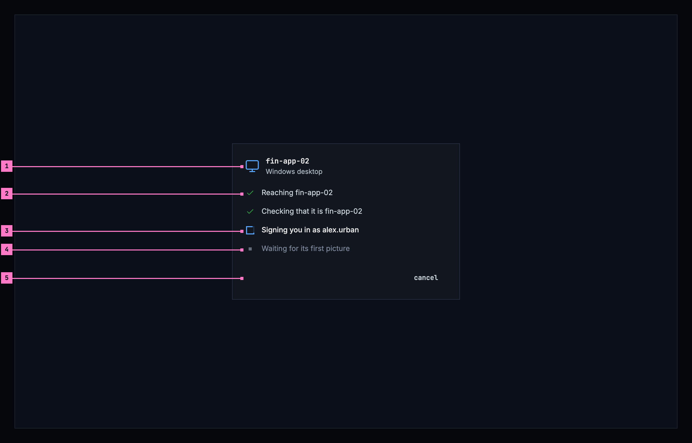
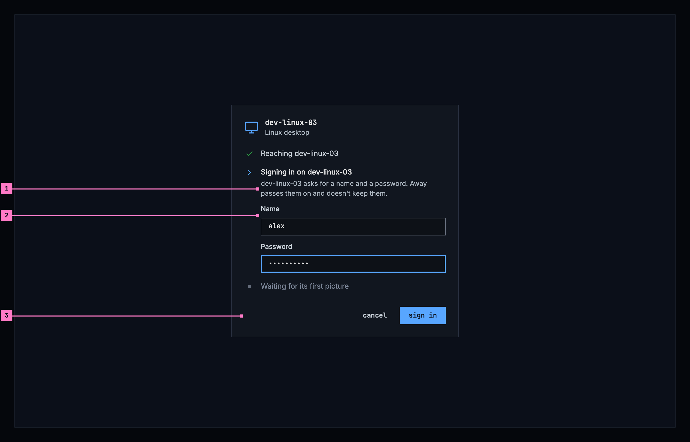
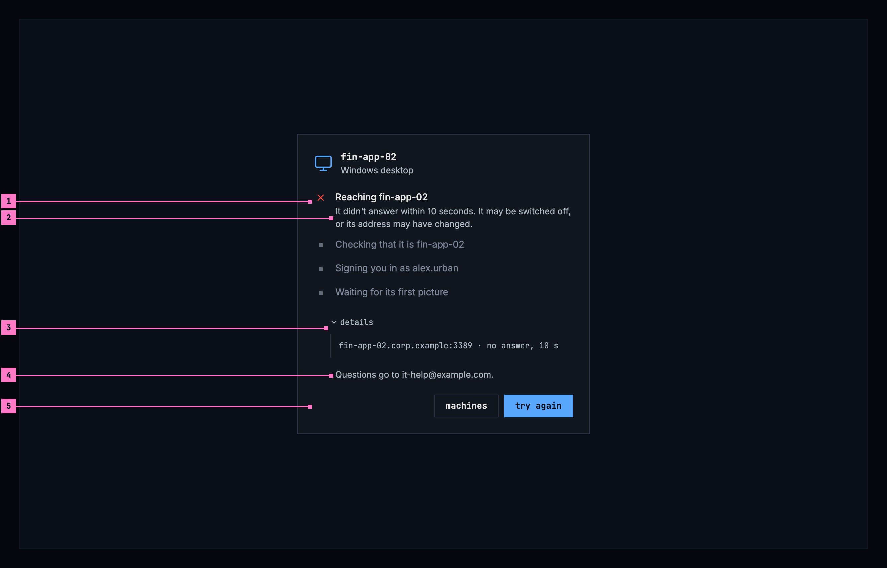
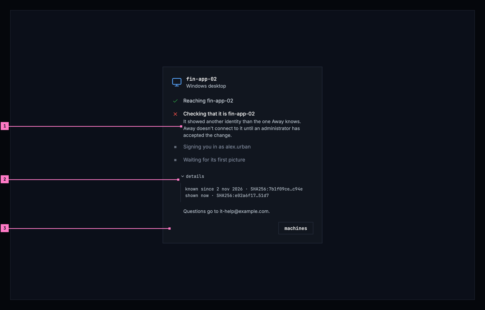
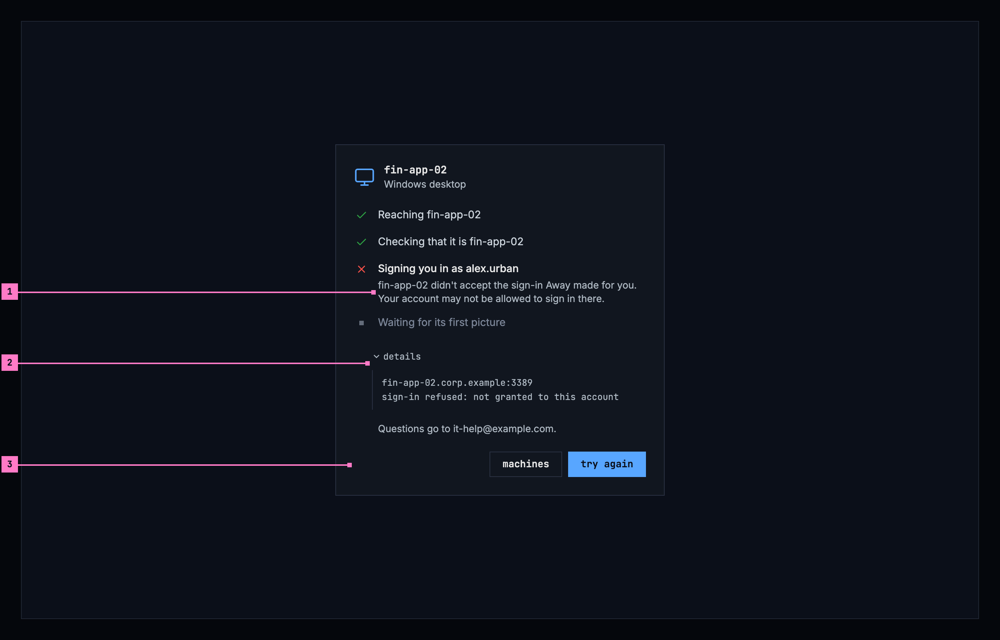
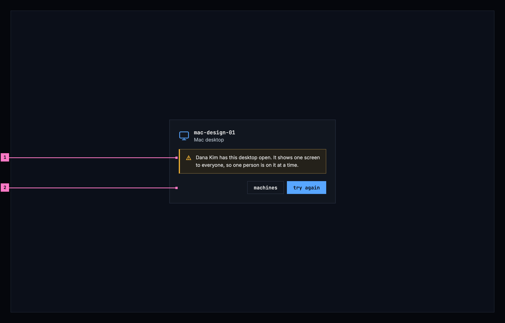
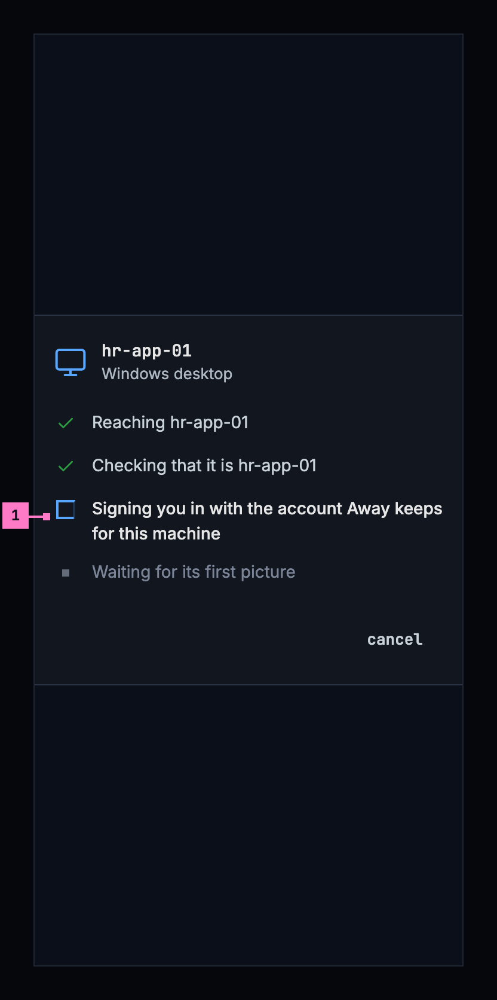

# 5 Opening a machine

Opening a machine is a connection in a few steps: Away reaches the machine,
checks that it is the one it knows, signs the person in, and waits for the
first picture. This chapter covers what shows meanwhile, what a machine that
wants a name and a password asks for, and what a step that fails says. It ends
where the session begins: a desktop ([chapter 6](./desktop.md)), a program
([chapter 7](./programs.md)) or a shell ([chapter 8](./shell.md)).

It draws what the first release holds of
[Opening a machine](../capabilities/session.md#opening-a-machine) before the
first picture, and of [Signing in](../capabilities/app.md#signing-in) on the
machine.

## 5.1 The steps

**Figure 5.1** The steps of a connection, the third one running.

1. **The machine** that is being opened, and what of it: its desktop, a
   program or its shell.
2. **A step that is done** has a green check.
3. **The step that is running** has the loader, and stands in stronger type.
   The third step names the account one will be on the machine.
4. **A step that is to come** is quieter.
5. **Cancel** gives up and shows the page one came from.

- A machine opens in the window where it was chosen, or in a tab of its own
  when it was opened that way. The steps show there from the first moment, so a
  connection that is quick passes through them in a moment.
- The second step is there for a machine that can show who it is: a Windows
  machine, and a shell. A desktop that has no way to show it has three steps.
- With the first picture the card goes, and the session has the window.
- A desktop that was left running is picked up the same way. The steps are the
  same, and the first picture is the desktop as it was left.

The steps, in their order:

| Step | What Away does |
|---|---|
| Reaching fin-app-02 | finds the machine at its address and connects to it |
| Checking that it is fin-app-02 | compares what the machine shows of itself with what Away knows of it |
| Signing you in as alex.urban | signs the person in on the machine (5.2) |
| Waiting for its first picture | waits until the machine shows something; for a shell the step reads “Starting the shell” |

## 5.2 Getting in on the machine

How the third step goes is set for each machine by an administrator
([chapter 12](./admin-machines.md)), and a machine's page says which it is
([chapter 4](./machines.md)).

| The machine signs people in | The third step | What is asked |
|---|---|---|
| as themselves | Signing you in as alex.urban | nothing |
| with an account Away keeps for it | Signing you in with the account Away keeps for this machine | nothing |
| by what they type | Signing in on dev-linux-03 | a name and a password, or a password alone, as the machine asks |

**Figure 5.2** A machine that asks for a name and a password.

1. **Who asks, and what becomes of the answer.**
2. **The name and the password**, as the machine wants them.
3. **Sign in** passes them to the machine. **Cancel** gives up.

- Away passes on what is typed and doesn't keep it. The next time, the machine
  asks again.
- A name and a password the machine doesn't accept leave the fields where they
  are, with the name still in its field and the reason over them:
  “dev-linux-03 didn't accept that name and password.”
- An account that Away keeps for a machine is never shown, and its password
  never reaches the browser. In the session, the bar names the account after
  “as” ([chapter 6](./desktop.md)).

## 5.3 When a step fails

A connection that fails says which step failed, why, in the reader's words, and
what can be done. The technical reason is under details, for whoever is asked
for help.

**Figure 5.3** The machine could not be reached.

1. **The step that failed** has a red cross, and the steps after it stay to
   come.
2. **Why**, and what may be behind it.
3. **Details**: the technical reason.
4. **Whom to turn to**, where the operator named someone.
5. **Machines** leads home. **Try again** starts the connection again.

**Figure 5.4** The machine is not the one Away knows.

1. **Why Away doesn't connect**, and who can change that.
2. **Details**: what Away knows of the machine, and what the machine showed.
3. **Machines** is the one way on. Trying again would end the same way.

**Figure 5.5** The machine did not accept the sign-in.

1. **Why**, and what may be behind it.
2. **Details.**
3. **Machines**, and **try again**.

What each step says when it fails:

| Step | What happened | It says | It offers |
|---|---|---|---|
| Reaching | no answer in time | It didn't answer within 10 seconds. It may be switched off, or its address may have changed. | try again, machines |
| Reaching | its name leads to no address | Its name, fin-app-02.corp.example, leads to no address. | try again, machines |
| Reaching | it refused the connection | It refused the connection. Remote access may be switched off there. | try again, machines |
| Checking | it shows another identity than the known one | It showed another identity than the one Away knows. Away doesn't connect to it until an administrator has accepted the change. | machines |
| Checking | nothing vouches for what it shows | It couldn't show that it is fin-app-02. Away doesn't connect to a machine it can't tell from another. | machines |
| Signing in | it refused the sign-in Away made for the person | fin-app-02 didn't accept the sign-in Away made for you. Your account may not be allowed to sign in there. | try again, machines |
| Signing in | it refused the account Away keeps | hr-app-01 didn't accept the account Away keeps for it. An administrator has to set it right. | machines |
| Signing in | Away could not make the sign-in | Away can't sign people in on machines right now. | try again, machines |
| First picture | none in time | It took the sign-in and showed nothing within 30 seconds. | try again, machines |

- The times come from what the operator set, and the names from the machine.
- A failure that trying again can't change offers only the way back.
- Other reasons a machine doesn't open, such as a right that is gone or a
  browser that can't show a session, are in [chapter 16](./errors.md).

## 5.4 A desktop someone else is on

**Figure 5.6** A desktop that someone else is on.

1. **Who is on it, and why that keeps one out.** No step has begun.
2. **Machines**, and **try again** for when they have left.

- Some desktops can't hold two people apart. A desktop that shows one screen to
  everyone would let the second look at the first one's work. A machine that
  signs several people in with one kept account would hand the first one's
  desktop to the second. Away opens such a desktop for one person at a time.
- A machine that signs people in as themselves gives each a desktop of their
  own, and opens for both.
- Away knows the sessions it opened itself. Someone who sits at the machine, or
  reached it another way, doesn't show here.
- The first release doesn't offer to take the desktop over. An administrator can
  end the other session ([chapter 14](./admin-records.md)).

| The desktop | It says |
|---|---|
| shows one screen to everyone | Dana Kim has this desktop open. It shows one screen to everyone, so one person is on it at a time. |
| is reached with one kept account | Dana Kim is on hr-app-01 with the account Away keeps for it. Opening it would take the desktop from them, so one person is on it at a time. |

## 5.5 On a phone

**Figure 5.7** The steps on a phone, for a machine with an account that Away
keeps.

1. **The third step** says that the account is one Away keeps, and asks
   nothing.

- The card is as wide as the screen, and its parts are the same.

## 5.6 Words

| Where | Text |
|---|---|
| The steps | Reaching fin-app-02 · Checking that it is fin-app-02 · Signing you in as alex.urban · Waiting for its first picture |
| The third step, by how the machine signs people in | Signing you in as alex.urban · Signing you in with the account Away keeps for this machine · Signing in on dev-linux-03 |
| The last step of a shell | Starting the shell |
| What is opened, under the machine's name | Windows desktop · Mac desktop · Linux desktop · shell · the program's name |
| A machine that asks | dev-linux-03 asks for a name and a password. Away passes them on and doesn't keep them. · Name · Password · sign in |
| A name and a password it didn't accept | dev-linux-03 didn't accept that name and password. |
| A step that failed | the sentences of the table in 5.3 · details · machines · try again |
| A desktop someone else is on | the sentences of the table in 5.4 · machines · try again |
| Whom to turn to | Questions go to it-help@example.com. |
| The button under the steps | cancel |

## 5.7 What the figures draw

<!-- generated: draws -->
| Figure | Draws |
|---|---|
| 5.1 The steps of a connection, the third one running | [See how far a connection has come, and which step failed and why](../capabilities/session.md#opening-a-machine), [Be signed in on the machine as oneself, with nothing asked](../capabilities/app.md#signing-in), [Check that a machine is the one it claims to be, and refuse one that changed](../capabilities/app.md#signing-in) |
| 5.2 A machine that asks for a name and a password | [Type a name and a password when the machine asks for them](../capabilities/app.md#signing-in), [See how far a connection has come, and which step failed and why](../capabilities/session.md#opening-a-machine) |
| 5.3 The machine could not be reached | [See how far a connection has come, and which step failed and why](../capabilities/session.md#opening-a-machine), [Say whom people turn to, and show it wherever something fails](../capabilities/platform.md#installing-and-configuring) |
| 5.4 The machine is not the one Away knows | [Check that a machine is the one it claims to be, and refuse one that changed](../capabilities/app.md#signing-in), [See how far a connection has come, and which step failed and why](../capabilities/session.md#opening-a-machine), [Say whom people turn to, and show it wherever something fails](../capabilities/platform.md#installing-and-configuring) |
| 5.5 The machine did not accept the sign-in | [See how far a connection has come, and which step failed and why](../capabilities/session.md#opening-a-machine), [Be signed in on the machine as oneself, with nothing asked](../capabilities/app.md#signing-in), [Say whom people turn to, and show it wherever something fails](../capabilities/platform.md#installing-and-configuring) |
| 5.6 A desktop that someone else is on | [See that a desktop is in use by someone else, where opening it would take it from them or show their screen](../capabilities/session.md#opening-a-machine) |
| 5.7 The steps on a phone, for a machine with an account that Away keeps | [See how far a connection has come, and which step failed and why](../capabilities/session.md#opening-a-machine), [Be signed in with a name and password or a key that Away keeps for the machine](../capabilities/app.md#signing-in), [Find a machine and open it on a phone, with every page fitted to it](../capabilities/session.md#on-a-phone-or-a-tablet) |
<!-- end: draws -->
