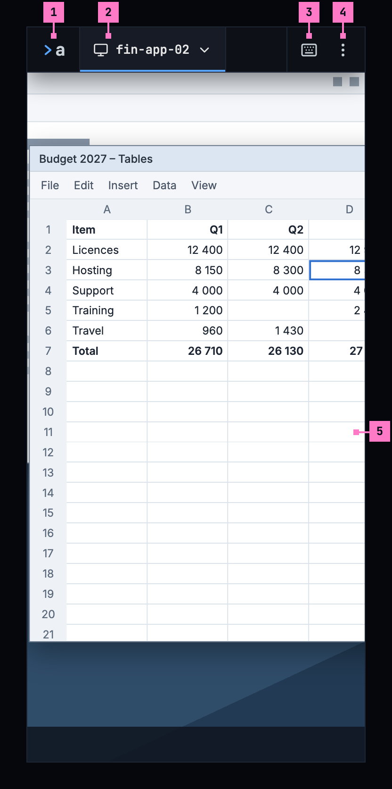
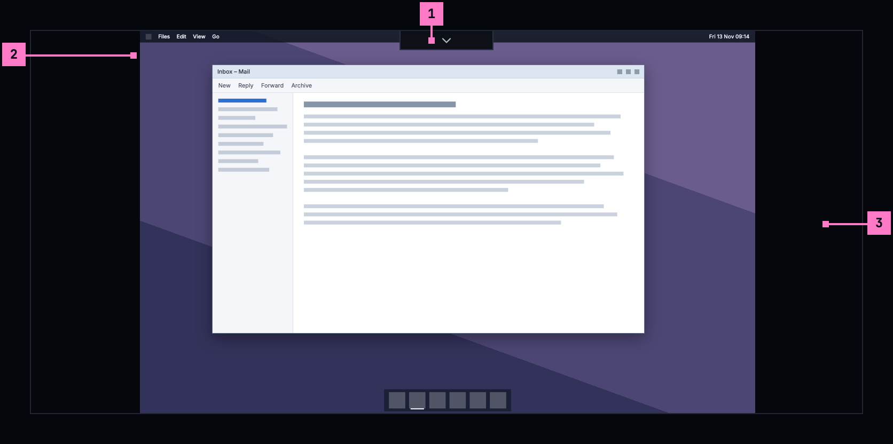
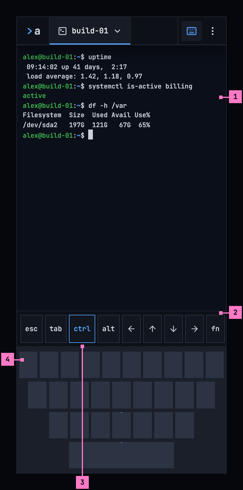
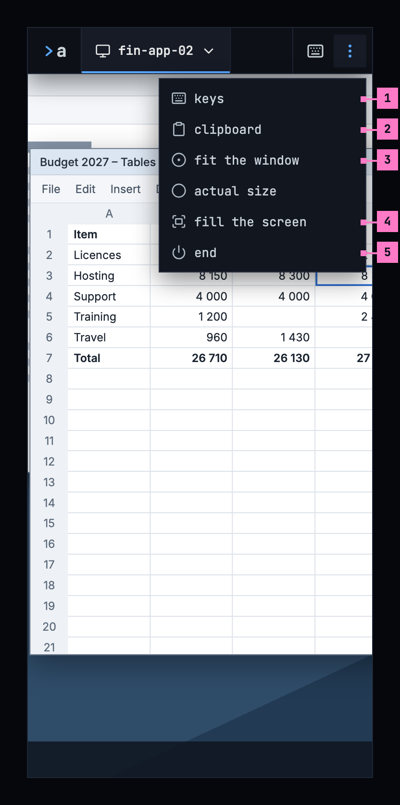
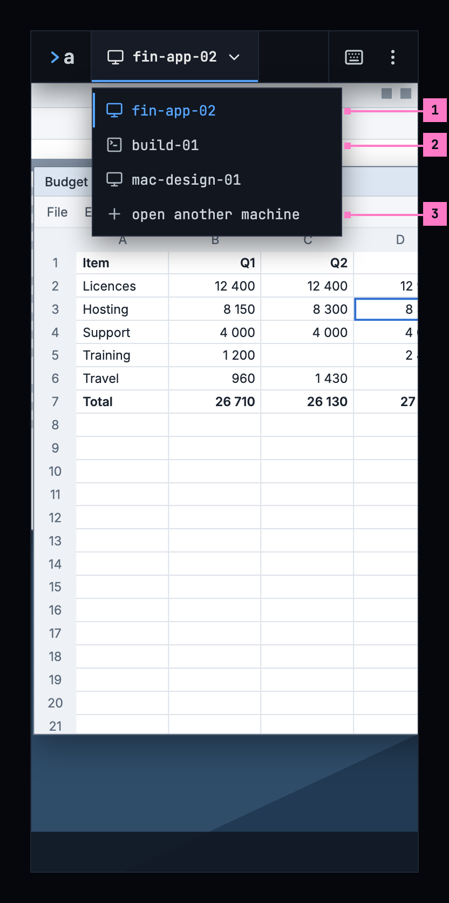

# 10 On a phone

A phone has a small screen, and neither a keyboard nor a mouse. This chapter
covers a session on a phone: its bar, which is shorter, a desktop worked by
touch, the keys a phone's keyboard lacks, and the two menus that hold what the
bar has no room for. A tablet without a keyboard works the same way.

A session opens on a phone as it does on a computer, from
[home](./machines.md) through the steps of [chapter 5](./opening.md). Away's
own pages on a phone are drawn in their chapters: the frame in
[chapter 2](./frame.md), home in [chapter 4](./machines.md), the sessions in
[chapter 9](./sessions.md) and the settings in [chapter 11](./settings.md). A
machine's programs on a phone are in [chapter 7](./programs.md).

It draws what the first release holds of
[On a phone or a tablet](../capabilities/session.md#on-a-phone-or-a-tablet),
with the parts of [The picture](../capabilities/session.md#the-picture) and of
[The frame](../capabilities/app.md#the-frame) that a phone changes.

## 10.1 A desktop on a phone

**Figure 10.1** A desktop on a phone, zoomed in, with the session's bar open.

1. **The mark** leads to Away's pages, and the session goes on.
2. **The session's name**, with its kind's icon, opens the list of the open
   sessions (10.5).
3. **Keyboard** shows and hides the phone's keyboard, with the keys it lacks
   (10.3).
4. **More** holds the rest of what a computer's bar has (10.4).
5. **The machine's screen**, here zoomed in on a part of it.

- The bar is the bar of [chapter 6](./desktop.md), in the room a phone has. It
  opens with a tap on the handle and closes with a tap on the machine's screen.
- A session has the whole screen of the phone's browser, as on a computer.
- The phone's keyboard doesn't come by itself: Away can't see where the machine
  expects text. The keyboard button brings it.

Touch works the machine's pointer:

| On the phone | On the machine |
|---|---|
| A tap | a click, where the finger is |
| A double tap | a double click |
| A hold | a click with the other mouse button |
| A hold, then a move | a drag |
| Two fingers moved together | scrolling, up, down and sideways |
| A pinch | nothing: it zooms the picture in and out, and the picture moves with the pinch |

- The picture zooms from the whole screen in view up to four times that. Zooming
  changes what one sees, and nothing at the machine.
- While zoomed in, the picture moves on by itself when a drag nears its edge.

## 10.2 Held sideways

**Figure 10.2** A desktop on a phone held sideways, the bar closed.

1. **The handle**, all that Away shows while the bar is closed.
2. **The machine's screen**, whole.
3. **What the phone's screen has left over** stays empty.

- A Windows machine's screen takes the phone's shape, and the new one when the
  phone is turned, so nothing is left over.
- Any other desktop keeps the shape its machine gives it and is scaled to fit,
  as the figure shows.

## 10.3 The keys a phone lacks

**Figure 10.3** A shell on a phone, with the keyboard up.

1. **The shell**, in the room the keyboard leaves. It has fewer rows now, and a
   program in it is told so.
2. **The keys a phone's keyboard lacks**, in a row over it: Esc, Tab, Ctrl, Alt
   and the four arrows.
3. **A key that is held.** A tap on Ctrl or Alt holds it for the next key, then
   lets it go. A second tap lets it go at once.
4. **The phone's own keyboard**, as the phone draws it.

- Fn, the row's last key, changes the row to a further one: F1 to F12, Home,
  End, Page up and Page down. A second tap brings the first row back.
- The row is there for a desktop too. A desktop keeps its size when the
  keyboard comes up, and the view moves so that the pointer stays in sight.
- Every key of the row is 48 px high.

## 10.4 More

**Figure 10.4** More, for a desktop.

1. **Keys** lists the key combinations a browser keeps for itself
   ([chapter 6](./desktop.md), figure 6.3).
2. **Clipboard** opens the clipboard panel of chapter 6, over the foot of the
   screen.
3. **The picture's size**: fit the window or actual size, with the one in use
   marked.
4. **Fill the screen** is in the menu where the phone's browser can do it.
5. **End** ends the session. A desktop goes on running at its machine, as in
   chapter 6.

- For a shell, the menu has text and find where a desktop has the picture's
  size ([chapter 8](./shell.md)).

## 10.5 The open sessions

**Figure 10.5** The open sessions, under the session's name.

1. **The session one is in**, in blue with a bar on its edge.
2. **Another open session.** A tap goes to it.
3. **Open another machine** shows home, to choose one.

- The list is the one a computer's bar shows as tabs: the sessions open in this
  browser window, the one used last first.

## 10.6 Words

| Where | Text |
|---|---|
| The bar's buttons, as names for a screen reader | keyboard · more |
| The session's name, for a screen reader | the open sessions |
| The keys a phone lacks | esc · tab · ctrl · alt · the four arrows · fn |
| The further row | f1 to f12 · home · end · pg up · pg dn |
| More, for a desktop | keys · clipboard · fit the window · actual size · fill the screen · end |
| More, for a shell | keys · clipboard · text · find · fill the screen · end |
| The list of the open sessions | the machines' names · open another machine |

## 10.7 What the figures draw

<!-- generated: draws -->
| Figure | Draws |
|---|---|
| 10.1 A desktop on a phone, zoomed in, with the session's bar open | [Find a machine and open it on a phone, with every page fitted to it](../capabilities/session.md#on-a-phone-or-a-tablet), [Zoom into the picture with two fingers and move around it](../capabilities/session.md#on-a-phone-or-a-tablet), [Reach a session's own controls without leaving it: keys, clipboard, files, size, ending it](../capabilities/app.md#the-frame), [Give the machine the whole window while a session is open](../capabilities/app.md#the-frame) |
| 10.2 A desktop on a phone held sideways, the bar closed | [Fit the machine's screen to the window, and follow when its size changes](../capabilities/session.md#the-picture), [Give the machine the whole window while a session is open](../capabilities/app.md#the-frame) |
| 10.3 A shell on a phone, with the keyboard up | [Use the keys a phone's keyboard lacks: Ctrl, Alt, Esc, Tab, the arrows, the function keys](../capabilities/session.md#on-a-phone-or-a-tablet), [Open a shell on a machine](../capabilities/session.md#opening-a-machine) |
| 10.4 More, for a desktop | [Reach a session's own controls without leaving it: keys, clipboard, files, size, ending it](../capabilities/app.md#the-frame), [Fit the machine's screen to the window, and follow when its size changes](../capabilities/session.md#the-picture), [Fill the whole screen with a session](../capabilities/session.md#the-picture) |
| 10.5 The open sessions, under the session's name | [See the sessions that are open, and go to one](../capabilities/app.md#the-frame), [Keep several machines open at once and move between them](../capabilities/session.md#opening-a-machine) |
<!-- end: draws -->
