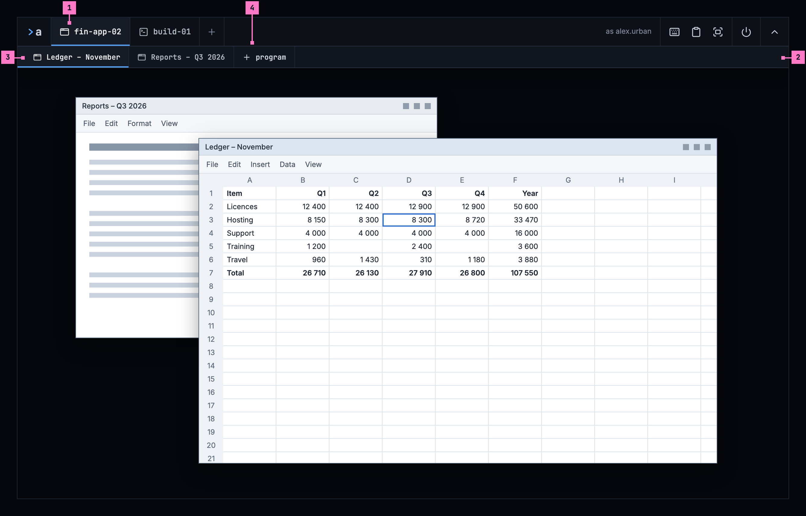

# 7 Programs

A Windows machine can offer single programs, without its desktop. A program
opens in a session, as a desktop does, and the session shows nothing of the
machine but the program's windows. This chapter covers those windows, and how
one moves between the programs that are open on a machine.

People get here from [home](./machines.md), where a machine's page lists the
programs it offers, through the steps of [chapter 5](./opening.md). Which
programs a machine offers is an administrator's choice
([chapter 12](./admin-machines.md)).

It draws what the first release holds of
[Opening a machine](../capabilities/session.md#opening-a-machine) for programs,
with [Finding a machine](../capabilities/app.md#finding-a-machine) and
[The frame](../capabilities/app.md#the-frame) where a program is chosen and
switched to.

## 7.1 A program's windows

**Figure 7.1** Two programs of one machine, on a computer.

1. **A program's window**, as the machine draws it: its title, its buttons and
   its menus are the program's own. The window in front has the keys.
2. **The ground** is Away's. Nothing of the machine's desktop shows.

- One sign-in on the machine holds every program opened there. A second program
  of the same machine opens in the session that is already open, with nothing
  asked again.
- A window is moved, sized, made small and closed inside the area as at the
  machine, with its own title and buttons. It can't be moved out of the area,
  which is as large as the browser window.
- A click on a window brings it to the front. A dialog of a program stays over
  the window it belongs to.
- A program with several windows has each of them here.
- The session has the whole browser window, with the handle of
  [chapter 6](./desktop.md) at its top edge, and the browser tab is named after
  the machine.

## 7.2 Switching between programs

**Figure 7.2** The bar of a session with programs, and the strip of its
windows.

1. **The session's tab** is the machine, not a program: every program of
   fin-app-02 is in this one session.
2. **The strip** lists the machine's open windows, in the order they opened.
   It shows with the bar and closes with it.
3. **The window in front** stands on a lighter ground with a blue bar under it,
   as the current session does in the bar. A click on another chip brings that
   window to the front, also one that was made small.
4. **Open a program** lists the programs the machine offers (figure 7.3).

- The bar is the bar of [chapter 6](./desktop.md): the mark, the open sessions,
  who one is on the machine, keys, clipboard, fill the screen, end, and close
  the bar. It has no picture button: a program's windows have their own sizes.
- Alt + Tab, in the keys menu, moves between the windows as at the machine.
- A chip carries the window's title as the program sets it, and follows when
  the title changes.

**Figure 7.3** The programs the machine offers.

1. **The programs**, by name, in the order of the alphabet. A click opens one in
   this session, and its window comes to the front. A program that is already
   open gets a further window, where the program allows more than one.

- The list is the one a machine's page shows on [home](./machines.md). A person
  sees the programs a rule gives them, and no others.

## 7.3 Ending

- Ending is as for a desktop ([chapter 6](./desktop.md), figure 6.7). Leave it
  running ends the connection, and the programs stay open at the machine, to be
  there again the next time one of them is opened. Sign out of the machine
  closes them.
- Closing a program's last window closes the program. When no window is left,
  the session ends by itself, and the page one came from says so in one line.
- A session with programs is one session in the list of
  [chapter 9](./sessions.md), under the machine's name, with its programs named.

## 7.4 States

| State | What shows |
|---|---|
| A program is starting | its chip is in the strip at once, with a loader in place of the icon, until its first window is there |
| The last window was closed | the session ends, and the page one came from shows, for a few seconds: “The last program on fin-app-02 was closed, so its session ended.” |
| The machine can't start a program | the windows stay as they are, and a line over them says which one: “fin-app-02 couldn't start Payroll.” |
| The connection drops, the session ends | as for a desktop, in the words of [chapter 6](./desktop.md), with “Your programs are still running on fin-app-02.” |

## 7.5 Words

| Where | Text |
|---|---|
| The bar's buttons, as tooltips | keys · clipboard · fill the screen · end · close the bar |
| A chip of the strip | the window's title, as the program sets it |
| The strip's last chip | program, after a plus; its name for a screen reader: open a program |
| The menu of programs | the programs' names, as the machine gives them |
| The last window was closed | The last program on fin-app-02 was closed, so its session ended. |
| A program didn't start | fin-app-02 couldn't start Payroll. |
| The connection dropped | connection lost · Trying again, for the third time. Your programs are still running on fin-app-02. · leave · try now |

## 7.6 What the figures draw

<!-- generated: draws -->
| Figure | Draws |
|---|---|
| 7.1 Two programs of one machine, on a computer | [Open one program of a Windows machine, without its desktop](../capabilities/session.md#opening-a-machine), [Switch between the programs open on a machine, each in a window of its own](../capabilities/session.md#opening-a-machine), [Give the machine the whole window while a session is open](../capabilities/app.md#the-frame) |
| 7.2 The bar of a session with programs, and the strip of its windows | [Switch between the programs open on a machine, each in a window of its own](../capabilities/session.md#opening-a-machine), [Reach a session's own controls without leaving it: keys, clipboard, files, size, ending it](../capabilities/app.md#the-frame), [Keep several machines open at once and move between them](../capabilities/session.md#opening-a-machine) |
| 7.3 The programs the machine offers | [See the programs a Windows machine offers, and open one](../capabilities/app.md#finding-a-machine), [Open one program of a Windows machine, without its desktop](../capabilities/session.md#opening-a-machine) |
<!-- end: draws -->
