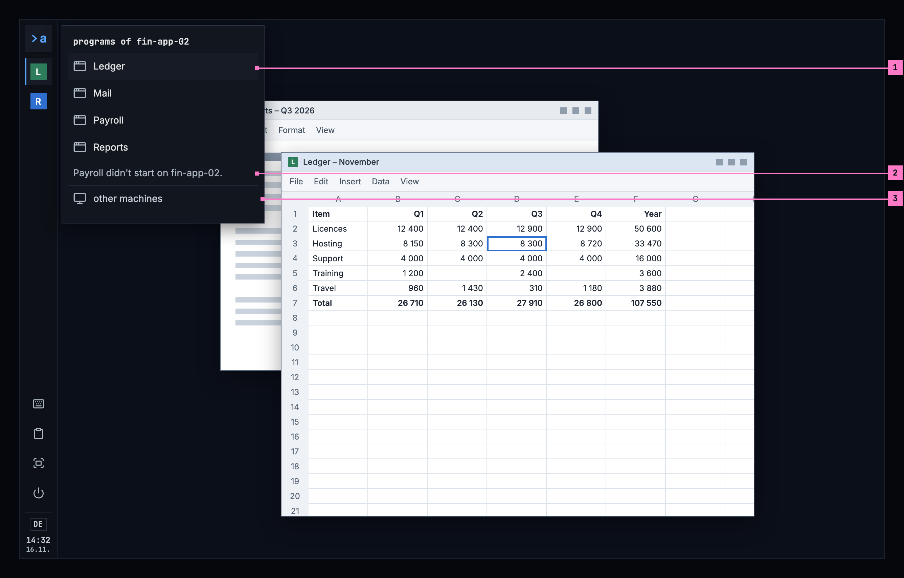
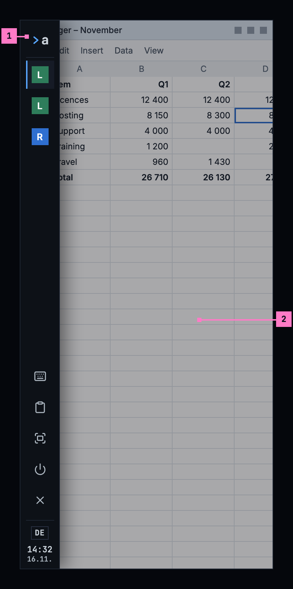

# 7 Programs

A Windows machine can offer single programs, without its desktop. A program
opens in a session, as a desktop does, and the session shows nothing of the
machine but the program's windows. A desktop brings a taskbar of its own to
move between its windows. Programs alone bring none, so Away gives them a rail
down the side, as a taskbar. This chapter covers the windows, that rail, and
how a further program of the machine is opened in the same session.

People get here from [home](./machines.md), where a machine's page lists the
programs it offers, through the steps of [chapter 5](./opening.md). Which
programs a machine offers is an administrator's choice
([chapter 12](./admin-machines.md)).

It draws what the first release holds of
[Opening a machine](../capabilities/session.md#opening-a-machine) for programs,
with [Finding a machine](../capabilities/app.md#finding-a-machine) and
[The frame](../capabilities/app.md#the-frame) where a program is chosen and
switched to.

## 7.1 A program's windows

**Figure 7.1** Two programs of one machine, and the rail beside their windows.

1. **A program's window**, as the machine draws it: its title, its buttons and
   its menus are the program's own. The window in front has the keys.
2. **The ground** is Away's. Nothing of the machine's desktop shows.
3. **The rail** (7.2).

- One sign-in on the machine holds every program opened there. A further
  program of the same machine opens in the session that is already open, with
  nothing asked again (7.3).
- A window is moved, sized, made small and closed as at the machine, with its
  own title and buttons. Its room is the browser window less the rail.
- A window made as large as it gets fills that room. It lies beside the rail,
  never under it.
- A click on a window brings it to the front. A dialog of a program stays over
  the window it belongs to.
- A program with several windows has each of them here.
- Windows' own language bar, which floats over a program's windows, is not
  shown: the rail says which keyboard the machine types as.
- The session has the whole browser window, and the browser tab is named after
  the program.

## 7.2 The rail

**Figure 7.2** The rail, with three windows open.

1. **The Away mark** lists the machine's programs (7.3).
2. **The window in front**, as its own icon, stands on a lighter ground with a
   blue bar on its edge, as the current view does in the rail of
   [chapter 2](./frame.md).
3. **Another window.** A click brings it to the front. Under the pointer or the
   keyboard's focus a small cross shows at its corner, which closes it.
4. **The session's controls**: keys, clipboard, fill the screen and end, as on
   the bar of a desktop ([chapter 6](./desktop.md)).
5. **The keyboard** the machine was told of, as its language, short: DE, FR,
   EN. Its full name is for the pointer that rests on it and for a screen
   reader.
6. **The time and the day** on the person's own device, as a taskbar has them.

- The rail is there for as long as the session is, and while the session fills
  the screen. It is 56 px wide, in the design of Away's own rail: every button
  the same square, its icon in the middle.
- Each window has the icon the machine gives it, and its title, as the program
  sets it, is the button's name, for the pointer that rests on it and for a
  screen reader. Dialogs, menus and tips belong to their window and are in no
  list.
- The windows stand in the order the machine has them. With more of them than
  the rail has room for, they scroll up and down; the rail never scrolls
  sideways.
- Alt + Tab, in the keys menu, moves between the windows as at the machine.
- The rail holds one machine's windows. Programs of another machine are
  another session. Programs of several machines side by side come later.

## 7.3 Opening a further program

**Figure 7.3** The machine's programs, from the mark.

1. **The programs**, by name. A click opens one in this session, and its
   window comes to the front. A program that is already open gets a further
   window, where the program allows more than one.
2. **A program the machine didn't start** says so here, and the session goes
   on.
3. **The other machines**: the machines' page. The programs keep running at the
   machine.

- The list holds what the machine's page shows on [home](./machines.md). A
  person sees the programs a rule gives them, and no others; whether they may
  still open one is asked again as they choose it.
- While a program starts, a loader turns in its row, and the list takes no
  other choice. Once its window is there the list closes.
- Esc closes the list, and the mark has the keys again.

## 7.4 On a phone

**Figure 7.4** Programs on a phone.

1. **The window in front** has the screen.
2. **The rail waits at the left edge**, as a short grip.

**Figure 7.5** On a phone, the rail swiped in.

1. **The rail**, as on a computer, with a button that puts it away.
2. **A touch beside it** puts it away, and reaches nothing of the window.

- A swipe from the left edge, or a tap on the grip, brings the rail in over the
  picture. A swipe back, a touch beside it or Esc puts it away.
- Nothing takes width from the window: the rail lies over it while it is there.
- The rail is the phone's way to the windows, the programs and the session's
  controls, held upright and sideways.

## 7.5 Ending

- Ending is as for a desktop ([chapter 6](./desktop.md)). It ends the
  connection, and the programs stay open at the machine, to be there again the
  next time one of them is opened.
- Closing a program's last window closes the program. When no window is left,
  and no program asked for is on its way, the session ends by itself, and the
  machine's page shows.
- A session with programs is one session in the list of
  [chapter 9](./sessions.md), under the machine's name, with its programs named.

## 7.6 States

| State | What shows |
|---|---|
| A further program is starting | a loader in its row of the list, which takes no other choice, until the machine says whether it started |
| The machine can't start a further program | the windows stay as they are, and the list says which one: “Payroll didn't start on fin-app-02.” |
| The last window was closed | the session ends, and the machine's page shows |
| The connection drops | as for a desktop, in the words of [chapter 6](./desktop.md), with “Your programs are still running on fin-app-02.” |

## 7.7 Words

| Where | Text |
|---|---|
| The mark, for a screen reader and as a tooltip | open a program |
| The list's head | programs of fin-app-02 |
| A row of the list | the program's name, as the files give it |
| The list's last row | other machines |
| A program didn't start | Payroll didn't start on fin-app-02. |
| A window's icon, for a screen reader and as a tooltip | bring to the front: Ledger – November |
| A window's cross | close: Ledger – November |
| The keyboard, for a screen reader and as a tooltip | the keyboard: German (Switzerland) |
| The time, for a screen reader | the time on your device |
| The rail's buttons, as tooltips | keys · clipboard · fill the screen · end; on a phone also close the bar |
| The connection dropped | connection lost · Trying again, for the third time. Your programs are still running on fin-app-02. · leave · try now |

## 7.8 What the figures draw

<!-- generated: draws -->
| Figure | Draws |
|---|---|
| 7.1 Two programs of one machine, and the rail beside their windows | [Open one program of a Windows machine, without its desktop](../capabilities/session.md#opening-a-machine), [Switch between the programs open on a machine, each in a window of its own](../capabilities/session.md#opening-a-machine), [See a machine's open windows in a list beside them, and bring one to the front, also one made small](../capabilities/session.md#opening-a-machine) |
| 7.2 The rail, with three windows open | [See a machine's open windows in a list beside them, and bring one to the front, also one made small](../capabilities/session.md#opening-a-machine), [Switch between the programs open on a machine, each in a window of its own](../capabilities/session.md#opening-a-machine), [Reach a session's own controls without leaving it: keys, clipboard, files, size, ending it](../capabilities/app.md#the-frame) |
| 7.3 The machine's programs, from the mark | [See the programs a Windows machine offers, and open one](../capabilities/app.md#finding-a-machine), [Open one program of a Windows machine, without its desktop](../capabilities/session.md#opening-a-machine), [Switch between the programs open on a machine, each in a window of its own](../capabilities/session.md#opening-a-machine) |
| 7.4 Programs on a phone | [Open one program of a Windows machine, without its desktop](../capabilities/session.md#opening-a-machine), [Find a machine and open it on a phone, with every page fitted to it](../capabilities/session.md#on-a-phone-or-a-tablet) |
| 7.5 On a phone, the rail swiped in | [See a machine's open windows in a list beside them, and bring one to the front, also one made small](../capabilities/session.md#opening-a-machine), [Reach a session's own controls without leaving it: keys, clipboard, files, size, ending it](../capabilities/app.md#the-frame), [Find a machine and open it on a phone, with every page fitted to it](../capabilities/session.md#on-a-phone-or-a-tablet) |
<!-- end: draws -->
