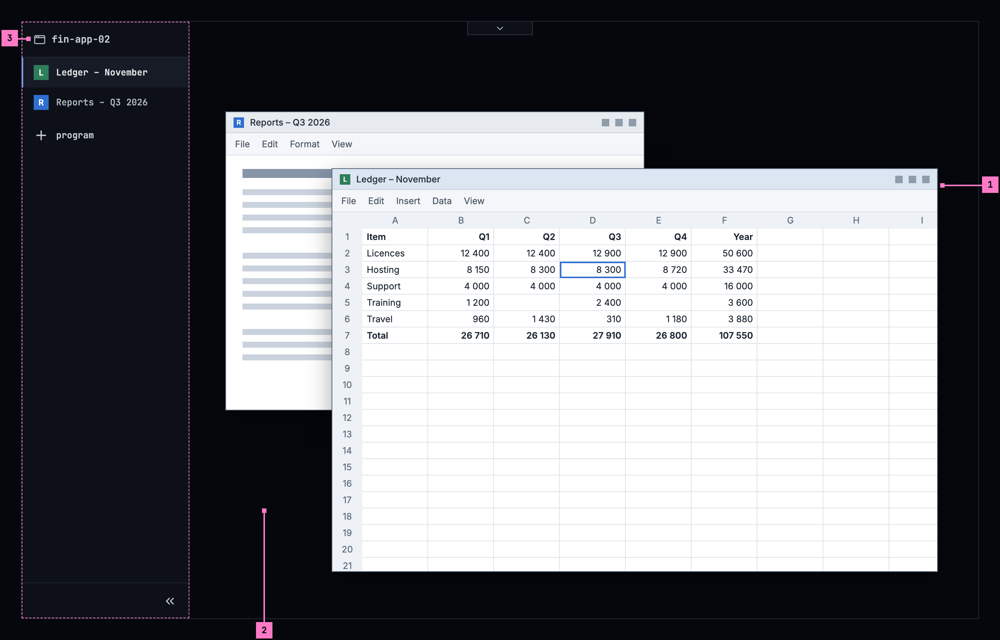
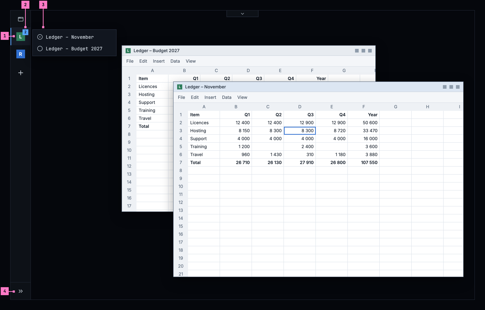
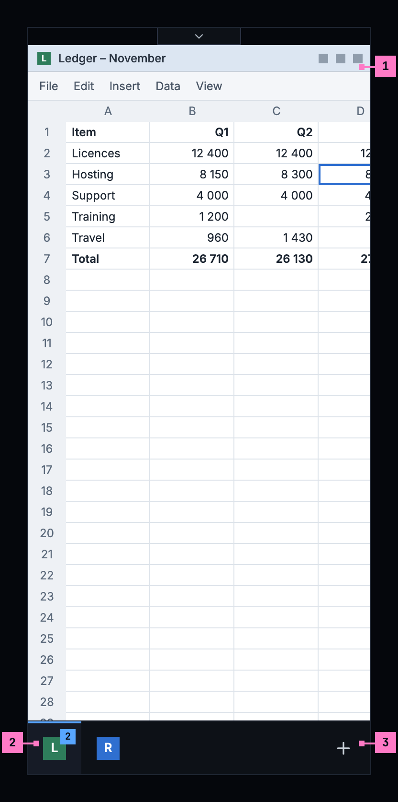

# 7 Programs

A Windows machine can offer single programs, without its desktop. A program
opens in a session, as a desktop does, and the session shows nothing of the
machine but the program's windows. A desktop brings a task bar of its own to
move between its windows. Programs alone bring none, so Away lists their
windows down the side. This chapter covers the windows, that list, and how one
moves between the programs that are open on a machine.

People get here from [home](./machines.md), where a machine's page lists the
programs it offers, through the steps of [chapter 5](./opening.md). Which
programs a machine offers is an administrator's choice
([chapter 12](./admin-machines.md)).

It draws what the first release holds of
[Opening a machine](../capabilities/session.md#opening-a-machine) for programs,
with [Finding a machine](../capabilities/app.md#finding-a-machine) and
[The frame](../capabilities/app.md#the-frame) where a program is chosen and
switched to.

## 7.1 A program's windows

**Figure 7.1** Two programs of one machine, and the list of their windows.

1. **A program's window**, as the machine draws it: its title, its buttons and
   its menus are the program's own. The window in front has the keys.
2. **The ground** is Away's. Nothing of the machine's desktop shows.
3. **The list of windows** (7.2).

- One sign-in on the machine holds every program opened there. A second program
  of the same machine opens in the session that is already open, with nothing
  asked again.
- A window is moved, sized, made small and closed as at the machine, with its
  own title and buttons. It can't be moved out of the room it has, which is the
  browser window less the list.
- A window made as large as it gets fills that room. It lies beside the list,
  never under it.
- A click on a window brings it to the front. A dialog of a program stays over
  the window it belongs to.
- A program with several windows has each of them here.
- The session has the whole browser window, with the handle of
  [chapter 6](./desktop.md) at its top edge, and the browser tab is named after
  the machine.

## 7.2 The list of windows

**Figure 7.2** The list of windows, with three windows open.

1. **The machine** whose windows these are.
2. **The window in front** stands on a lighter ground with a blue bar on its
   edge, as the current view does in the rail of [chapter 2](./frame.md).
3. **Another window.** A click brings it to the front. The windows of one
   program stand together.
4. **A window that was made small** is quieter and carries a dash. It shows
   nowhere but here, and a click brings it back.
5. **Open a program** lists the programs the machine offers (7.3).
6. **Make the list narrow** (figure 7.3).

- The list is there for as long as the session is, with the bar open or closed
  and while the session fills the screen. It is how a window that was made
  small, or one that lies under others, is reached.
- A row carries the window's icon and title as the program sets them, and
  follows when they change. A title too long for the row is cut at its end, and
  shows whole when the pointer rests on it.
- The programs stand in the order they were opened, and a program's windows in
  the order they opened.
- A click on the row of the window in front makes that window small, as a task
  bar does.
- Alt + Tab, in the keys menu, moves between the windows as at the machine.
- With the keyboard the list comes after the bar: once the bar is open, the Tab
  key walks through its buttons and then into the list, where the arrow keys
  move between the rows and Enter brings a window to the front.
- The list holds one machine's windows. Programs of another machine are another
  session with a list of its own, and the bar moves between the two (7.4).
  Programs of several machines side by side come later.

**Figure 7.3** The list made narrow, with the windows of a program that has two.

1. **A program**, as its icon alone. The one whose window is in front is marked
   as a row is.
2. **How many windows** a program has, where it has more than one.
3. **The program's windows.** A click on a program with one window brings that
   window to the front. With several it lists them, the one in front chosen.
4. **Show the names** makes the list wide again.

- Narrow, the list has one icon for each program and is 56 px wide, where the
  wide one is 224 px.
- An icon is named after the program's window that was last in front, for the
  pointer that rests on it and for a screen reader.
- The list opens the way it was left the last time, in this browser. The first
  time it is wide.

## 7.3 Opening a further program

**Figure 7.4** The programs the machine offers.

1. **The programs**, by name, in the order of the alphabet. A click opens one in
   this session, and its window comes to the front. A program that is already
   open gets a further window, where the program allows more than one.

- The row that opens the menu is the list's last one. In the narrow list it is
  a plus alone.
- The menu holds what a machine's page shows on [home](./machines.md). A person
  sees the programs a rule gives them, and no others.

## 7.4 The session's bar

**Figure 7.5** The bar of a session with programs.

1. **The session's tab** is the machine, not a program: every program of
   fin-app-02 is in this one session.
2. **The list** stays as it is. The bar lies over its head, which names the
   same machine as the tab.

- The bar is the bar of [chapter 6](./desktop.md): the mark, the open sessions,
  who one is on the machine, keys, clipboard, fill the screen, end, and close
  the bar. It has no picture button: a program's windows have their own sizes.
- The two have different jobs. The bar moves between sessions and holds what
  Away offers in one. The list moves between the windows of this session.

## 7.5 On a phone

**Figure 7.6** Programs on a phone.

1. **The window in front** has the screen. One window shows at a time.
2. **The programs**, one icon for each, along the foot, where Away's pages have
   their tabs. They are marked and counted as in the narrow list.
3. **Open a program.**

- A tap on a program brings its window to the front. A program with several
  windows lists them first.
- A window opens as large as the room is, where its program allows that. A
  window with a size of its own, such as a dialog, shows whole in the middle,
  and two fingers zoom into it as into a desktop ([chapter 10](./phone.md)).
- The room begins under the handle, so the handle covers nothing of a window's
  title.
- Held sideways, the phone has the icons down its left edge, as the narrow
  list.
- While the phone's keyboard is up, the icons give way to it and to the keys a
  phone lacks.

## 7.6 Ending

- Ending is as for a desktop ([chapter 6](./desktop.md), figure 6.7). Leave it
  running ends the connection, and the programs stay open at the machine, to be
  there again the next time one of them is opened. Sign out of the machine
  closes them.
- Closing a program's last window closes the program. When no window is left,
  the session ends by itself, and the page one came from says so in one line.
- A session with programs is one session in the list of
  [chapter 9](./sessions.md), under the machine's name, with its programs named.

## 7.7 States

| State | What shows |
|---|---|
| A program is starting | its row is in the list at once, with a loader in place of the icon and the program's name, until its first window is there |
| The last window was closed | the session ends, and the page one came from shows, for a few seconds: “The last program on fin-app-02 was closed, so its session ended.” |
| The machine can't start a program | the windows stay as they are, and a line over them says which one: “fin-app-02 couldn't start Payroll.” |
| The connection drops, the session ends | as for a desktop, in the words of [chapter 6](./desktop.md), with “Your programs are still running on fin-app-02.” |

## 7.8 Words

| Where | Text |
|---|---|
| The list's head | the machine's name |
| A row of the list | the window's title, as the program sets it |
| A window that was made small, for a screen reader | the window's title, then: made small |
| The list's last row | program, after a plus; its name for a screen reader: open a program |
| The button at the list's foot, as a tooltip | make the list narrow · show the names |
| An icon of the narrow list, as a tooltip | Ledger – November · with several windows: Ledger – November, and 1 more window |
| The menu of programs | the programs' names, as the machine gives them |
| The bar's buttons, as tooltips | keys · clipboard · fill the screen · end · close the bar |
| The last window was closed | The last program on fin-app-02 was closed, so its session ended. |
| A program didn't start | fin-app-02 couldn't start Payroll. |
| The connection dropped | connection lost · Trying again, for the third time. Your programs are still running on fin-app-02. · leave · try now |

## 7.9 What the figures draw

<!-- generated: draws -->
| Figure | Draws |
|---|---|
| 7.1 Two programs of one machine, and the list of their windows | [Open one program of a Windows machine, without its desktop](../capabilities/session.md#opening-a-machine), [Switch between the programs open on a machine, each in a window of its own](../capabilities/session.md#opening-a-machine), [See a machine's open windows in a list beside them, and bring one to the front, also one made small](../capabilities/session.md#opening-a-machine) |
| 7.2 The list of windows, with three windows open | [See a machine's open windows in a list beside them, and bring one to the front, also one made small](../capabilities/session.md#opening-a-machine), [Switch between the programs open on a machine, each in a window of its own](../capabilities/session.md#opening-a-machine) |
| 7.3 The list made narrow, with the windows of a program that has two | [See a machine's open windows in a list beside them, and bring one to the front, also one made small](../capabilities/session.md#opening-a-machine), [Switch between the programs open on a machine, each in a window of its own](../capabilities/session.md#opening-a-machine) |
| 7.4 The programs the machine offers | [See the programs a Windows machine offers, and open one](../capabilities/app.md#finding-a-machine), [Open one program of a Windows machine, without its desktop](../capabilities/session.md#opening-a-machine) |
| 7.5 The bar of a session with programs | [Reach a session's own controls without leaving it: keys, clipboard, files, size, ending it](../capabilities/app.md#the-frame), [Keep several machines open at once and move between them](../capabilities/session.md#opening-a-machine), [See a machine's open windows in a list beside them, and bring one to the front, also one made small](../capabilities/session.md#opening-a-machine) |
| 7.6 Programs on a phone | [Open one program of a Windows machine, without its desktop](../capabilities/session.md#opening-a-machine), [See a machine's open windows in a list beside them, and bring one to the front, also one made small](../capabilities/session.md#opening-a-machine), [Find a machine and open it on a phone, with every page fitted to it](../capabilities/session.md#on-a-phone-or-a-tablet) |
<!-- end: draws -->
