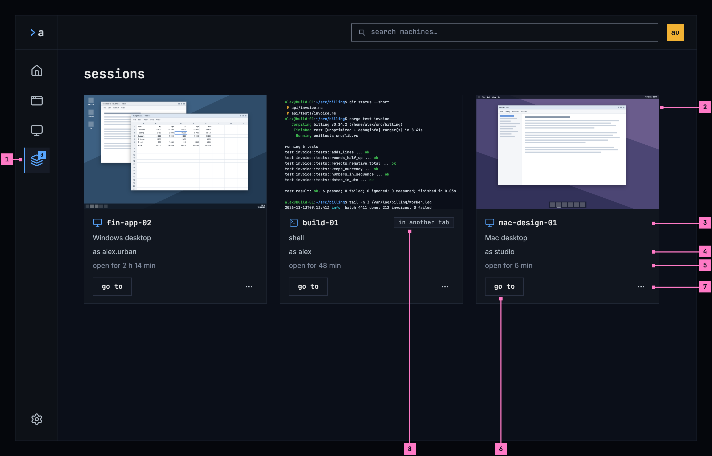
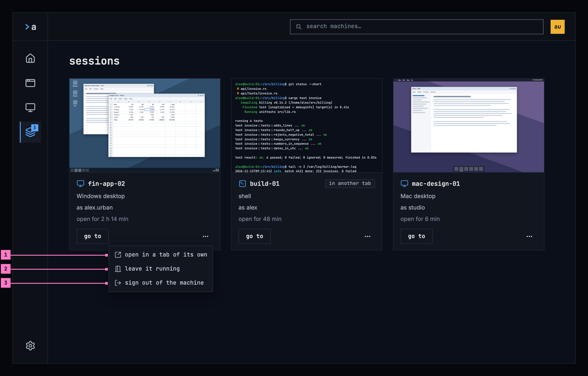
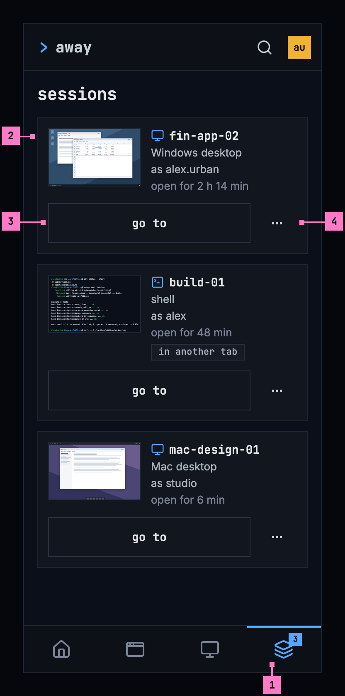
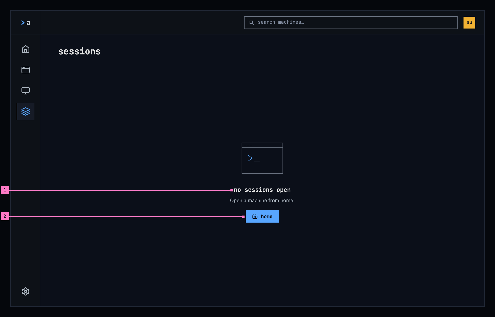

# 9 Sessions

Sessions is the view that lists every session one has open in this browser,
each with its last picture, and leads to it. This chapter covers the list, a
session's menu, the list on a phone, and the list when nothing is open.

People get here with the second icon of the rail or of a phone's tabs
([chapter 2](./frame.md)). From inside a session, the mark of its bar leads to
Away's pages, and this view is one press from there. A session's own bar lists
the sessions of its browser window too ([chapter 6](./desktop.md)).

It draws what the first release holds of
[The frame](../capabilities/app.md#the-frame) for the open sessions, and of
[Opening a machine](../capabilities/session.md#opening-a-machine) for several
sessions at once.

## 9.1 The open sessions

**Figure 9.1** The sessions that are open, on a computer.

1. **The sessions icon** carries how many sessions are open.
2. **The session's last picture**, taken when one left it. A shell's is its last
   lines. A click on it goes to the session.
3. **The machine's name**, with its kind's icon, and under it what it is.
4. **Who one is on the machine**: the account's name there, after “as”.
5. **How long** the session has been open.
6. **Go to** shows the session in this tab.
7. **The session's menu** (9.2).
8. **In another tab** marks a session that is open in a browser tab of its own.

- The list holds the sessions that are open in this browser, in all its tabs
  and windows. The number on the icon counts the same.
- The session used last comes first.
- Go to shows the session in this tab. A session that was in another tab moves
  here, and its old tab says where it went and offers to bring it back.
- A session that ended is not in the list. Why it ended shows where it was
  open ([chapter 6](./desktop.md)).
- A desktop that was left running at its machine is not a session, and is not
  in the list. Opening the machine again picks it up
  ([chapter 5](./opening.md)).
- A machine's programs are one session, under the machine's name, with the
  programs that are open named where a desktop says what it is
  ([chapter 7](./programs.md)).
- The picture is not live. It is the last one the session showed in this
  browser, and stays in this browser.

## 9.2 A session's menu

**Figure 9.2** A session's menu, for a Windows desktop.

1. **Open in a tab of its own** moves the session to a new browser tab, where it
   has the whole window. A session that already has its own tab is without this
   choice.
2. **Leave it running** ends the connection, and the desktop goes on at the
   machine.
3. **Sign out of the machine** closes the programs there and ends the desktop.

- A Windows desktop and a machine's programs have the two ways to end of
  [chapter 6](./desktop.md). Any other session has one, and its menu says end.
- Ending from here asks nothing more, as the end button of a session's bar
  does. The card leaves the list.

## 9.3 On a phone

**Figure 9.3** The same list on a phone.

1. **The sessions tab**, with how many are open.
2. **A card**: the picture, small, beside the same facts.
3. **Go to**, as wide as the card allows.
4. **The session's menu**.

- A phone shows one card in a row. Everything that is pressed is 48 px high.
- Held sideways, the list is the same, beside the rail.

## 9.4 States

**Figure 9.4** No session is open.

1. **What the view says** when nothing is open.
2. **Home**, where the machines are.

- The list is what this browser holds, so it is there at once: the view has no
  loading state and none for a list that couldn't load.
- When the last session ends while the view is open, the view changes to
  figure 9.4.

## 9.5 Words

| Where | Text |
|---|---|
| The heading | sessions |
| What a session is | Windows desktop · Mac desktop · Linux desktop · shell · the open programs' names |
| A card | as alex.urban · open for 2 h 14 min · in another tab |
| A card's buttons | go to · the menu's name for a screen reader: more for fin-app-02 |
| A session's menu | open in a tab of its own · leave it running · sign out of the machine · end |
| A tab whose session moved | this session is open in another tab · bring it back |
| Nothing is open | no sessions open · Open a machine from home. · home |

## 9.6 What the figures draw

<!-- generated: draws -->
| Figure | Draws |
|---|---|
| 9.1 The sessions that are open, on a computer | [See the sessions that are open, and go to one](../capabilities/app.md#the-frame), [Keep several machines open at once and move between them](../capabilities/session.md#opening-a-machine), [Move between home, the programs, the machines, the open sessions and the settings](../capabilities/app.md#the-frame), [Open a session in a browser tab or window of its own](../capabilities/session.md#opening-a-machine) |
| 9.2 A session's menu, for a Windows desktop | [Open a session in a browser tab or window of its own](../capabilities/session.md#opening-a-machine), [Choose between leaving a desktop running and signing out of the machine](../capabilities/session.md#opening-a-machine) |
| 9.3 The same list on a phone | [See the sessions that are open, and go to one](../capabilities/app.md#the-frame), [Find a machine and open it on a phone, with every page fitted to it](../capabilities/session.md#on-a-phone-or-a-tablet) |
| 9.4 No session is open | [See the sessions that are open, and go to one](../capabilities/app.md#the-frame) |
<!-- end: draws -->
