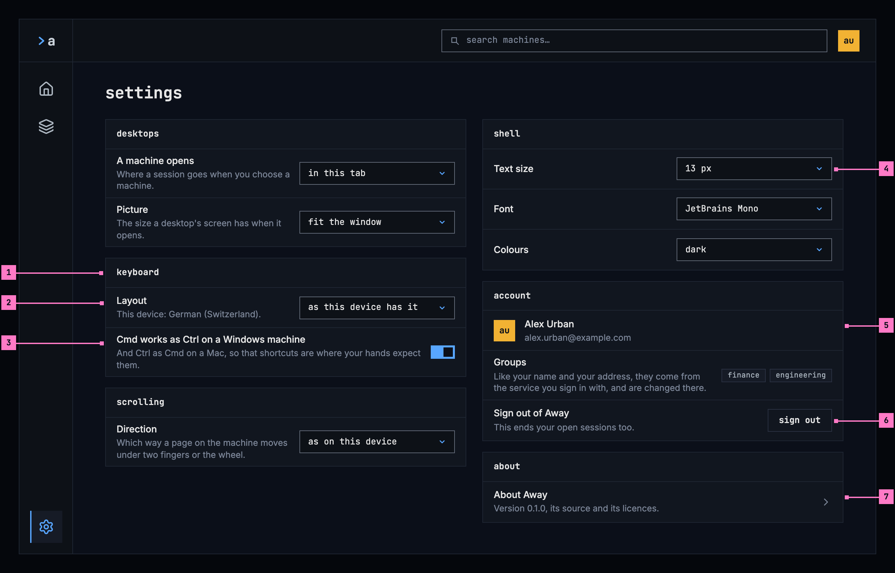
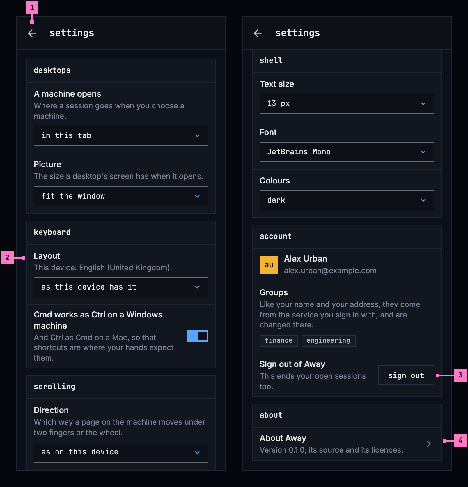

# 11 Settings

Settings is the one page where a person says how Away should be for them: how a
machine opens, how the keyboard and scrolling behave, how a shell looks. It also
shows who is signed in, and leads to what Away is. People get to it with the
gear at the rail's foot and from the avatar's menu ([chapter 2](./frame.md)); on
a phone from the avatar's menu alone.

It draws [One's own settings](../capabilities/app.md#ones-own-settings), and
what a person sets of [Keyboard and pointer](../capabilities/session.md#keyboard-and-pointer),
[The picture](../capabilities/session.md#the-picture) and
[The shell](../capabilities/session.md#the-shell). The account is part of
[Signing in](../capabilities/app.md#signing-in), and the about page of
[Checking it](../capabilities/platform.md#checking-it).

## 11.1 The page

**Figure 11.1** Settings, on a computer.

1. **A card** holds the settings that belong together, under one name.
2. **A setting** is a row: its name, a line that says what it does, and its
   choice at the row's end.
3. **A setting that is on or off** has a switch.
4. **A choice of one from a list** is a dropdown that shows what is chosen.
5. **Who is signed in**: the name and the address the sign-in gave (11.3).
6. **Sign out.**
7. **About Away** leads to the page of 11.4.

- A setting applies at once. There is no button to save, and the page says
  nothing when it worked.
- What a person sets is kept with their account, so it holds on every device
  they sign in from. Nothing is kept in the browser alone.
- A setting says how a session starts. The picture menu of a session's bar
  ([chapter 6](./desktop.md)) changes that one session and leaves the setting
  as it is.
- The page lists what the first release can set, and nothing else.

## 11.2 What can be set

| Card | Setting | Choices | Starts as |
|---|---|---|---|
| desktops | A machine opens | in this tab · in a tab of its own | in this tab |
| desktops | Picture | fit the window · actual size | fit the window |
| keyboard | Layout | as this device has it · a layout chosen by its name | as this device has it |
| keyboard | Cmd works as Ctrl on a Windows machine | on · off | on |
| scrolling | Direction | as on this device · the other way | as on this device |
| shell | Text size | 11, 12, 13, 14, 16, 18 or 20 px | 13 px |
| shell | Font | JetBrains Mono · this device's own | JetBrains Mono |
| shell | Colours | dark · light · high contrast | dark |

**A machine opens.** In this tab, a session takes the place of the page, and
the mark in its bar leads back. In a tab of its own, the page stays where it is
and the session opens beside it. A machine's menu can open it in a tab of its own
for one time, whatever this setting says ([chapter 4](./machines.md)).

**Picture.** The two sizes of [chapter 6](./desktop.md): the machine's screen
fitted to the window, or dot for dot.

**Layout.** The machine gets the character a key types on this device,
whatever layout the machine itself has. “As this device has it” asks the browser
which layout the device has, and the line under the setting names what it
found: “This device: German (Switzerland).” A browser that doesn't tell is
taken to have the layout of the language it is set to. Where that is wrong, the
layout is chosen by its name, and then holds for this account on every device.

**Cmd works as Ctrl on a Windows machine.** With the switch on, shortcuts are
where the hands expect them:

| Pressed | The machine gets |
|---|---|
| On a Mac keyboard, on a Windows machine: cmd with a letter, such as cmd + C | ctrl with that letter |
| On a Mac keyboard, on a Windows machine: option | alt |
| On a Windows keyboard, on a Mac desktop: ctrl with a letter, such as ctrl + C | cmd with that letter |
| On a Windows keyboard, on a Mac desktop: alt | option |

A Linux desktop counts as a Windows machine here. With the switch off, every
key is sent as the key it is: cmd as the Windows key, control as ctrl. A
shortcut the device keeps for itself, such as cmd + tab, never reaches the
machine either way; the keys menu of a session's bar sends those
([chapter 6](./desktop.md)). In a shell nothing is swapped
([chapter 8](./shell.md)).

**Direction.** “As on this device” moves a page on the machine the way pages
move on this device, whatever the machine itself is set to, and as far and as
smoothly as the fingers or the wheel ask. “The other way” turns it round.

**Text size, font and colours** are the shell's look. They are the same
settings that the text button of a shell's bar changes
([chapter 8](./shell.md)): a change in either place holds for every shell, at
once.

## 11.3 The account

Parts 5 and 6 of figure 11.1.

- The name, the address and the groups are what the sign-in gave when the
  person last signed in. Away keeps no names and no groups of its own, so they
  are changed where the person signs in, and the card says so.
- The groups are the ones that the rules use
  ([chapter 13](./admin-rules.md)). A person without a group has no line for
  them.
- Sign out signs out of Away and ends the sessions Away opened
  ([chapter 3](./start.md)).

## 11.4 About Away

**Figure 11.2** About Away.

1. **Back to settings.**
2. **The version** that runs.
3. **What it was built from**: the commit, and the address of the source.
4. **The licence**, with a link to its text.
5. **What Away sends to others**: nothing.
6. **How to report a security hole** in private: a link to the project's page
   for it.
7. **What it is built from**: every part with its version and its licence, in
   the order of their names. The field over the table finds a part.

- The version, the commit and the source's address are what the build recorded.
  A build made from other source says its own.
- The table lists every part a release is built from, by its name. The rows in
  the drawing stand for those.
- Everyone who is signed in can read this page.

## 11.5 On a phone

**Figure 11.3** Settings on a phone: the top of the page, and the page moved to
its end.

1. **Back** leads to the page one came from. Settings has no tab, so the tab
   bar is not shown.
2. **A choice sits under its setting's name**, as wide as the card. The list
   of choices is the phone's own.
3. **Sign out**, and
4. **About Away**, at the page's end.

- The cards and their words are the same as on a computer, one under the other.
- The line under Layout names the layout of the device in the hand, here another
  one than in figure 11.1.

## 11.6 States

- **Loading.** The cards show as grey blocks in their shape until the settings
  are there. No choice can be made before.
- **Couldn't load.** The page says so in its place
  ([chapter 16](./errors.md)).
- **A setting that couldn't be kept.** The choice goes back to what it was, and
  a banner over its card says: “Couldn't keep this setting. Try again.”

## 11.7 Words

| Where | Text |
|---|---|
| The page's heading | settings |
| The cards | desktops · keyboard · scrolling · shell · account · about |
| desktops | A machine opens · Where a session goes when you choose a machine. · in this tab · in a tab of its own |
| desktops | Picture · The size a desktop's screen has when it opens. · fit the window · actual size |
| keyboard | Layout · This device: German (Switzerland). · as this device has it |
| keyboard | Cmd works as Ctrl on a Windows machine · And Ctrl as Cmd on a Mac, so that shortcuts are where your hands expect them. |
| scrolling | Direction · Which way a page on the machine moves under two fingers or the wheel. · as on this device · the other way |
| shell | Text size · Font · Colours · JetBrains Mono · this device's own · dark · light · high contrast |
| account | Groups · Like your name and your address, they come from the service you sign in with, and are changed there. |
| account | Sign out of Away · This ends your open sessions too. · sign out |
| about | About Away · Version 0.1.0, its source and its licences. |
| The about page | about away · this away · Version · Built from · of · Licence · its text |
| The about page | This Away asks nobody outside for anything: no fonts, no scripts, no statistics and no checks for updates. |
| The about page | Found a security hole? How to report it in private. |
| The about page, the parts | what it is built from · 214 parts · find a part… · part · version · licence |
| A setting that couldn't be kept | Couldn't keep this setting. Try again. |

## 11.8 What the figures draw

<!-- generated: draws -->
| Figure | Draws |
|---|---|
| 11.1 Settings, on a computer | [Set how one's sessions open: their size, the picture, the keyboard layout](../capabilities/app.md#ones-own-settings), [Open a session in a browser tab or window of its own](../capabilities/session.md#opening-a-machine), [Fit the machine's screen to the window, and follow when its size changes](../capabilities/session.md#the-picture), [Type with one's own keyboard layout, whatever the machine's is](../capabilities/session.md#keyboard-and-pointer), [Use a Mac keyboard on a Windows machine and the reverse, with the keys where the hands expect them](../capabilities/session.md#keyboard-and-pointer), [Scroll with a trackpad as smoothly, as fast and in the direction one is used to](../capabilities/session.md#keyboard-and-pointer), [Set the shell's text size, its font and its colours](../capabilities/session.md#the-shell), [See which account is signed in](../capabilities/app.md#the-frame), [Take people and their groups from the identity provider, and keep none of its own](../capabilities/admin.md#who-reaches-what), [Sign out, and end the sessions Away opened](../capabilities/app.md#signing-in), [See in Away itself which version runs, where its source is and the licences of what it is built from](../capabilities/platform.md#checking-it) |
| 11.2 About Away | [See in Away itself which version runs, where its source is and the licences of what it is built from](../capabilities/platform.md#checking-it), [Run it with no call to anyone outside: no fonts, scripts, statistics or update checks](../capabilities/platform.md#checking-it), [Report a security hole in private, and learn what happens next](../capabilities/platform.md#checking-it) |
| 11.3 Settings on a phone, at the top of the page and at its end | [Find a machine and open it on a phone, with every page fitted to it](../capabilities/session.md#on-a-phone-or-a-tablet), [Set how one's sessions open: their size, the picture, the keyboard layout](../capabilities/app.md#ones-own-settings), [Open a session in a browser tab or window of its own](../capabilities/session.md#opening-a-machine), [Fit the machine's screen to the window, and follow when its size changes](../capabilities/session.md#the-picture), [Type with one's own keyboard layout, whatever the machine's is](../capabilities/session.md#keyboard-and-pointer), [Use a Mac keyboard on a Windows machine and the reverse, with the keys where the hands expect them](../capabilities/session.md#keyboard-and-pointer), [Scroll with a trackpad as smoothly, as fast and in the direction one is used to](../capabilities/session.md#keyboard-and-pointer), [Set the shell's text size, its font and its colours](../capabilities/session.md#the-shell), [See which account is signed in](../capabilities/app.md#the-frame), [Take people and their groups from the identity provider, and keep none of its own](../capabilities/admin.md#who-reaches-what), [Sign out, and end the sessions Away opened](../capabilities/app.md#signing-in), [See in Away itself which version runs, where its source is and the licences of what it is built from](../capabilities/platform.md#checking-it) |
<!-- end: draws -->
