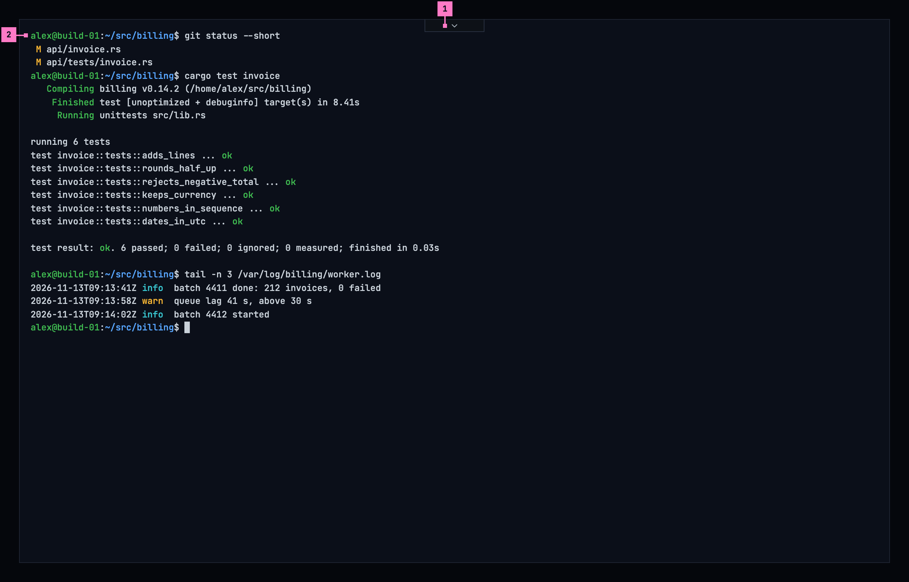
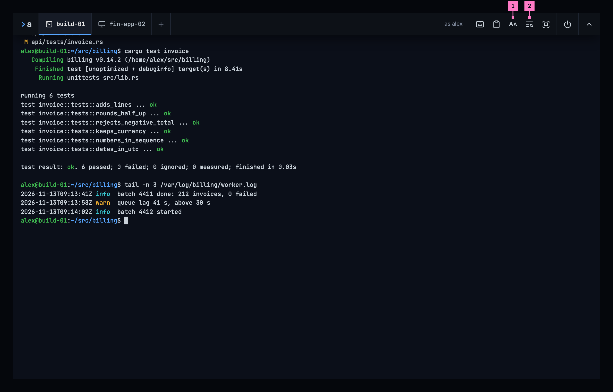
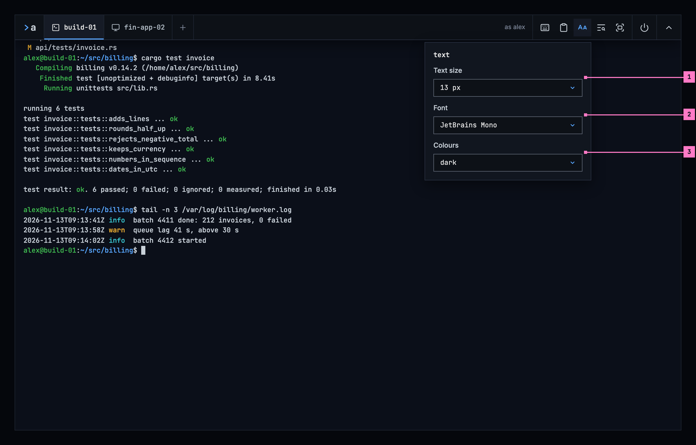
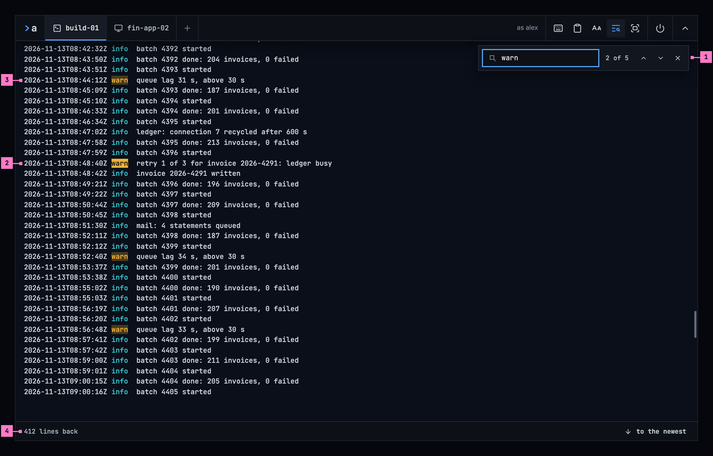
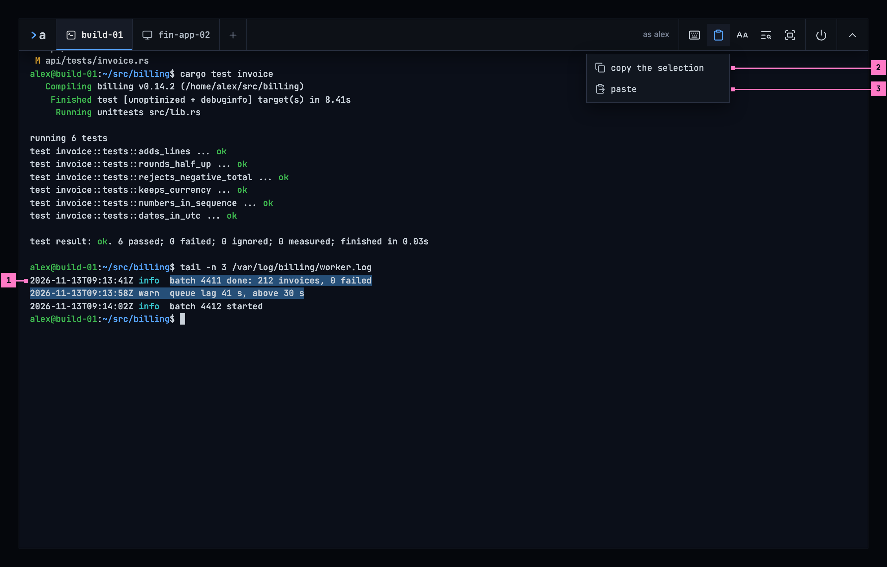
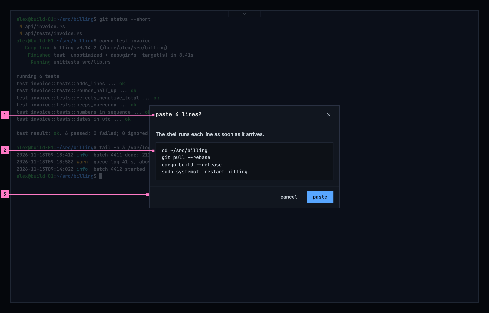
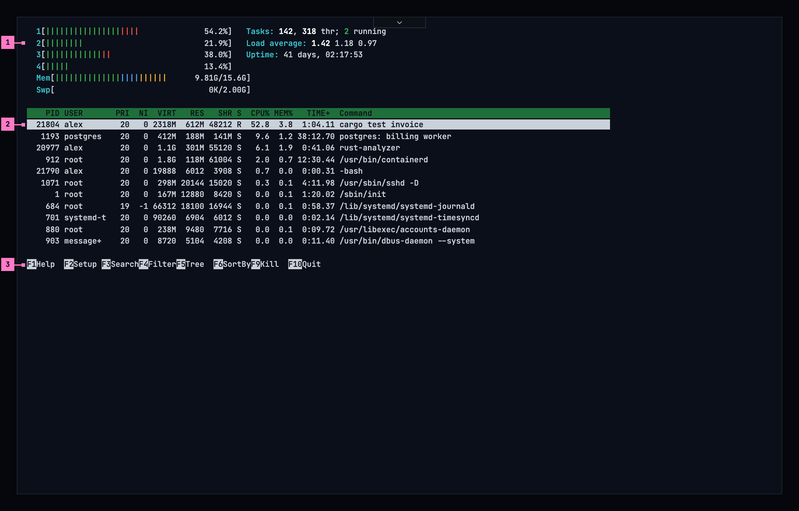
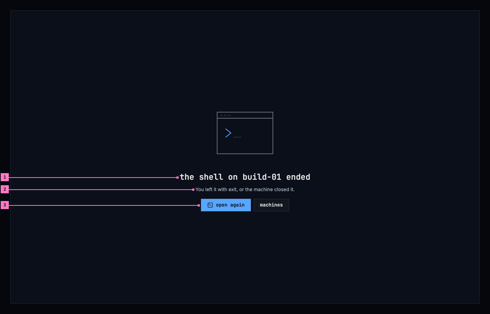

# 8 A shell

A shell is a machine's command line in the browser. It is text, so its session
differs from a desktop's in what the picture is, and in two buttons of its bar.
This chapter covers the shell's text and its look, scrolling back and finding,
selecting and copying, the programs that take the whole shell, and its end.

People get here from [home](./machines.md), from a machine that offers a shell,
through the steps of [chapter 5](./opening.md). The bar it shares with a
desktop is in [chapter 6](./desktop.md), and a shell on a phone in
[chapter 10](./phone.md).

It draws what the first release holds of
[The shell](../capabilities/session.md#the-shell), with the parts of
[Opening a machine](../capabilities/session.md#opening-a-machine),
[Keyboard and pointer](../capabilities/session.md#keyboard-and-pointer) and
[Clipboard, files and printing](../capabilities/session.md#clipboard-files-and-printing)
that a shell has.

## 8.1 The shell has the window

**Figure 8.1** A shell, on a computer.

1. **The handle** opens the session's bar, as on a desktop.
2. **The shell's text.** Every key goes to the machine, in one's own keyboard
   layout.

- The shell has as many rows and columns as fit the window, and follows when the
  window changes. A program that is running in it is told the new size.
- It shows the colours a shell's programs use, and text that is bold, underlined
  or reversed.
- A shell lasts as long as its page. Closing the browser tab or reloading the
  page ends it, so the browser asks before either. A desktop is different: it
  goes on at its machine ([chapter 6](./desktop.md)).
- The browser tab is named after the machine.

## 8.2 The shell's bar

**Figure 8.2** The bar of a shell.

1. **Text**: the text's size, its face and its colours (8.3).
2. **Find**: a word in what the shell showed (8.4).

- The rest is the bar of [chapter 6](./desktop.md), with the same parts in the
  same places: the mark, the open sessions, who one is on the machine, keys,
  clipboard, fill the screen, end, and close the bar.
- A shell has no picture button. Its text has the size set here, and the shell
  takes the window's size.
- The keys menu holds the keys a browser keeps for itself that a shell's
  programs use: Ctrl + W, Ctrl + T, Ctrl + N, and Esc while the session fills
  the screen.
- The clipboard button opens a menu of two choices (8.5).
- A shell has one way to end, so the end button ends it at once, with no menu.
  What ran in it ends as it does when a terminal is closed.

## 8.3 The text's look

**Figure 8.3** The text panel.

1. **Text size**, from 11 to 20 px.
2. **Font**: JetBrains Mono, which comes with Away, or the device's own
   monospace face.
3. **Colours**: dark, light or high contrast.

- A choice applies at once, to every shell that is open.
- The choices are one's own settings: they are the same in
  [settings](./settings.md), and hold on every device one signs in from.
- A larger text leaves fewer rows and columns in the same window.

## 8.4 Scrolling back and finding

**Figure 8.4** A shell scrolled back, with the find field open.

1. **The find field**: the word, which match of how many, the match before, the
   next match, and close.
2. **The match one is at**, marked strongly, in a line that is in view.
3. **The other matches**, marked more quietly.
4. **How far back** the shell is scrolled, and the way **to the newest** line.

- The wheel, or two fingers on a trackpad, scrolls back through what went by. A
  shell keeps its last 10 000 lines. A program that takes the mouse gets the
  wheel instead (8.6).
- While the shell is scrolled back, what it writes moves nothing. A key typed
  into the shell goes to the newest line first, and so does the button.
- Find looks through every line the shell keeps, not only those in view, and
  takes capitals and small letters as the same. Enter goes to the next match
  and Shift + Enter to the one before. Esc closes the field and leaves the view
  where it is.
- Find opens with its button, with Ctrl + Shift + F, and on a Mac with Cmd + F.
- A word that is nowhere says “no match” where the count is.

## 8.5 Selecting and copying

**Figure 8.5** Selected text, and the clipboard's menu.

1. **The selection**, drawn with the mouse.
2. **Copy the selection** puts it in one's own clipboard, as text.
3. **Paste** types one's clipboard into the shell.

- Dragging selects, a double click selects a word and a triple click a line.
  With the keys, Ctrl + Shift + Space starts a selection at the cursor, the
  arrow keys stretch it, Enter copies it and Esc gives it up.
- Selecting copies nothing by itself. Ctrl + Shift + C copies, and on a Mac
  Cmd + C. Ctrl + Shift + V pastes, and on a Mac Cmd + V.
- In a program that takes the mouse, holding Shift while dragging selects all
  the same.
- Where a rule forbids a direction, the menu shows the sentence of
  [chapter 6](./desktop.md) in place of that choice: “Copying from build-01 is
  switched off.” or “Pasting to build-01 is switched off.”

**Figure 8.6** Pasting several lines asks first.

1. **How many lines** are about to be pasted.
2. **The lines**, to check them. More than eight show the first eight and how
   many follow.
3. **Cancel** pastes nothing. **Paste** types them.

- One line is pasted without asking. Several ask, because a shell runs each
  line as soon as it arrives.

## 8.6 Programs that take the whole shell

**Figure 8.7** A program that takes the whole shell.

1. **The program's own colours**, as it draws them.
2. **A row chosen with the mouse.** A program that asks for the mouse gets the
   clicks, every button, and the wheel.
3. **The program's own keys.** The function keys and the key combinations go to
   it.

- Editors, monitors and menus work as in any terminal: they have the whole
  shell, and get it back in its new size when the window changes.
- When such a program ends, the lines that were there before it are back.
  Scrolling back shows the shell's lines, never the program's screen.

## 8.7 When a shell ends

**Figure 8.8** A shell that ended.

1. **What happened.**
2. **Why.**
3. **Open again**, which opens a new shell on the same machine, and the way back
   to the machines.

| Why it ended | It says | It offers |
|---|---|---|
| The shell was left with exit, or the machine closed it | the shell on build-01 ended: “You left it with exit, or the machine closed it.” | open again, machines |
| Nobody used it for the time a rule sets | this session ended: “Nobody used it for 30 minutes.” | open again, machines |
| An administrator ended it | this session was ended: “An administrator ended it.” | open again, machines |
| The right to the machine is gone | you can't open build-01 anymore: “The rule that let you reach it is gone, so this session ended.” | machines |
| Away was updated | the shell on build-01 ended: “Away was updated, and a shell doesn't last through that.” | open again, machines |

- The warning before a session ends unused is the one of
  [chapter 6](./desktop.md), figure 6.9.
- When the connection drops, the card of chapter 6 shows over the shell: “Trying
  again, for the third time. Your shell is waiting on build-01.” Away holds the
  shell meanwhile, and what it wrote in between is there when the connection is
  back.
- Ending a shell with the bar's button shows the page one came from, with
  nothing more said.

## 8.8 Words

| Where | Text |
|---|---|
| The bar's buttons, as tooltips | keys · clipboard · text · find · fill the screen · end · close the bar |
| The keys menu | ctrl + w · ctrl + t · ctrl + n · esc |
| The text panel | text · Text size · Font · Colours |
| The text panel's choices | 11 px to 20 px · JetBrains Mono · this device's monospace font · dark · light · high contrast |
| The find field | find in this shell… · 2 of 5 · no match |
| The find field's buttons, as tooltips | the match before · the next match · close |
| The strip at the foot | 412 lines back · to the newest |
| The clipboard's menu | copy the selection · paste |
| Pasting several lines | paste 4 lines? · The shell runs each line as soon as it arrives. · cancel · paste |
| The connection dropped | connection lost · Trying again, for the third time. Your shell is waiting on build-01. · leave · try now |
| A shell that ended | the texts of the table in 8.7 · open again · machines |

## 8.9 What the figures draw

<!-- generated: draws -->
| Figure | Draws |
|---|---|
| 8.1 A shell, on a computer | [Open a shell on a machine](../capabilities/session.md#opening-a-machine), [Give the machine the whole window while a session is open](../capabilities/app.md#the-frame) |
| 8.2 The bar of a shell | [Reach a session's own controls without leaving it: keys, clipboard, files, size, ending it](../capabilities/app.md#the-frame), [Keep several machines open at once and move between them](../capabilities/session.md#opening-a-machine) |
| 8.3 The text panel | [Set the shell's text size, its font and its colours](../capabilities/session.md#the-shell) |
| 8.4 A shell scrolled back, with the find field open | [Scroll back through what the shell showed, and search it](../capabilities/session.md#the-shell) |
| 8.5 Selected text, and the clipboard's menu | [Select the shell's text with the mouse or the keys, and copy it](../capabilities/session.md#the-shell), [Copy text on one side and paste it on the other](../capabilities/session.md#clipboard-files-and-printing) |
| 8.6 Pasting several lines asks first | [Copy text on one side and paste it on the other](../capabilities/session.md#clipboard-files-and-printing) |
| 8.7 A program that takes the whole shell | [Run the programs that take the whole shell: editors, monitors, with colours and the mouse](../capabilities/session.md#the-shell) |
| 8.8 A shell that ended | [See why a session ended, and open it again from there](../capabilities/session.md#opening-a-machine) |
<!-- end: draws -->
