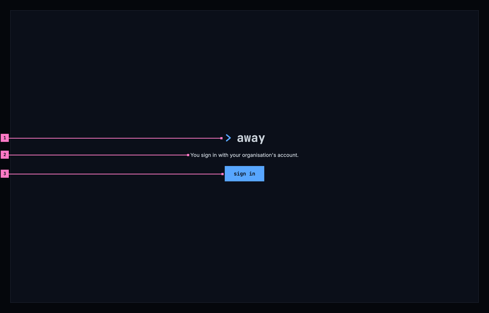
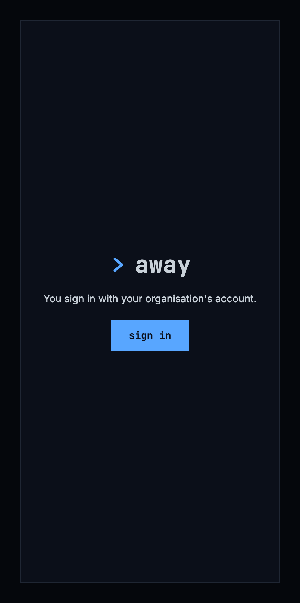
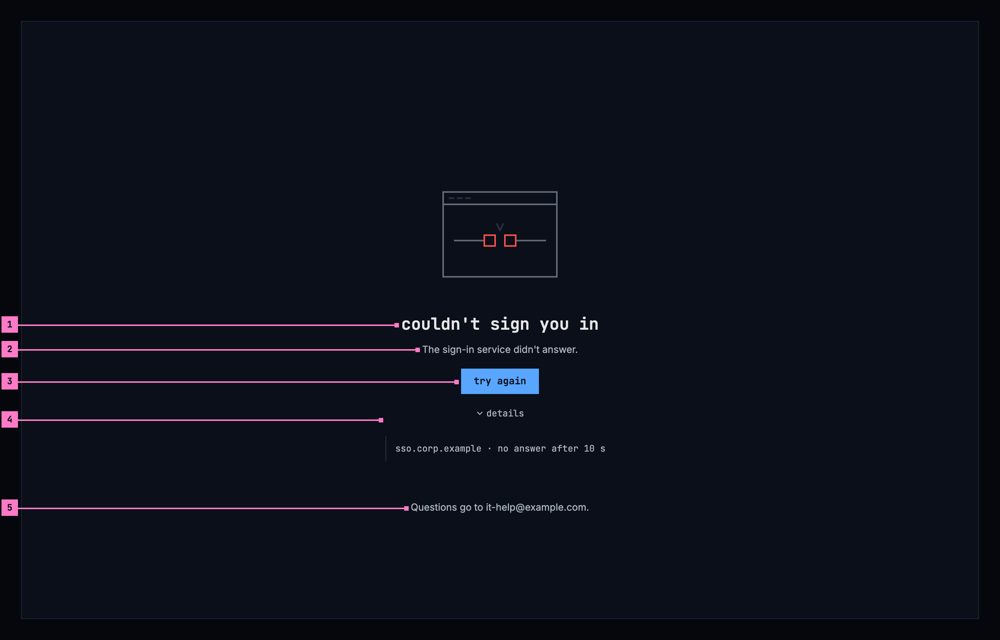
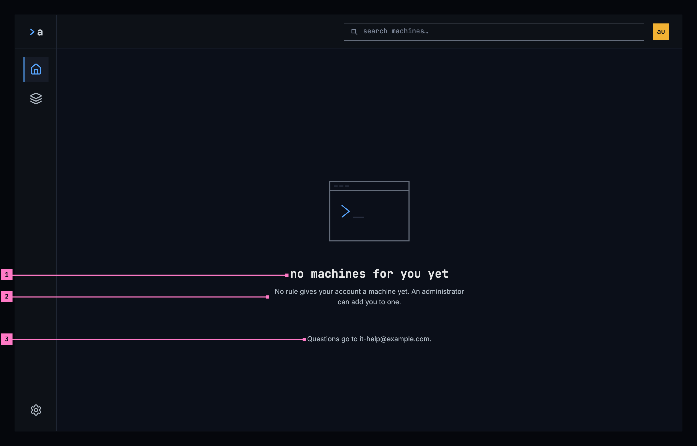
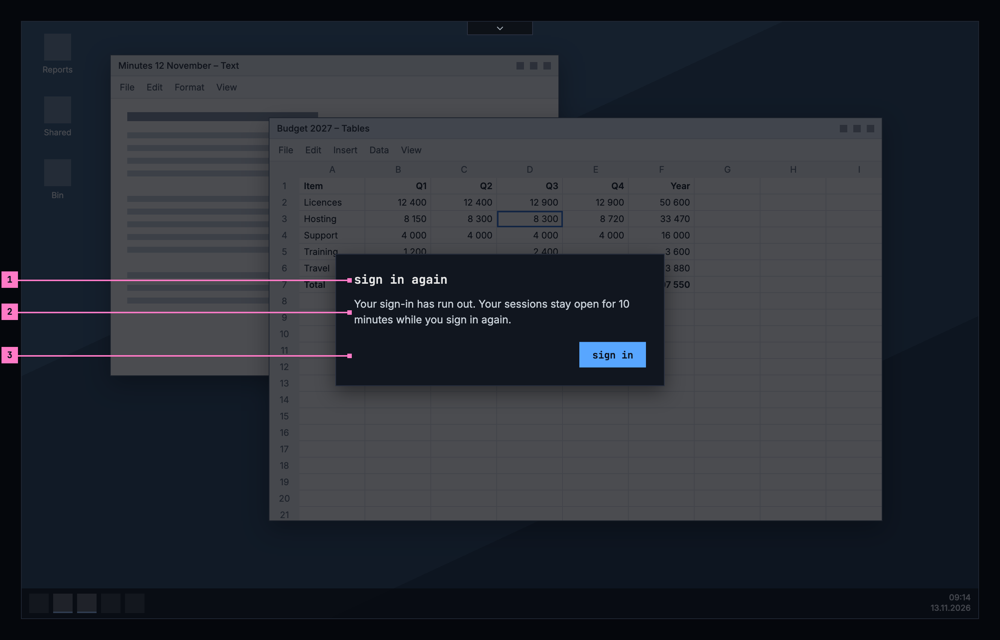
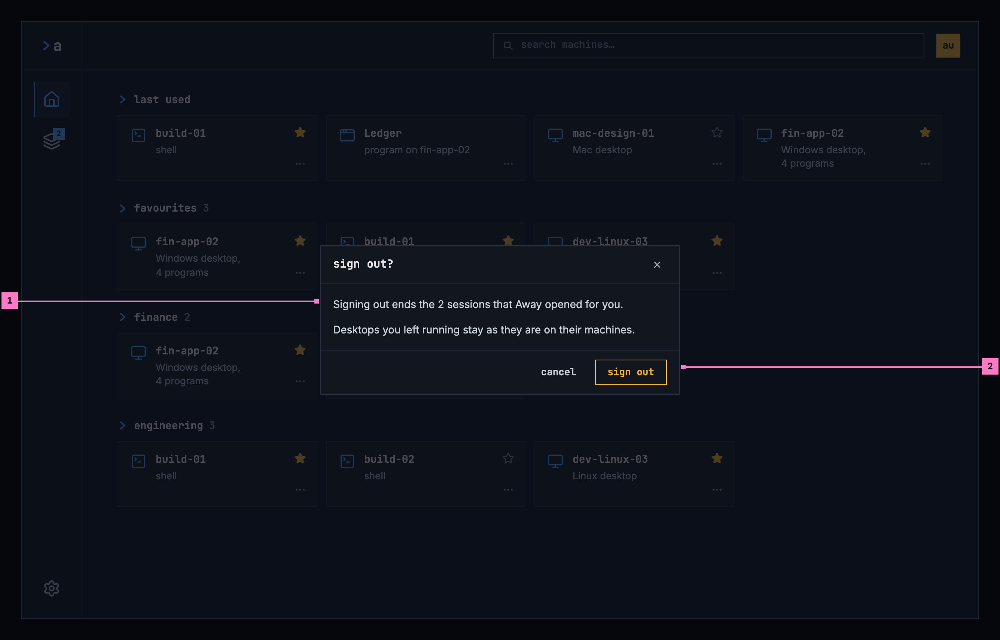

# 3 Getting in

Away has no sign-in form of its own. The organisation's identity provider signs
a person in, once, and from then on Away signs them in on each machine
([chapter 5](./opening.md)). This chapter covers the pages around that: the page
of someone who is not signed in, a sign-in that failed, an account that no rule
gives a machine, a sign-in that ran out, and signing out.

It draws what the first release holds of
[Signing in](../capabilities/app.md#signing-in), and of
[Who reaches what](../capabilities/admin.md#who-reaches-what) that a person sees
only what a rule gives them.

## 3.1 Signing in

**Figure 3.1** The page of someone who is not signed in, on a computer.

1. **The name.**
2. **How one signs in**, in one sentence.
3. **Sign in** leads to the organisation's sign-in page, and from there back to
   Away.

**Figure 3.2** The same page on a phone.

- Someone who opens Away, or follows a link to a machine, without being signed
  in is sent to the organisation's sign-in page at once and never sees this
  page. After signing in they are on the page they asked for: home, or the
  machine of the link.
- This page shows after signing out, and when the sign-in page sent someone
  back without a sign-in. After signing out, a line over the sentence says so:
  “You're signed out.”
- Away asks for no name and no password itself. A second factor, where the
  organisation asks for one, is asked by its sign-in page.

## 3.2 When signing in fails

**Figure 3.3** Signing in failed.

1. **What happened.**
2. **Why**, in the reader's words.
3. **Try again** starts the sign-in again.
4. **Details**: the technical reason, for whoever is asked for help.
5. **Whom to turn to**, where the operator named someone.

| What happened | It says |
|---|---|
| The sign-in service did not answer | couldn't sign you in: “The sign-in service didn't answer.” |
| The sign-in service answered with something Away can't use | couldn't sign you in: “The sign-in service's answer can't be used. Something is wrong with how Away is set up, not with your account.” |
| The person gave up on the sign-in page, or was refused there | the sign-in page says so itself; back in Away, the page of 3.1 |

## 3.3 Nothing to reach

**Figure 3.4** Signed in, and no rule gives the account a machine.

1. **What is the case.**
2. **Why**, and who can change it.
3. **Whom to turn to.**

- A person sees the machines a rule gives them, and no others
  ([chapter 13](./admin-rules.md)). With none, home says so in place of the
  machines.
- The page changes by itself as soon as a rule gives the account a machine.

## 3.4 Staying signed in

The sign-in renews itself for as long as the organisation allows, with sessions
open or not, and nothing shows. When it can't be renewed, because the
organisation wants the person to sign in again, Away asks for that and keeps
what is open.

**Figure 3.5** The sign-in ran out while a session is open.

1. **What is asked.**
2. **Why**, and what becomes of the open sessions meanwhile.
3. **Sign in** opens the organisation's sign-in page beside the session, so the
   session stays as it is.

- While the card shows, the sessions take no key and no click, and their
  pictures are dimmed. They are not ended: after the sign-in the card goes, and
  everything is as it was.
- The time the sessions stay open is set by the operator, and the card names
  it. When it passes without a sign-in, the sessions end as signing out ends
  them, and the page of 3.1 shows.
- On a page of Away the same card lies over the page.
- An account that is gone, or that lost its right to a machine, is another
  matter: its sessions end at once ([chapter 6](./desktop.md)).

## 3.5 Signing out

**Figure 3.6** Signing out while sessions are open.

1. **What signing out ends**, with the number of sessions, and what it leaves
   alone.
2. **Cancel**, and **sign out**.

- Sign out is in the avatar's menu ([chapter 2](./frame.md)). With no session
  open it signs out at once, without a question.
- Signing out ends the sessions that are open under this sign-in, in every tab
  of this browser. A desktop that is open is left running on its machine, as
  “leave it running” does in [chapter 6](./desktop.md). A shell ends.
- Afterwards the page of 3.1 shows, with “You're signed out.”

## 3.6 Words

| Where | Text |
|---|---|
| Not signed in | away · You sign in with your organisation's account. · sign in |
| After signing out, over that sentence | You're signed out. |
| Signing in failed | couldn't sign you in · the sentences of the table in 3.2 · try again · details |
| No rule gives a machine | no machines for you yet · No rule gives your account a machine yet. An administrator can add you to one. |
| Whom to turn to, wherever something fails | Questions go to it-help@example.com. |
| The sign-in ran out | sign in again · Your sign-in has run out. Your sessions stay open for 10 minutes while you sign in again. · sign in |
| Signing out with sessions open | sign out? · Signing out ends the 2 sessions that Away opened for you. · Desktops you left running stay as they are on their machines. · cancel · sign out |

The contact and the 10 minutes come from what the operator set, and the number
of sessions from what is open.

## 3.7 What the figures draw

<!-- generated: draws -->
| Figure | Draws |
|---|---|
| 3.1 Not signed in, on a computer | [Sign in through the organisation's identity provider](../capabilities/app.md#signing-in) |
| 3.2 Not signed in, on a phone | [Sign in through the organisation's identity provider](../capabilities/app.md#signing-in), [Find a machine and open it on a phone, with every page fitted to it](../capabilities/session.md#on-a-phone-or-a-tablet) |
| 3.3 Signing in failed | [Sign in through the organisation's identity provider](../capabilities/app.md#signing-in), [Say whom people turn to, and show it wherever something fails](../capabilities/platform.md#installing-and-configuring) |
| 3.4 Signed in, and no rule gives the account a machine | [Show a person only the machines a rule gives them](../capabilities/admin.md#who-reaches-what), [Say whom people turn to, and show it wherever something fails](../capabilities/platform.md#installing-and-configuring) |
| 3.5 The sign-in ran out while a session is open | [Sign in again when the sign-in has run out, with the open sessions kept](../capabilities/app.md#signing-in) |
| 3.6 Signing out while sessions are open | [Sign out, and end the sessions Away opened](../capabilities/app.md#signing-in) |
<!-- end: draws -->
